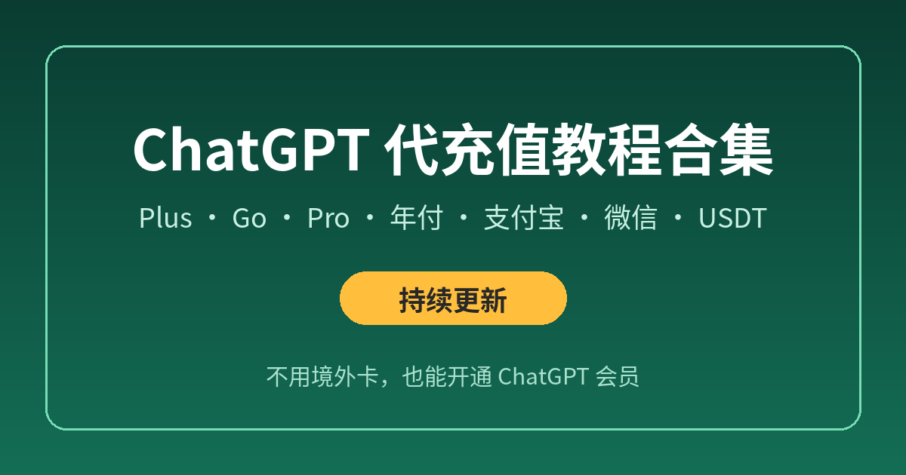

# ChatGPT 代充值教程合集（持续更新）

没有境外信用卡，也想开通 ChatGPT Plus、Go 或 Pro？这里整理了**代充值**相关的教程：怎么选平台、怎么下单、不同套餐和支付方式怎么选、开通后怎么核对，以及自己付款失败时的排查方法。

> 本合集为个人整理，非 OpenAI 官方内容。价格、额度和政策以 [OpenAI 帮助中心](https://help.openai.com/) 为准。

## 🆕 最近更新

- 2026-11-05 · [GPT 代充卡密怎么兑换？从付款到会员生效的完整流程 + 兑换失败 8 种情况处理](gpt-daichong-kami-duihuan-2026.md)
- 2026-11 · [ChatGPT 代充怎么选？靠谱代充平台的 8 个判断标准 + 防骗指南](choose-daichong-platform.md)
- 2026-11 · [ChatGPT 提示 Your card was declined 怎么办？](card-declined-fix.md)

## 📂 教程索引

### 🧭 代充入门
- [ChatGPT 代充怎么选？靠谱代充平台的 8 个判断标准 + 防骗指南](choose-daichong-platform.md)

### 📦 按套餐
- 整理中

### 💰 按支付方式
- 整理中

### ✅ 开通后
- [GPT 代充卡密怎么兑换？从付款到会员生效的完整流程 + 兑换失败 8 种情况处理](gpt-daichong-kami-duihuan-2026.md)

### 🛠️ 自己付款遇到问题
- [ChatGPT 提示 Your card was declined 怎么办？](card-declined-fix.md)

## 说明

- 教程会随 ChatGPT 页面和政策变化持续修订，文末标注最后更新时间
- 发现内容过时，欢迎通过 Issues 反馈
