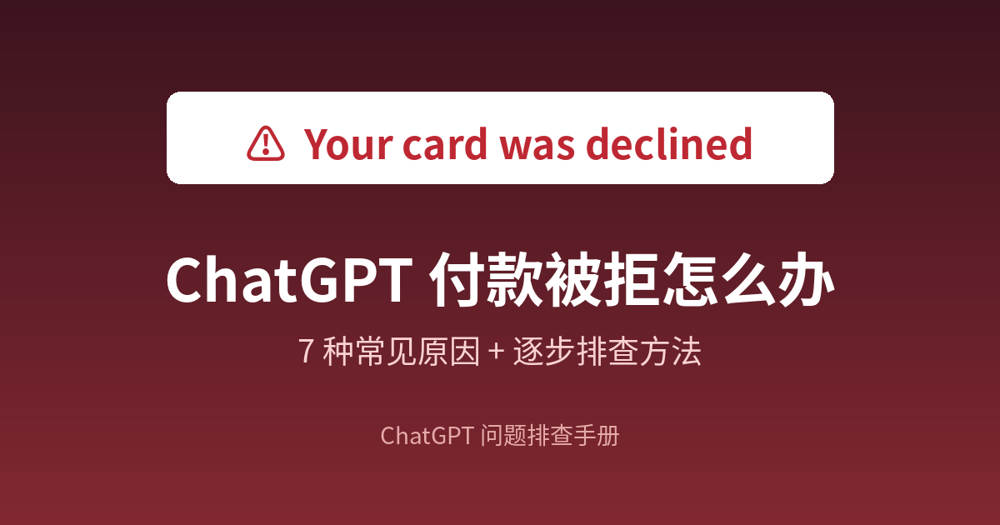
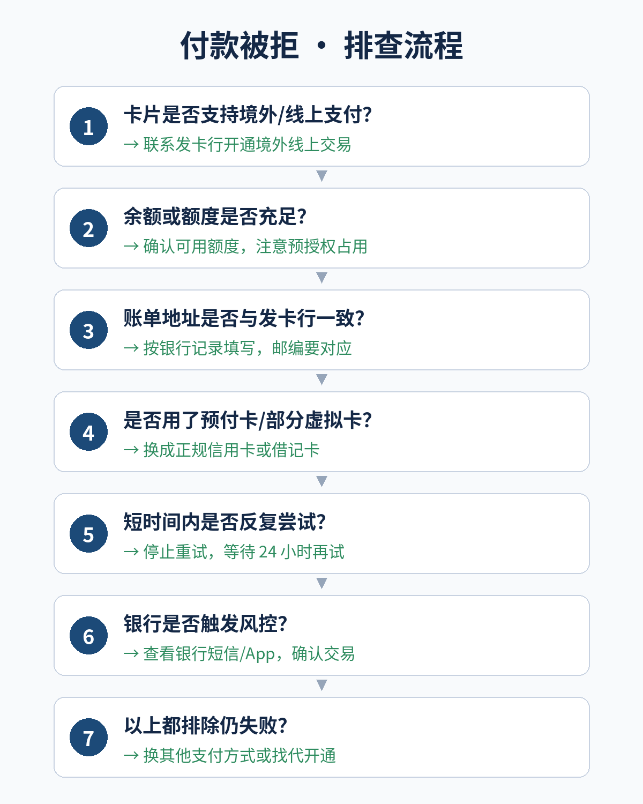

# ChatGPT 提示 Your card was declined 怎么办？原因、排查步骤与解决方法（完整版）

**简短回答：** 「Your card was declined」表示发卡银行拒绝了这笔扣款。问题通常不在 ChatGPT 账号本身，而在卡片类型、账单信息、银行风控或支付地区限制。先停止反复尝试，再按本文的排查顺序逐项检查，大多数情况都能找到原因。

---

## 目录

1. 这个提示是什么意思
2. 付款前 1 分钟自查清单
3. 排查流程一览
4. 7 种常见原因与处理方法
5. 不同卡片类型的成功率参考
6. 3D 验证（3D Secure）失败怎么办
7. 换个渠道付款：网页、iOS、Android 有什么不同
8. 打给银行时怎么说
9. 被拒之后的正确时间线
10. 以上都试过仍然失败？
11. 常见问题

---

## 1. 这个提示是什么意思

在 ChatGPT 订阅 Plus 等付费方案时，网页端的付款由第三方支付服务处理。出现 *Your card was declined*，说明付款请求已经送到了你的发卡银行，但银行没有批准。

关键点：**拒绝的决定是银行做的，不是 ChatGPT 做的。** 所以很多时候，在 ChatGPT 这边怎么改都没用，要从卡片和银行那边入手。

常见的相关提示及含义：

| 提示 | 大致含义 | 优先检查 |
|---|---|---|
| Your card was declined | 银行拒绝，原因未说明 | 境外交易权限、风控 |
| Your card does not support this type of purchase | 卡片不支持此类交易 | 卡片类型、境外/线上权限 |
| Your card has insufficient funds | 余额或可用额度不足 | 可用额度、预授权占用 |
| Your card's security code is incorrect | 安全码（CVC）有误 | 卡背面 3 位数字 |
| Your card has expired | 卡片已过期 | 有效期填写 |
| Your card number is incorrect | 卡号有误 | 重新输入卡号 |
| Authentication failed / required | 3D 验证未完成 | 银行短信或 App 确认 |

---

## 2. 付款前 1 分钟自查清单

付款之前先对照一遍，可以避开一大半失败：

- [ ] 卡片已开通 **境外交易** 和 **线上无卡支付**
- [ ] 可用额度充足（留出一点余量）
- [ ] 卡号、有效期、CVC 逐位核对过
- [ ] 账单地址、邮编与银行登记信息一致
- [ ] 不是预付卡、礼品卡或来源不明的虚拟卡
- [ ] 手机能正常收到银行短信或 App 推送（用于 3D 验证）
- [ ] 网络稳定，没有频繁切换节点或 IP
- [ ] 今天没有连续失败多次

---

## 3. 排查流程一览

---

## 4. 7 种常见原因与处理方法

### 原因 1：卡片没开通境外或线上支付

**现象：** 卡在国内消费一切正常，一到境外网站付款就被拒。

**原因：** 不少银行卡默认关闭境外交易或无卡线上交易，需要手动开通。

**处理：**
1. 打开银行 App，找到「卡片管理」「交易设置」或「境外交易」相关选项
2. 开启境外交易、线上支付（有的银行叫「无卡支付」「网上支付」）
3. 确认卡组织是 Visa、Mastercard 等支持境外扣款的类型
4. 设置完成后等几分钟再付款

### 原因 2：余额或可用额度不足

**现象：** 有时能付，有时被拒；或者刚好卡在额度边缘。

**原因：** 除了订阅金额本身，部分支付会先做一笔小额预授权验证，汇率换算和手续费也会占用额度。

**处理：**
1. 在银行 App 查看「可用额度」而不是「总额度」
2. 留出比订阅价格多一些的余量
3. 如果有未入账的预授权，等几天释放后再试

### 原因 3：账单地址与银行记录不一致

**现象：** 卡号、有效期、CVC 都没问题，仍然被拒。

**原因：** 支付系统会核对地址和邮编，信息不匹配会提高风险评分，被银行或支付平台拦截。

**处理：**
1. 按发卡银行登记的地址填写，不要随意编造
2. 邮编和城市要对应
3. 地址里的门牌号、街道名尽量完整

### 原因 4：使用了预付卡或部分虚拟卡

**现象：** 新办的虚拟卡、礼品卡、预付卡一付就被拒。

**原因：** 很多支付平台对预付类卡片有限制，部分虚拟卡的发卡机构也会被风控系统重点关注。

**处理：**
1. 优先使用正规银行发行的信用卡
2. 其次是正规银行的借记卡
3. 避免使用来源不明、反复被多人使用的虚拟卡

### 原因 5：短时间内反复尝试

**现象：** 第一次失败后连续换卡或重试了很多次，之后怎么都付不了，连原本正常的卡也失败。

**原因：** 频繁失败本身就是风控信号，系统可能暂时限制该账号、设备或网络的付款行为。

**处理：**
1. **立刻停止重试**
2. 等待 24 小时左右
3. 把信息全部核对清楚后，只用一张最有把握的卡尝试一次

### 原因 6：银行触发风控拦截

**现象：** 付款时银行发来交易提醒、验证短信，或者在 App 里显示交易被拦截。

**原因：** 境外、首次、金额突然变化的交易，容易被银行判定为可疑。

**处理：**
1. 打开银行 App，查看是否有待确认的交易
2. 确认是「本人交易」
3. 如果没有提示，致电银行客服说明情况（话术见第 8 节）

### 原因 7：所在地区或支付方式不受支持

**现象：** 换了几张不同银行的卡都失败。

**原因：** 部分地区或支付方式不在官方支持范围内，这种情况换卡也无法解决。

**处理：** 支持的国家和地区以 [OpenAI 帮助中心](https://help.openai.com/) 的说明为准；如果确实不支持，只能考虑其他开通渠道。

---

## 5. 不同卡片类型的成功率参考

以下为一般经验，不代表绝对结果，具体以银行和支付平台为准：

| 卡片类型 | 成功率参考 | 说明 |
|---|---|---|
| 正规银行信用卡（Visa / Mastercard） | 较高 | 首选，开通境外交易后通常没问题 |
| 正规银行借记卡 | 中等 | 部分银行借记卡不支持境外线上扣款 |
| 银联单标卡 | 较低 | 境外网站支持有限 |
| 预付卡 / 礼品卡 | 低 | 很多平台直接限制 |
| 来源不明的虚拟卡 | 不稳定 | 容易被风控，且可能影响后续续费 |

---

## 6. 3D 验证（3D Secure）失败怎么办

部分银行会在付款时要求额外验证，比如弹出银行页面、发送短信验证码，或要求在银行 App 里确认。

**常见失败原因：**
- 验证页面被浏览器拦截或没有弹出
- 短信验证码过期或没收到
- 没有在银行 App 里及时确认

**处理方法：**
1. 允许浏览器弹出窗口，或换一个浏览器
2. 确认手机能正常接收银行短信
3. 付款后几分钟内留意银行 App 推送并及时确认
4. 不要在验证过程中刷新或关闭页面

---

## 7. 换个渠道付款：网页、iOS、Android 有什么不同

| 渠道 | 付款方式 | 特点 |
|---|---|---|
| 网页端 | 直接绑定银行卡 | 最常见，受卡片和银行限制影响大 |
| iOS App | 通过 Apple ID 内购 | 用 Apple ID 绑定的付款方式，规则跟随 App Store |
| Android App | 通过 Google Play 付款 | 用 Google Play 绑定的付款方式 |

**注意：**
- 不同渠道订阅的管理和取消入口不同，网页订阅在网页端管理，App 内购在对应应用商店管理
- 不要在多个渠道重复订阅，以免重复扣费
- 各渠道的价格和可用性以官方页面为准

---

## 8. 打给银行时怎么说

很多人卡在“不知道怎么跟银行说”。可以直接参考下面的说法：

> 您好，我刚才在一个境外网站做线上订阅付款，被拒绝了。想确认一下：
> 1. 我这张卡有没有开通境外交易和线上无卡支付？
> 2. 刚才那笔交易是不是被风控拦截了？
> 3. 如果是，能不能帮我解除，或者告诉我需要怎么操作？
> 这笔交易是我本人操作的。

通话时准备好：卡号后四位、交易时间、大致金额。

---

## 9. 被拒之后的正确时间线

| 时间 | 该做什么 |
|---|---|
| 刚被拒 | 停止重试，截图保存报错信息 |
| 10 分钟内 | 查看银行 App 和短信，确认是否有拦截提示 |
| 当天 | 按第 2 节清单核对信息，必要时联系银行 |
| 24 小时后 | 用一张最有把握的卡尝试一次 |
| 仍然失败 | 考虑换支付渠道或其他开通方式 |

---

## 10. 以上都试过仍然失败？可以考虑代充

如果手上没有合适的境外卡，或者不想反复折腾银行风控，**代充**是更省事的选择：不需要自己绑卡，也不用担心付款被拒，由代充平台直接帮你的账号开通 Plus 或 Pro。

**代充和自己绑卡的区别：**

| 对比项 | 自己绑卡付款 | 代充 |
|---|---|---|
| 是否需要境外卡 | 需要 | 不需要 |
| 付款被拒风险 | 有 | 无 |
| 支付方式 | 信用卡 / 借记卡 | 通常支持支付宝、微信、USDT 等 |
| 开通后账号归属 | 自己的账号 | 同样在自己的账号上生效 |
| 适合人群 | 有合适卡片的人 | 没卡、怕风控、想省事的人 |

以 [GPT20X](https://gpt20x.com/) 为例，代充的大致流程是：选择套餐 → 支付 → 提交账号信息 → 等待开通。具体步骤和注意事项可以看这篇[代开通流程说明](https://gpt20x.com/blog/chatgpt-plus-pro-recharge-guide)。

选择任何代充平台前，建议先确认：是否有明确的售后说明、能否查询订单进度、开通后是否在你自己的账号上生效。

---

## 11. 常见问题

**Q：被拒了会不会扣钱？**
一般不会。如果银行显示有一笔待处理金额，多数是预授权，通常会在几天内自动释放，具体时间以发卡行为准。

**Q：付款失败会不会影响 ChatGPT 账号？**
付款失败本身通常不会影响免费功能的使用。但短时间内大量尝试不同的卡，可能触发更严格的风控，应尽量避免。

**Q：换一张卡就能解决吗？**
如果原因是卡片类型或银行限制，换卡往往有效；如果是地区不支持，换卡也可能无效。

**Q：为什么之前能付，续费时却被拒？**
常见原因有：卡片过期或换卡、额度不足、银行风控规则调整。可以在订阅管理页面更新付款方式。

**Q：借记卡能用吗？**
部分可以，取决于银行是否支持境外线上扣款。建议先在银行 App 里确认境外交易权限。

**Q：被拒之后多久可以再试？**
建议至少间隔 24 小时，并在核对完所有信息后再尝试，避免连续失败加重风控。

**Q：用了代充，怎么知道开通了没有？**
一是登录 ChatGPT 看账号是否显示对应的会员标识；二是用平台提供的订单号查询进度，例如可以在这里[用订单号查询开通进度](https://gpt20x.com/query)。

---

*最后更新：2026-11-05*　｜　[返回教程首页](README.md)
