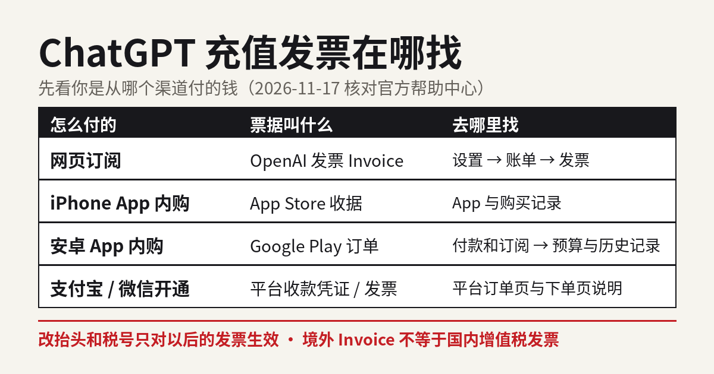

# ChatGPT充值发票怎么开？四种渠道找票报销｜GPT20X

ChatGPT充值发票是很多人续费之后才想起来的问题：公司让报销、财务要抬头和税号，打开 ChatGPT 却不知道票在哪。其实「发票」放在哪里，完全取决于**你当初是从哪个渠道付的钱**：网页订阅、iPhone 上的 App Store、安卓上的 Google Play，还是用支付宝 / 微信找第三方开通。若要用人民币付款开通，可以先看 [GPT20X 的 Plus 开通页](https://gpt20x.com/chatgpt-plus)。四条渠道开出来的票据，名字不同、下载位置不同、能不能改抬头也不同。下面按 OpenAI 帮助中心、Apple 支持和 Google Play 帮助的原文整理（2026-11-17 核对），找票步骤一步一步写清楚，最后附一张报销材料清单。

---

## 目录

1. 先分清：你要的是哪一种「票」
2. 网页订阅：在账单里下载 Invoice 的 6 步
3. 抬头、地址、税号写错了怎么办
4. App 内订阅：去 Apple 或 Google Play 找收据
5. Business 工作空间：只有所有者能看发票
6. 发票日期能不能改？账期怎么对
7. ChatGPT充值发票能不能拿去国内报销
8. 找不到发票的 6 种情况
9. 报销前的材料清单
10. 常见问题

---

## 1. 先分清：你要的是哪一种「票」

同样一句「我要发票」，在 ChatGPT 这里可能指四种完全不同的东西。先对号入座，后面就不会找错地方。

| 你是怎么付的 | 拿到的票据叫什么 | 谁开的 | 在哪里找 |
|---|---|---|---|
| chatgpt.com 网页订阅（银行卡等） | 发票（Invoice） | OpenAI | ChatGPT 设置 → 账单 → 发票 |
| iPhone / iPad 上的 ChatGPT App 内购 | App Store 收据 | Apple | App Store 购买记录、Apple 发到付款邮箱的收据 |
| 安卓上的 ChatGPT App 内购 | Google Play 订单确认 | Google | Play 商店「付款和订阅」→「预算与历史记录」 |
| 支付宝 / 微信找第三方平台开通 | 平台的收款凭证，部分商品可选增值税普通发票 | 收你钱的那家平台 | 平台的订单查询页或下单页说明 |

有两点最容易搞混：

- **ChatGPT 账单里只会出现网页订阅的发票。**帮助中心写明，通过 App Store 或 Google Play 订阅的收据不会显示在 ChatGPT 的账单页。
- **ChatGPT 和 API 是两套独立的账单。**API 额度和费用在 API 平台的账单页里看，和 ChatGPT 订阅互不相干，报销时别把两边的票混在一起交。

---

## 2. 网页订阅：在账单里下载 Invoice 的 6 步

适用于在 chatgpt.com 网页上开通的 Go、Plus 或 Pro。按《查找 ChatGPT 历史发票（Finding past ChatGPT invoices）》的步骤：

1. 用**电脑浏览器**打开 chatgpt.com，登录当初付款的那个账号（不是随便一个账号）。
2. 点左下角头像，进入「设置」。
3. 选「账单」标签。
4. 往下找到「发票」这一栏。
5. 在某张发票旁边点「查看」打开；想看更早的，点「查看全部」。
6. 打开后用浏览器自带的下载或打印功能保存成 PDF，文件名建议写成「年月-套餐-金额」，方便以后对账。

**页面上没有「账单」或「发票」怎么办？**帮助中心给的办法是：换一个浏览器登录同一个 ChatGPT 账号再试，比如 Safari 里不显示就换 Chrome。部分账号的入口在「设置 → 账户 → 付款 → 管理」，点进去会打开账单门户，在里面同样可以看到历史发票。

**每个月的发票是哪天开的？**按《ChatGPT 和 API 账单的发票日期》，按月自助订阅在你订阅的那一天周期性扣费，比如 12 号开通，以后每个月 12 号再扣一次，发票日期跟着这个日子走。

---

## 3. 抬头、地址、税号写错了怎么办

公司报销常要求发票上有公司名称和税号。ChatGPT 的发票信息可以自己改，但有一个关键限制：**改了只对以后开的发票生效，已经开出来的不会自动变。**

### 修改以后发票上的信息

按《更新账单信息、税号和增值税号》：

1. 在 chatgpt.com 点头像 → 「设置」。
2. 选「账单」标签。
3. 在「账单信息」这一栏点「编辑」。
4. 填写或修改名称、地址，以及税号。
5. 点「保存」。

如果你的界面是在「设置 → 账户」里看到「付款」，就点「管理」打开账单门户，再在「账单信息」里点「更新信息」。帮助中心还提醒：**填了无效的税号，系统可能随时把它删掉并照常收取相应税费**，所以税号要和你所在地区的格式一致，别随手填一串数字。

### 已经开出的发票想改

只能联系 OpenAI 支持团队申请复核。通过帮助中心右下角的聊天窗口提交，内容写清三件事：

- 每张要改的发票的**发票编号**；
- 现在显示的是什么、你希望改成什么；
- 希望显示的账单名称、账单地址、税号或增值税号。

支持团队会评估能不能重新开具，但**不保证一定能重开**。所以最省事的做法是：第一次付款之前，就先把账单信息填好。

---

## 4. App 内订阅：去 Apple 或 Google Play 找收据

在手机 App 里订的会员，钱是付给 Apple 或 Google 的，票据也由它们出。注意：**付款用的 Apple 账户或 Google 账号，邮箱可能和你的 ChatGPT 登录邮箱不一样**，找不到时先想想当初用的是哪个账户。

### iPhone / iPad（App Store）

1. 打开 App Store，点右上角的头像或姓名首字母。
2. 点「App 与购买记录」，按提示登录 Apple 账户。
3. 点「购买记录」，找到 ChatGPT 那一笔。
4. 默认只显示最近 90 天，更早的扣款点顶部的「过去 90 天」改筛选条件。

也可以在电脑浏览器打开 reportaproblem.apple.com，登录付款用的 Apple 账户查看列表，知道金额的话还能按金额搜。另外，每次续费 Apple 都会往该账户邮箱发一封收据邮件，可以直接把这封邮件存成 PDF。

### 安卓（Google Play）

1. 打开 Google Play 商店，点右上角个人资料图标。
2. 依次点「付款和订阅」→「预算与历史记录」。
3. 找到 ChatGPT 的订单。

在电脑上可以去 play.google.com 的「付款和订阅 → 预算和订单记录」，或者 payments.google.com 的「活动」「订阅及服务」里查。Google 也会把购买确认邮件发到付款用的 Google 账号邮箱。

---

## 5. Business 工作空间：只有所有者能看发票

团队用的 ChatGPT Business，发票权限是收紧的：按《管理 ChatGPT 和 API 平台的计费》，**只有工作空间所有者**才能更新账单信息、付款方式和查看发票，管理员和普通成员看不到。

所有者的操作路径：工作空间设置 → 账单 → 发票；也可以从「管理套餐 → 付款方式」进入客户账单门户查看历史发票。修改公司名称和税号在工作空间的账单设置里点「编辑」。如果工作空间已经停用、打不开账单页，要联系支持团队，并提供账户邮箱、工作空间名称或 ID、需要的账期和任意一张旧发票的号码。

报销时常见的卡点是「付钱的人不是所有者」。建议团队一开始就约定由谁当所有者，每月账单出来后由他统一下载、转给财务。

---

## 6. 发票日期能不能改？账期怎么对

不能改。帮助中心原话是 OpenAI 不支持更改发票日期，计费周期由订阅类型决定。对账时记住三条规律：

- **网页按月订阅：**每月在开通日扣费、开票，想让发票落在月初，只能在月初那天开通，事后没法调整。
- **Business 中途加席位：**两次续订之间新增付费席位，可能产生按比例计算的费用，所以同一个月里可能有不止一张票。
- **API：**个人或团队客户在 API 平台的账单历史里看付款记录和收据，和 ChatGPT 订阅分开。

如果你的单位按自然月报销，最实用的做法是把开通日和金额记在一张表里，每月扣费后当天下载发票，别等到年底一次补。

---

## 7. ChatGPT充值发票能不能拿去国内报销

这一节是大家最关心的。先说结论：**OpenAI、Apple、Google 开出的都是境外票据，不是国内的增值税发票。**它们能不能报销，取决于你所在单位的财务制度：有的单位接受境外 Invoice 加付款记录，有的单位只认国内发票。付款之前先问一句财务，比事后补救省事得多。

如果单位要求国内票据，可以考虑由国内主体收款、能出具国内票据的开通方式。走 [GPT代充](https://gpt20x.com/) 这类用支付宝或微信付款的路径时，先看清下单页写的票据类型：GPT20X（gpt20x.com）的 Pro 100、Pro 200、Pro 500 和 Plus 年付可在下单时勾选开发票，开票价以结算页为准；Plus 月付和 Go 不支持开发票。需要专票或对公结算请先问客服。不管选哪家，判断标准都一样：

- 票据上的抬头、税号能不能按你的要求填；
- 收款凭证和发票上写的商品名称、金额、日期是否与订单一致；
- 套餐是否开到你自己的账号，全程不需要交出密码；
- 出了问题能不能凭订单号退款或补开。

ChatGPT 对账号使用地区有要求，开通前建议先看一下 OpenAI 官方的支持地区说明。

---

## 8. 找不到发票的 6 种情况

| 现象 | 最常见的原因 | 怎么处理 |
|---|---|---|
| 账单里「发票」一栏是空的 | 登录的不是付款那个账号或工作空间 | 退出，换付款时的邮箱登录再看 |
| 账单页根本没有发票入口 | 订阅是在 App 里买的 | 去 App Store / Google Play 购买记录找 |
| 账单入口不显示 | 浏览器兼容问题 | 换 Chrome 等其他浏览器登录同一账号 |
| 苹果购买记录里找不到 | 当初用的是另一个 Apple 账户 | 登录其他 Apple 账户再查 |
| Business 成员看不到发票 | 只有所有者有权限 | 请工作空间所有者下载 |
| 网页订阅但确实没有发票 | 记录异常 | 联系支持团队，提供账单周期和发票号码（如有） |

---

## 9. 报销前的材料清单

交给财务之前，按这张清单逐项核对一遍，能少跑很多趟：

- [ ] 票据来源与付款渠道一致（网页 Invoice / Apple 收据 / Google 订单 / 平台凭证）
- [ ] 票据上的账单名称、地址、税号正确；要改的已在付款前更新
- [ ] 每张票据的日期和金额，能和银行卡、支付宝或微信的扣款记录对上
- [ ] 套餐名称写清楚（Go、Plus、Pro 还是 Business），避免财务看不懂
- [ ] 网页订阅的发票编号已记录，日后申请复核要用
- [ ] App 内订阅的收据邮件已存档，并注明付款用的 Apple / Google 账户
- [ ] ChatGPT 订阅和 API 费用分开整理
- [ ] 单位是否接受境外票据，已提前跟财务确认

---

## 10. 常见问题

**Q：ChatGPT 能直接开中国的增值税发票吗？**
OpenAI 帮助中心没有提到国内增值税发票，网页订阅能拿到的是账单里的 Invoice。需要国内发票，要找能开国内票据的收款方。

**Q：发票上能不能写公司名称？**
可以在「设置 → 账单 → 账单信息」里填写名称、地址和税号，但只对以后的发票生效。

**Q：上个月的发票抬头填错了，还能改吗？**
可以带着发票编号联系支持团队申请复核，是否重开由官方审核，不保证成功。

**Q：手机上订的会员，在电脑上能下载发票吗？**
ChatGPT 账单里没有。去 reportaproblem.apple.com 或 play.google.com / payments.google.com，用付款账户登录查看。

**Q：取消订阅以后，以前的发票还在吗？**
网页订阅的历史发票在账单的「发票」栏查看，点「查看全部」能看到更早的；如果找不到，联系支持团队，并提供账单周期和发票号码（如有）。

**Q：能把发票日期改到月初吗？**
不能。OpenAI 不支持更改发票日期，扣费和开票都跟着开通日走。

更多相关内容：[ChatGPT 订阅怎么管](chatgpt-dingyue-guanli-quxiao-2026.md)讲订阅归属和防重复扣费；[ChatGPT 代充用支付宝 / 微信怎么付](chatgpt-daichong-zhifubao-weixin-2026.md)讲人民币付款流程；[ChatGPT礼品卡怎么用？](chatgpt-lipinka-2026.md)讲余额和礼品卡。

---

## 参考来源

- [OpenAI 帮助中心：查找 ChatGPT 历史发票（Finding past ChatGPT invoices）](https://help.openai.com/zh-hans-cn/articles/12356340-finding-past-chatgpt-invoices)（网页订阅在设置 → 账单 → 发票，App 内订阅看应用商店，Business 只有所有者可看）
- [OpenAI 帮助中心：更新账单信息、税号和增值税号（Updating billing information, Tax ID, and VAT ID）](https://help.openai.com/zh-hans-cn/articles/9038389-updating-billing-information-tax-id-and-vat-id)（只影响以后的发票，已开发票申请复核，不保证重开）
- [OpenAI 帮助中心：ChatGPT 和 API 账单的发票日期（Invoice dates for ChatGPT and API billing）](https://help.openai.com/zh-hans-cn/articles/8156167-invoice-dates-for-chatgpt-and-api-billing)（不支持改发票日期，按开通日周期扣费）
- [OpenAI 帮助中心：管理 ChatGPT 和 API 平台的计费（Managing billing for ChatGPT and the API platform）](https://help.openai.com/zh-hans-cn/articles/9039756-managing-billing-for-chatgpt-and-the-api-platform)（两套独立账单，Business 只有所有者能看发票）
- [Apple 支持：查看你在 App Store 和其他 Apple 媒体服务中的购买记录](https://support.apple.com/zh-cn/118212)
- [Google Play 帮助：查看订单记录](https://support.google.com/googleplay/answer/2850369?hl=zh-Hans)
- [OpenAI 帮助中心：ChatGPT 支持的国家和地区](https://help.openai.com/zh-hans-cn/articles/7947663-chatgpt-supported-countries)
- [ChatGPT 定价页](https://chatgpt.com/pricing)

> 非 OpenAI 官方内容。账单界面和政策会调整，请以 OpenAI 帮助中心、Apple 支持、Google Play 帮助和你实际看到的页面为准。

---

*最后更新：2026-11-17*　｜　[返回教程首页](README.md)　｜　本文由 [GPT20X](https://gpt20x.com/) 整理
