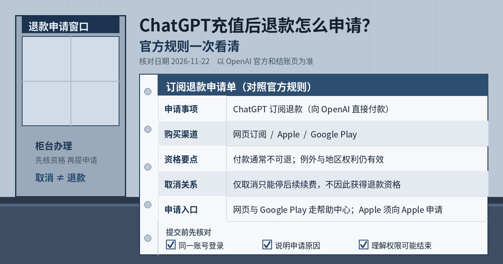

# ChatGPT充值后退款怎么申请？官方规则一次看清｜GPT20X

已经向 OpenAI 直接付款、想确认能不能申请订阅退款的人，需要先分清两件事：取消订阅只会停止后续续费，并不因此获得退款资格；退款能不能批、应该向谁申请，取决于购买渠道、使用情况和适用的地区规则。本文整理的是向 OpenAI 直接付款后的官方退款规则，适合网页订阅、经 Apple 或 Google Play 购买，以及可能住在官方点名地区的个人用户和 Business 工作区所有者对照。核对日期：2026-11-22，具体以 OpenAI 官方和结账页为准。

## 资格总览：一般规则、例外和取消的区别

帮助中心写明：付款通常不可退，但法律、合同和地区权利仍有效；退款政策须遵守使用条款。可能批准的例外、未使用个人订阅的酌情条件，以及取消与退款的区别，见下表。不要把酌情退款写成一定能退，也不要把未点名地区理解成 7 天无理由必退。

原文如下：

> Canceling a subscription by itself stops future renewals and does not establish refund eligibility.

这 14 个词的意思是：仅取消订阅只能停止后续续费，并不能因此获得退款资格。有进行中的付款争议，或资金已通过争议通道退回时，不能再另行退一笔；若争议结果利于 OpenAI 且资金未退回，可以再按政策申请审核。这并不限制你联系银行或发卡机构。

| 情形 | 官方怎么写 | 不要理解成 |
|---|---|---|
| 一般付款 | 通常不可退；法律、合同和地区权利仍有效 | 一律不能退，或一律必须退 |
| 可能批准的例外 | 已核实的计费错误、经确认的未授权扣款、有记录的服务或访问故障 | 只要自称异常就一定能退 |
| 未使用的个人订阅 | 扣款起 7 天内联系，可能获得酌情退款；须针对当前账期，并满足重复退款限制、无实质使用、无进行中的付款争议、无已确认滥用；须说明原因，并确认理解退款后权限通常结束。7 天后没有自动按比例的酌情退款 | 7 天无理由必退，或过了 7 天必按比例退 |
| 误购、忘记取消、不满意、换套餐 | 本身不构成例外之外的资格 | 只要说买错了就一定能退 |
| 仅取消订阅 | 只能停止后续续费，不因此获得退款资格 | 取消等于退款 |
| 退款获批之后 | 该笔扣款对应的权限通常结束（法律另有规定除外） | 退款后仍默认用到账期结束 |
| 付款争议进行中或资金已退回 | 不能再另行退一笔 | 可同时向银行和 OpenAI 各退一次 |

## 按购买渠道怎么申请

申请入口取决于购买渠道。联系时应登录被扣款的同一 OpenAI 账号，或使用与该笔扣款相关联的邮箱。

| 购买渠道 | 向谁申请 | 怎么操作 | 官方写到的处理时间 |
|---|---|---|---|
| 网页个人订阅 | OpenAI 帮助中心聊天组件 | 先登录被扣款的同一 ChatGPT 账号，到帮助中心用聊天组件申请；系统会先显示资格摘要再转人工。须登录 help.openai.com 到同一账号。若聊天显示 requires_login、login required 或找不到订阅，先登录再重开聊天后提交。 | 若符合资格，约 5–7 个工作日 |
| 经 Apple 订阅 | 必须向 Apple 申请 | 取消和退款都必须直接向 Apple 提出，不能改在 OpenAI 帮助中心完成。 | 本页未给出 Apple 侧处理天数，尚未确认，以 Apple 为准 |
| 经 Google Play 订阅 | 向已登录同一账号的 OpenAI 帮助中心聊天申请 | 登录要求和聊天入口与网页订阅相同。若订单历史有多笔，要在实际付款的 Google 账号里找到原始已付款订单；零金额订单不能说明已付款订单是否已退。联系时请带上已付款订单的日期和金额。 | 若符合资格，约 10 个工作日 |

上表工作日只覆盖 OpenAI 处理时间，到账还取决于银行。获批后回执会发到账户邮箱，也请查看垃圾箱。若原付款含 ChatGPT wallet，已批准退款可能退回钱包余额；混合支付可能拆分退回。删除 OpenAI 账号会取消由 ChatGPT 直接计费的订阅；Apple 或 Google Play 订阅须先到对应商店核对并取消。取消步骤见文末相关教程。

多平台同时订阅不会自动获得退款；已核实的重复计费错误可申请更正。经 Apple 购买的向 Apple 申请；经 Google Play 购买的向已登录的 OpenAI Support 申请。若在 chatgpt.com 订阅或不确定渠道，按帮助中心说明联系 Support。

Business 自助工作区未使用席位在已承诺账期内通常不可退，除非适用法律或已批准例外。所有者可安排下一账期减席。计划继续使用时，可请 Support 审核已核实的席位数错误、误操作的年付续费或误关闭工作区，但不自动具备退款资格。询问时在帮助中心聊天提供账户邮箱、工作区名称或 ID、发票号、扣款日期和金额，以及原因。

## 官方点名地区的补充权利

下列规则只适用于帮助中心点名的居民或账户条件，不能套用到未点名地区。

| 地区或条件 | 官方写到的补充权利 | 申请后权限怎么变化 |
|---|---|---|
| 欧盟、英国、土耳其居民 | 购买后 14 天内取消，可获得按比例退款 | 本条只写了按比例退款资格，细节以官方和结账页为准 |
| 韩国居民 | 购买日起 7 天内申请且期间未使用，可全额退；否则按申请日至已付期末的剩余时间按比例退 | 一旦申请，取消立即生效，并失去订阅访问 |
| 巴西：账户注册在巴西，且银行卡在巴西发行 | 第一次：7 天内全额，7 天后按未用部分比例退。第二次：7 天内全额，无论是否已使用；7 天后这些地区规则不再提供第二次退款。第三次及以后：需额外审核，若批准，可能在扣款 14 天内按比例退。分类按已获得的退款计，不是按购买次数。符合资格的 Google Play 退款目前全额发放；Apple 订阅仍须向 Apple 申请。 | 其他适用权利和例外仍有效；权限结束规则以官方说明为准 |

判断适用哪一条时，会核对退款历史和排除情形。

## 对你有什么影响，你该怎么做

- 网页订阅：用被扣款的同一账号，在帮助中心聊天组件申请；若出现 requires_login、login required 或找不到订阅，先登录再重开。
- 经 Apple 订阅：取消和退款都必须向 Apple 申请。
- 经 Google Play 订阅：向已登录同一账号的 OpenAI 帮助中心聊天申请，并提供原始已付款订单的日期和金额。
- 可能住在官方点名地区的人：先核对是否属于上表条件再申请，不要混用规则。韩国居民一旦申请，取消立即生效并失去访问。
- Business 工作区所有者：已承诺账期内未使用席位通常不可退；下一账期减席由所有者安排。申请方式和例外审核见上文，并不自动具备退款资格。
- 经第三方渠道开通的人：本文整理的是向 OpenAI 直接付款的官方规则。若经其他付款渠道开通，退款与售后以该渠道结算页和客服说明为准，官方帮助中心未证实的内容不在此推断。若想先了解 [ChatGPT充值](https://gpt20x.com/) 这类开通方式，GPT20X 只是付款选项之一，不要把它的售后理解成官方退款规则。

## 常见问题

**取消订阅之后，是不是就能退款？**  
不能这样理解。取消订阅只能停止后续续费，并不能因此获得退款资格；是否批准仍要按购买渠道、使用情况和适用规则单独评估。

**扣款超过 7 天，是不是还能按未使用部分自动按比例退？**  
对未使用的个人订阅，帮助中心写明 7 天后没有自动按比例的酌情退款。欧盟、英国、土耳其、韩国和符合条件的巴西账户另有点名规则，不能把这些地区的补充权利套到未点名地区。

**经 Apple 买的订阅，能不能在 OpenAI 帮助中心申请退款？**  
不能改在 OpenAI 帮助中心完成。经 Apple 订阅的取消和退款，必须直接向 Apple 申请。

**已经向银行发起付款争议，还能再向 OpenAI 申请一笔退款吗？**  
有进行中的付款争议，或资金已通过争议通道退回时，不能再另行退一笔。若争议结果利于 OpenAI 且资金未退回，可以再按政策申请审核。这并不限制你联系银行或发卡机构。

**退款获批后，订阅还能用到当前账期结束吗？**  
通常不能按「用到账期结束」来理解。若退款获批，该笔扣款对应的权限通常结束，适用法律另有规定除外。仅取消而未获批退款时，当期权益通常保留到账期末，这与退款不是同一件事。

## 相关教程

- [订阅取消与防重复扣费](https://amber-moose-14.github.io/chatgpt-daichong-guide/chatgpt-dingyue-guanli-quxiao-2026.html)
- [充值发票怎么开](https://amber-moose-14.github.io/chatgpt-daichong-guide/chatgpt-chongzhi-fapiao-2026.html)
- [付款被拒绝怎么办](https://amber-moose-14.github.io/chatgpt-daichong-guide/card-declined-fix.html)

## 官方来源

- [如何申请 ChatGPT 订阅退款](https://help.openai.com/en/articles/7232895-how-do-i-request-a-refund-for-my-chatgpt-subscription)。说明资格、入口、处理时间和地区权利。
- [如何取消 ChatGPT 订阅](https://help.openai.com/en/articles/7232927-canceling-your-chatgpt-subscription)。说明取消并不自动退还已产生的扣款。
- [如何避免在 iOS、Android 和网页重复订阅扣费](https://help.openai.com/en/articles/20001043-how-do-i-avoid-being-charged-twice-if-i-subscribe-to-chatgpt-on-ios-android-and-the-web)。说明多平台同时订阅不自动获得退款。

> 本页为 GPT20X 整理，非 OpenAI 官方内容。价格、退款资格和政策以 OpenAI 官方和结账页为准。

*最后更新：2026-11-22*
