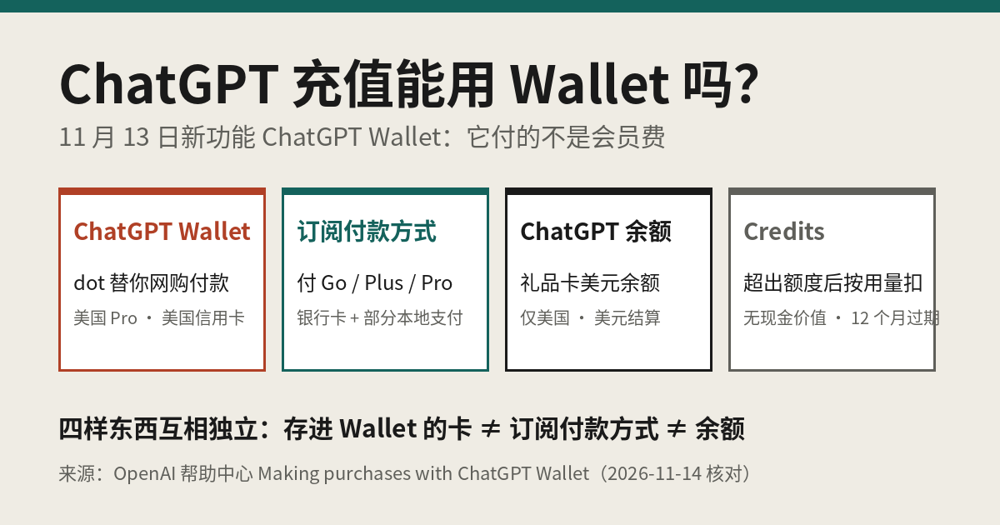

# ChatGPT充值能用Wallet吗？一文分清｜GPT20X

ChatGPT充值（开通 Go / Plus / Pro 会员）和 OpenAI 在 2026 年 11 月 13 日推出的 **ChatGPT Wallet** 不是一回事。Wallet 是给 Pro 用户的 dot 智能体「替你网购结账」用的付款工具，买的是商家的衣服、酒店这类商品，**不是用来付 ChatGPT 会员费的**。OpenAI 帮助中心原话是：存进 Wallet 的卡，和你的 ChatGPT 订阅付款方式、礼品卡 / 预付余额是分开的。下面把 Wallet、订阅付款方式、ChatGPT 余额、Credits 这四样一次分清。（2026-11-14 核对，来源见文末）

---

## 目录

1. ChatGPT Wallet 是什么
2. 谁能用 Wallet：6 个条件
3. ChatGPT充值（订阅）到底用什么付
4. 四样东西对照表
5. 关于 Wallet 的 4 个常见误区
6. 用 Wallet 买东西出了问题找谁
7. 国内没有信用卡，chatgpt会员怎么开
8. 自查清单
9. 常见问题

---

## 1. ChatGPT Wallet 是什么

按 [OpenAI 官方公告](https://openai.com/index/introducing-chatgpt-wallet/) 和 [帮助中心说明](https://help.openai.com/en/articles/20001654-making-purchases-with-chatgpt-wallet)，Wallet 的流程是：

1. 你把一张符合条件的信用卡**存进 Wallet 一次**（在安全表单里填，不在聊天框里填）；
2. 让你的 dot（ChatGPT 里常驻的智能体，由 GPT-6 Astra 驱动）帮你找东西，比如「帮我找件毛衣」「订下周末芝加哥的酒店」；
3. 结账前，dot 会弹出购买请求，你核对**商家、商品、总价、所选卡片**，以及运费或自动续费条款；
4. 用 Face ID / Touch ID 等生物识别批准；
5. 卡组织生成一个**支付令牌**（替代卡号、安全码和有效期）去结账，商家和智能体都看不到你的真实卡号。

官方特别提醒：显示「Ready to check out」只代表**你批准了**，不代表商家已经下单成功，要以商家的订单确认为准。

---

## 2. 谁能用 Wallet：6 个条件

| 条件 | 官方要求 |
|---|---|
| 套餐 | ChatGPT **Pro**（Pro 100 / 200 / 500 官方月费分别是 $100 / $200 / $500） |
| 地区 | 居住在美国，卡片账单地址在美国 |
| 年龄 | 18 岁及以上 |
| 卡片 | 美国发行的 American Express、Chase、Mastercard、Visa **信用卡**；不支持借记卡，首发不支持虚拟卡 |
| 使用位置 | 只在和 dot 的对话里可用；Chat、Work、单独的 Codex 线程里都没有 |
| 设备 | 批准购买需要支持生物识别的设备 |

另外 Wallet 是**逐步推送**的，即使条件都满足，也可能暂时看不到。Plus、Go、免费版目前都用不了 Wallet。

---

## 3. ChatGPT充值（订阅）到底用什么付

开通会员走的是**订阅付款**，和 Wallet 没关系。官方 [Multi-currency billing](https://help.openai.com/en/articles/10421635-multicurrency-billing) 页写得很清楚：

- **网页订阅（chatgpt.com）**：所有国家都可以用信用卡 / 借记卡；另外少数市场有本地支付（英国和欧洲经济区的 Link、印度 UPI、印尼 GoPay、巴西 Pix、韩国 Kakao Pay / Naver Pay、菲律宾 GCash、越南 MoMo）；
- **App 内订阅**：iOS / Android 里买的会员由 Apple App Store 或 Google Play 扣费和管理；
- **ChatGPT 余额**：在美国、以美元结算的网页订单，可以用礼品卡兑换来的余额抵扣。

官方价格参考：Plus 为 [$20 / 月](https://help.openai.com/en/articles/6950777-what-is-chatgpt-plus)，官方不提供 Plus 年付；Pro 三档按月计费，也没有年付（[About ChatGPT Pro tiers](https://help.openai.com/en/articles/9793128-about-chatgpt-pro-tiers)）。

所以「chatgpt充值」这件事，要么在结账页绑卡 / 本地支付，要么在应用商店订阅，要么（仅美国）用余额抵扣——**没有「往 Wallet 里充钱再付会员费」这条路**。

---

## 4. 四样东西对照表

| | ChatGPT Wallet | 订阅付款方式 | ChatGPT 余额 | Credits |
|---|---|---|---|---|
| 是什么 | 存信用卡，让 dot 替你结账 | 付 Go / Plus / Pro 月费的卡或本地支付 | 美元账户余额（礼品卡兑换等） | 超出套餐额度后按用量扣的单位 |
| 用来付 | 外部商家的商品和服务 | ChatGPT 会员订阅 | 符合条件的网页订单 | Codex、Work、Word、Excel、PowerPoint 超额用量 |
| 谁能用 | 美国 Pro 用户 | 所有付费用户 | 在美国的账户、美元计价 | 按账户和套餐开放 |
| 能不能付会员费 | **不能** | 能 | 符合条件可以抵扣 | 不能，它不是订阅 |
| 能不能提现 | 不涉及（不存钱） | 不涉及 | 不能提现 | 无现金价值，不能转让，购买后 12 个月过期 |

Credits 的规则见 [Using Credits for Flexible Usage](https://help.openai.com/en/articles/12642688-using-credits-for-flexible-usage-in-chatgpt-personal-plans)，余额规则见 [Using your ChatGPT balance](https://help.openai.com/en/articles/20001508-using-your-chatgpt-balance)。官方两篇都强调：**Credits 余额和钱包余额是分开的**，兑换礼品卡不会自动变成 Credits。

---

## 5. 关于 Wallet 的 4 个常见误区

**误区 1：Wallet 上线了，ChatGPT 可以用钱包充值会员了。**
不对。官方明确写了 Wallet 里的卡和订阅付款方式是分开的。会员续费照旧走你开通时的渠道。

**误区 2：把卡存进 Wallet，dot 就能随便花钱。**
不对。存卡和批准购买是两个独立步骤，每一笔都要你核对后用生物识别批准。不认识的购买请求直接拒绝。

**误区 3：Wallet 能绑国内银行卡或虚拟卡。**
目前不行。只支持美国发行的指定信用卡，借记卡不支持，虚拟卡首发也不支持。

**误区 4：「ChatGPT 钱包余额」就是 Wallet。**
不是。帮助中心里的「ChatGPT wallet balance / ChatGPT 余额」是礼品卡兑换来的美元余额，能抵扣美国账户的网页订单；ChatGPT Wallet 是 dot 的购物付款工具。中文都容易叫「钱包」，看清英文名再操作。

---

## 6. 用 Wallet 买东西出了问题找谁

官方把责任分得很清楚：

| 问题 | 找谁 |
|---|---|
| 订单状态、取消、退货、退款 | 商家 |
| 扣款被拒、待处理、争议、陌生扣款、银行验证 | 发卡银行 |
| Wallet 报错、账号疑似被盗、扣的和批准的不一致 | OpenAI Support |

两条安全提醒：卡号、安全码、银行验证码**只填在安全表单里**，不要发在聊天或客服消息里；结账失败但看到待处理扣款时，先找商家确认订单，**不要马上重复下单**。

---

## 7. 国内没有信用卡，chatgpt会员怎么开

Wallet 对国内用户的现实意义不大：它要求美国 Pro 账户和美国信用卡，而且本来就不是付会员费的工具。国内用户常见的开通路径还是这三条：

1. **自己有境外信用卡**：在 chatgpt.com 的结账页直接订阅，被拒时按 [《Your card was declined 怎么办》](https://amber-moose-14.github.io/chatgpt-daichong-guide/card-declined-fix.html) 排查；
2. **应用商店订阅**：用 Apple / Google 账户里的付款方式订阅，扣费和取消都在应用商店里管；
3. **chatgpt代充**：没有境外卡的人，用支付宝或微信支付人民币，由代充平台把套餐开到你自己的账号上。以 GPT20X（gpt20x.com）为例，结账页支持支付宝、微信支付，不需要海外信用卡，也不需要提供账号密码，具体套餐以 [官网](https://gpt20x.com/) 当前显示为准。

ChatGPT 对账号使用地区有要求，开通前建议先看一下 OpenAI 官方的支持地区说明。

开通前再确认两件事：一是 Apple / Google Play / 官网没有还在扣费的旧订阅，避免重复扣费（方法见 [《ChatGPT 订阅怎么管》](https://amber-moose-14.github.io/chatgpt-daichong-guide/chatgpt-dingyue-guanli-quxiao-2026.html)）；二是想清楚要哪一档——日常聊天写作选 Plus，轻量使用看 Go，重度 Codex 或想要 dot 等 Pro 功能再考虑 Pro（选档见 [《ChatGPT 会员怎么选》](https://amber-moose-14.github.io/chatgpt-daichong-guide/chatgpt-huiyuan-zenme-xuan-2026.html)）。用支付宝 / 微信付款的完整步骤见 [《ChatGPT 代充用支付宝 / 微信怎么付》](https://amber-moose-14.github.io/chatgpt-daichong-guide/chatgpt-daichong-zhifubao-weixin-2026.html)。

各种付款方式的对比，也可以在 [ChatGPT 充值支付方式选择器](https://huggingface.co/spaces/gpt20x/chatgpt-chongzhi-zhifu) 里点一下。

---

## 8. 自查清单

- [ ] 知道 Wallet 是 dot 替你网购的付款工具，不是付会员费的
- [ ] 知道 Wallet 目前只面向美国 Pro 用户、美国发行的信用卡，且逐步推送
- [ ] 分清了 Wallet、订阅付款方式、ChatGPT 余额、Credits 四样东西
- [ ] 会员续费渠道（网页 / Apple / Google Play / 代充）自己心里有数
- [ ] 卡号、安全码、验证码从不发在聊天或客服消息里
- [ ] 开通新会员前，已停掉还在扣费的旧订阅

---

## 9. 常见问题

**Q：ChatGPT Wallet 能用来续费 Plus 或 Pro 吗？**  
不能。官方写明 Wallet 里的卡和订阅付款方式分开管理，会员费仍按你订阅时的渠道扣。

**Q：我是 Plus 用户，能用 Wallet 吗？**  
目前不能。Wallet 只在和 dot 的对话里使用，而 dot 和 Wallet 目前面向符合条件的 Pro 用户。Plus 的日常聊天默认是 GPT-6（由 GPT-6 Sol 驱动），Work 和 Codex 里可以用 GPT-6.1 Sol 和 GPT-6 Astra，GPT-5.6 Sol 属于上一代可选模型；模型和额度以账号内显示为准。

**Q：Wallet 会不会把我的真实卡号给商家？**  
官方说不会。批准后生成的是支付令牌（一个替代卡号），所以收据上的卡号可能和实体卡不一样。

**Q：dot 买错了东西怎么办？**  
批准前看清楚再点；已完成的订单要退要换，联系商家。如果扣的金额和你批准的不一样，联系 OpenAI Support。

**Q：国内用户以后能用 Wallet 吗？**  
目前尚未确认。官方只说会和商家、银行、卡组织合作逐步扩大范围，没有给出时间表和地区。

---

## 参考来源

- [OpenAI：Introducing ChatGPT Wallet](https://openai.com/index/introducing-chatgpt-wallet/)（2026-11-13 发布，合作卡组织、支付令牌、首发范围）
- [OpenAI 帮助中心：Making purchases with ChatGPT Wallet](https://help.openai.com/en/articles/20001654-making-purchases-with-chatgpt-wallet)（使用条件、存卡步骤、批准流程、问题找谁、FAQ）
- [OpenAI 帮助中心：ChatGPT release notes](https://help.openai.com/en/articles/6825453-chatgpt-release-notes)（2026-11-13 Introducing ChatGPT Wallet）
- [OpenAI 帮助中心：Multi-currency billing](https://help.openai.com/en/articles/10421635-multicurrency-billing)（订阅付款方式、App 订阅走 Apple / Google、美国余额抵扣）
- [OpenAI 帮助中心：Using your ChatGPT balance](https://help.openai.com/en/articles/20001508-using-your-chatgpt-balance)（余额来源、适用订单、不能提现）
- [OpenAI 帮助中心：Using Credits for Flexible Usage in ChatGPT](https://help.openai.com/en/articles/12642688-using-credits-for-flexible-usage-in-chatgpt-personal-plans)（Credits 与余额分开、12 个月过期、无现金价值）
- [OpenAI 帮助中心：What is ChatGPT Plus?](https://help.openai.com/en/articles/6950777-what-is-chatgpt-plus)、[About ChatGPT Pro tiers](https://help.openai.com/en/articles/9793128-about-chatgpt-pro-tiers)（官方月费、无年付）

> 本文由 GPT20X（gpt20x.com）整理，非 OpenAI 官方内容。功能范围、价格和付款方式会变化，请以 OpenAI 帮助中心和账号内显示为准。

---

*最后更新：2026-11-14*　｜　[返回教程首页](README.md)
