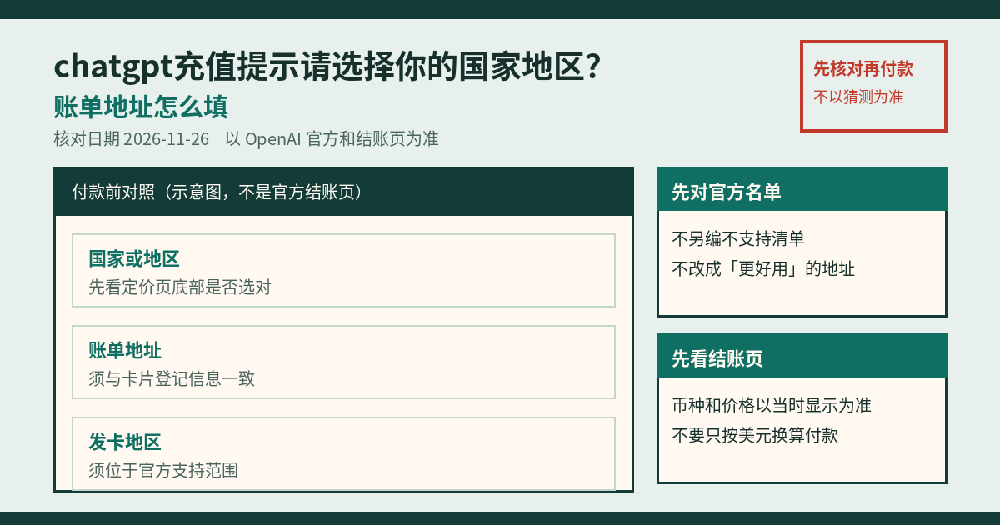

# chatgpt充值提示请选择你的国家地区？账单地址怎么填｜GPT20X

在 chatgpt.com 开通或续费时，结账前常会看到「请选择你的国家地区」。这个选项会影响你能看到的套餐、币种和付款方式，但不能用来改写官方的支持地区规则。若你正在考虑[ChatGPT充值](https://gpt20x.com/)，建议先在官方定价页底部确认国家或地区，再核对账单地址是否与卡片登记一致，并看清结账页上的币种和价格后再付款。本文按 2026-11-26 英文帮助中心核对，具体以官方页面和结账页当时显示为准。

ChatGPT 对账号使用地区有要求，开通前建议先看一下 OpenAI 官方的支持地区说明。

## 先看结论：先核对国家、账单地址和发卡地区，再付款

先把今天能核对的内容压成一张表。

| 你想确认的事 | 官方目前的说法（2026-11-26 按英文帮助中心核对） |
|---|---|
| 「请选择你的国家地区」先看哪里 | 在 chatgpt.com 打开 Upgrade plan，到定价页底部确认国家或地区是否选对 |
| 账单地址在哪里改 | 设置 → Billing → Billing information → Edit；若看到 Account 里的 Payment，则进入账单门户再更新 |
| 谁必须位于支持范围 | 你所在地和卡片发卡机构都要位于官方支持地区；任一方不在范围内，付款都可能被拒绝 |
| 用错支付方式的后果 | 使用来自官方支持名单以外国家或地区的支付方式，会导致无法继续使用服务 |
| 币种以哪一页为准 | 以结账页显示的价格和账单币种为准；本地化价格可能不同于把美元价直接换算的结果 |
| 应用内订阅 | iOS 或 Android 应用内订阅由 Apple 或 Google Play 管理，费用按当地货币显示 |
| 改账单信息以后 | 只影响之后的发票，不会自动改正已开具的发票 |

本页只解决国家或地区怎么选、账单地址怎么填。被拒卡排查和取消订阅见文末相关教程。

## 「请选择你的国家地区」通常出现在哪

网页开通付费套餐时，官方入口是：打开 chatgpt.com，点头像菜单，选择 Upgrade plan。帮助中心写明，要确认 the correct country selected at the bottom of the pricing page。意思是：看不到想要的套餐或币种时，先确认定价页底部选对了国家或地区。

这个底部选项是给结账展示用的，不能把不在官方支持名单里的使用地区改写成已经支持。选完后仍要再看结账页上的价格、币种和支付方式，不要只按记忆中的美元价付款。

如果是在 iOS 或 Android 应用里升级，应用只显示当前账号可用的套餐和结账方式。应用内购买由 Apple 或 Google Play 管理；若转到网页结账，要确认浏览器登录的就是你想升级的那个账号。

## 账单地址在哪里填写和修改

个人账号的官方步骤是：登录要付款的账号，打开 Settings → Billing，在 Billing information 下选择 Edit，更新账单信息（需要时也可填写 Tax ID）后保存。若设置里看到的是 Account 下面的 Payment，就选择 Manage，进入账单门户后再更新。账单邮箱可以和登录邮箱不同。账单控件缺失时，官方建议换一个浏览器登录同一账号再打开。

保存后，新的账单名称、地址或税号只会出现在以后的发票上，已开具的发票不会自动修改。税号若被认定为无效，系统可能移除它并按适用税额计税。填写时最常见的卡点，是地址是否与银行留存一致。被拒卡说明要求核对卡号、有效期、CVC 和账单地址（包括邮政编码）。不要为了让某种币种或套餐出现，去填写与卡片登记不符的地址。

## 所在地和发卡行都要在支持范围内

官方支持名单页列出了当前可在网页和移动端使用 ChatGPT 及 API 的国家、地区和领土。英文说明是：may result in your account being blocked or suspended。意思是：在名单以外访问或提供这些服务，账号可能被封禁或暂停。

续费排障页要求：你本人和卡片发卡机构都要位于支持的国家；任一方在范围之外，付款都可能被拒绝。购买只在支持地区开放，支付卡必须由这些地区的银行发行。重试前先对照官方名单，不要另编「不支持地区」清单。

支付方式来源同样重要。英文说明是：will result in you being blocked from using our services。意思是：使用来自支持名单以外国家或地区的支付方式，会导致无法继续使用服务。这和银行暂时拦截不是同一回事。

在支持地区创建的账号，旅行到不支持地区时也可能无法登录或使用。即便已经返回，仍可能看到 “OpenAI's services are not available in your country.”。清缓存、换浏览器或无痕窗口，只适用于「你当前就在支持的国家或地区」，不能当成绕过方法。仍无法使用时再联系 Support，不要提供完整卡号和安全码。

## 结账页上的币种和支付方式以当时显示为准

多币种说明覆盖的是在 chatgpt.com 网页购买的订阅。付款前先看结账页上的价格和账单币种。本地化价格可能不同于把美元价直接换算的结果。该说明适用于标准付费套餐；Enterprise 和 Education 另行管理，不在该文范围内。

2026-11-26 核对该页币种表时，未见人民币 CNY。这只代表当天这张表没有列出，并不对官方未来是否展示某币种作承诺。结账页当时显示什么币种，就按什么理解应付金额。网页结账普遍提到的是信用卡和借记卡；另外还有按地区提供的本地方式，它们不是全球通用。该文没有把支付宝或微信支付列为 chatgpt.com 的结账方式。

已有有效订阅时，会继续按当前币种扣费。若要改用后来新支持的币种，需要先取消，并等到当前账期结束后再重新订阅；取消 Pro 再订阅时，内含用量可能会变化。API Credits 目前仅限美元购买。

## 不同情况怎么处理

**准备在网页用银行卡开通的人。** 先在定价页底部确认国家或地区，再核对账单地址、邮编，以及卡片是否由支持地区的银行发行，并看清结账页上的币种和价格后再付款。

**准备在手机应用里开通的人。** 先分清订单是走 Apple、Google Play，还是跳转到网页。应用内购买要在对应商店管理；网页跳转则要确认登录的是同一个 ChatGPT 账号，避免重复付款。

**还没有付款、只看到国家或地区选项的人。** 先完成定价页底部的选择，再核对账单地址。若希望的套餐或币种仍未出现，先回官方支持地区页确认所在地，不要改填看起来「更好用」的地址。

**正在考虑用人民币、支付宝或微信支付的人。** 当天核对的多币种说明并未把支付宝或微信列为网页结账方式。GPT20X 只是可以用人民币了解开通选项的途径之一，不能替代官方支持地区规则。

**旅行或刚刚更换网络环境的人。** 先确认当前是否位于官方支持地区。只有已经位于支持地区时，才适合按官方说明清理缓存或换浏览器。

## 常见问题

**定价页底部的国家选错了，会怎样？**  
可能会看不到期望的套餐或币种，结账金额也可能和预先换算的不一致。发现选错后，先改回与实际情况相符的选项，再查看价格。

**账单地址能不能填和卡片不一样的国家，好让某种币种出现？**  
不要这样做。被拒卡说明要求账单地址（含邮编）与卡片登记一致，续费说明还要求你和发卡机构都位于支持地区。

**我改了账单地址，以前的发票会一起变吗？**  
不会自动改。官方写明，更新账单信息或税号只影响之后的发票；已开具发票是否能重开，需联系 Support 且并不保证。

**为什么结账页上的价格，和我按美元换算的不一样？**  
官方已提示：本地化价格可能不同于把美元价直接换算的结果。付款前以结账页当时显示为准。

**在手机应用里升级，还要不要填网页里的账单地址？**  
不一定。应用内购买由 Apple 或 Google Play 管理；只有转到网页结账时，才按网页账单信息和定价页底部国家核对。

**看到「服务在你所在的国家不可用」，是不是一定要换地区再试？**  
先在官方支持名单里核对所在地，不要把报错理解成必须改地址。只有当前已经在支持地区时，才适合按官方说明清理缓存或换浏览器。

## 相关教程

- [ChatGPT 提示 Your card was declined 怎么办？](https://amber-moose-14.github.io/chatgpt-daichong-guide/card-declined-fix.html)
- [ChatGPT 代充用支付宝 / 微信怎么付](https://amber-moose-14.github.io/chatgpt-daichong-guide/chatgpt-daichong-zhifubao-weixin-2026.html)
- [ChatGPT 订阅怎么管：取消与防重复扣费](https://amber-moose-14.github.io/chatgpt-daichong-guide/chatgpt-dingyue-guanli-quxiao-2026.html)

## 官方来源

- [ChatGPT 和 OpenAI API 支持的国家与地区（ChatGPT and OpenAI API supported countries and territories）](https://help.openai.com/en/articles/7947663-chatgpt-and-openai-api-supported-countries-and-territories)。列出当前支持名单，并说明名单以外访问可能导致账号暂停。
- [更新账单信息、税号和增值税号（Updating billing information, Tax ID, and VAT ID）](https://help.openai.com/en/articles/9038389-updating-billing-information-tax-id-and-vat-id)。说明个人账号修改账单地址的入口，以及更改只影响之后发票。
- [多币种账单（Multi-currency billing）](https://help.openai.com/en/articles/10421635-multicurrency-billing)。说明网页结账以当时显示的币种和价格为准。

> 本页为 [GPT20X](https://gpt20x.com/) 整理，非 OpenAI 官方内容。价格、额度和政策以 OpenAI 官方和结账页为准。

*最后更新：2026-11-26*
