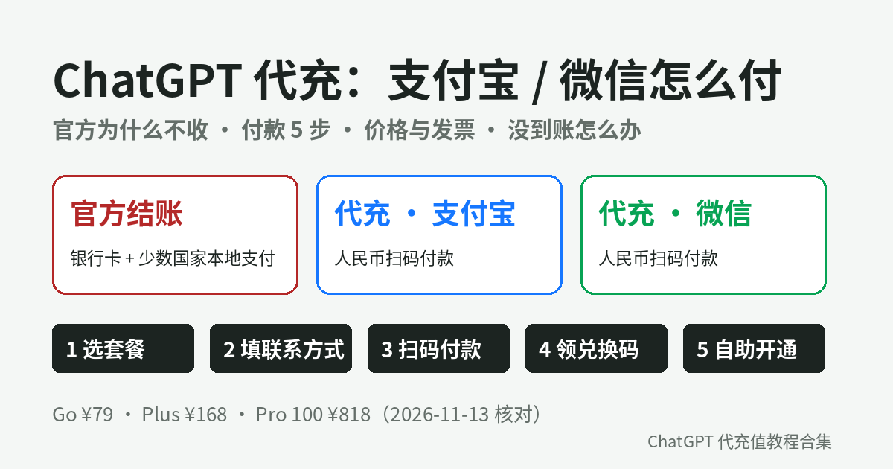

# ChatGPT 代充用支付宝 / 微信怎么付：官方为什么不收、付款 5 步、付款后没到账与退款怎么办

**简短回答：** OpenAI **官方结账页不收支付宝、微信，也不收人民币**。帮助中心的 Multi-currency billing 页写明：所有国家都可以用信用卡 / 借记卡，另外只在少数市场开放本地支付（英国和欧洲经济区的 Link、印度 UPI、印尼 GoPay、巴西 Pix、韩国 Kakao Pay / Naver Pay、菲律宾 GCash、越南 MoMo），支持的币种列表里也没有人民币。所以国内没有境外卡的人想用支付宝或微信，走的是 **ChatGPT 代充**：你用人民币付给代充平台，平台把套餐开到你自己的账号上。以 GPT20X 为例，结账页支持**支付宝、微信直接付款，人民币结算，不需要海外信用卡**；付款后订单页会显示交付内容，Plus / Go 按教程自助兑换，通常 2 分钟左右生效，Pro 按订单页提示加客服协助开通。（2026-11-13 核对，来源见文末）

---

## 目录

1. 官方为什么用不了支付宝 / 微信
2. 代充用支付宝 / 微信，付的到底是什么
3. 付款前准备好 5 样东西
4. 支付宝 / 微信付款 5 步
5. 各套餐人民币价格、收据和发票
6. 付款后 6 种常见情况怎么处理
7. 付款安全清单
8. 自查清单
9. 常见问题

---

## 1. 官方为什么用不了支付宝 / 微信

先看 OpenAI 自己怎么写（[Multi-currency billing](https://help.openai.com/en/articles/10421635-multicurrency-billing)，2026-11-13 核对）：

| 付款方式 | 官方支持范围 |
|---|---|
| 信用卡 / 借记卡 | 所有支持的国家 |
| Link 银行扣款 | 英国、欧洲经济区（部分） |
| UPI | 印度（仅 Go、Plus） |
| GoPay / Pix / GCash / MoMo | 印尼 / 巴西 / 菲律宾 / 越南 |
| Kakao Pay、Naver Pay | 韩国 |
| ChatGPT 钱包余额 | 仅美国、美元计价 |
| 支付宝 / 微信 / 人民币 | **不在列表里** |

另外两点也要知道：

- 在 iOS / Android App 里订阅，扣费走 Apple App Store 或 Google Play，用的是你应用商店账户里的付款方式（同一页开头的说明）；
- 网页、Apple、Google 三个渠道可以各自产生订阅，[Managing billing](https://help.openai.com/en/articles/9039756-managing-billing-for-chatgpt-and-the-api-platform) 写明多平台订阅可能**分别扣费**。

自己用境外卡付款被拒的排查方法，见[《Your card was declined 怎么办》](https://amber-moose-14.github.io/chatgpt-daichong-guide/card-declined-fix.html)。

---

## 2. 代充用支付宝 / 微信，付的到底是什么

用支付宝或微信付款时，你的钱是付给**代充平台**，不是付给 OpenAI。拿 GPT20X 的[开通流程说明](https://gpt20x.com/blog/chatgpt-plus-pro-recharge-guide)来看：

- 付款后拿到的是**本站订单兑换码**，只用于核对平台订单和套餐，**不是 OpenAI 官方充值卡、礼品卡或官方兑换码**；
- 用兑换码在自助页验证、确认账号和套餐后提交，套餐开到**你自己的 ChatGPT 账号**，聊天记录保留，不需要提供密码；
- GPT20X 写明自己是独立第三方平台，与 OpenAI 没有隶属或官方授权关系。

所以「用支付宝付 ChatGPT」的准确说法是：**人民币付给平台 → 平台交付兑换码 → 你自助提交开通**。售后、退款都找卖你的平台，不找 OpenAI。挑平台的通用标准见[《ChatGPT 代充怎么选》](https://amber-moose-14.github.io/chatgpt-daichong-guide/choose-daichong-platform.html)。

---

## 3. 付款前准备好 5 样东西

1. 一个能正常登录的 ChatGPT 账号（浏览器里登录了多个账号的，先确认当前是哪个）；
2. 能正常打开 ChatGPT 的浏览器；
3. 支付宝或微信，余额 / 绑定的银行卡够付；
4. 一个能收订单通知的联系方式（下单页「必填，用于查询订单状态与接收充值结果」）；
5. 想好买哪一档：日常聊天写作 Plus，轻量用 Go，重度用 Codex 看 Pro（选档见[《ChatGPT 会员怎么选》](https://amber-moose-14.github.io/chatgpt-daichong-guide/chatgpt-huiyuan-zenme-xuan-2026.html)）。

---

## 4. 支付宝 / 微信付款 5 步

| 步骤 | 做什么 | 要注意 |
|---|---|---|
| ① 选套餐 | 在 [GPT20X 首页](https://gpt20x.com/) 选 Plus / Go / Pro | 看清是 30 天还是一年 |
| ② 填联系方式 | 下单页填写用于查单的联系方式 | 写自己常用的，丢了订单靠它找回 |
| ③ 选付款方式 | 结账页选**支付宝**或**微信**，扫码付款 | 只在结账页付款，不私下转账 |
| ④ 领取兑换码 | 付款后自动发货，订单页立即显示交付内容 | 截图保存订单号和兑换码 |
| ⑤ 提交开通 | Plus / Go 到自助页验证兑换码、核对账号和套餐后提交；Pro 按订单页提示加客服 | 同一个兑换码不要反复提交 |

开通后**退出 ChatGPT 再重新登录**，到 Settings → Account 看套餐名是否已变成 Plus / Go / Pro。兑换环节的细节见[《GPT 代充卡密怎么兑换？》](https://amber-moose-14.github.io/chatgpt-daichong-guide/gpt-daichong-kami-duihuan-2026.html)。

---

## 5. 收据、发票和各套餐怎么开通

各套餐的人民币价格以下单页实时显示为准，可在 [GPT20X](https://gpt20x.com/) 打开对应开通页核对。Plus / Go 多为自助兑换，Plus 年付和 Pro 常见为人工开通或客服协助。

**报销收据：** Plus 月付、Pro 100 等套餐页写明「付款后可在订单查询页下载收款凭证」，Plus 年付页写明「提供报销收据」。

**发票：** 首页常见问题写明 Pro 套餐下单时选择发票选项即可。需要增值税普通发票时，结算金额可能含税费，开票价与不开票价不一样，付款前看清结算页。企业批量采购可联系客服对公结算。

年付和月付怎么选，见[《ChatGPT Plus 年付值不值》](https://amber-moose-14.github.io/chatgpt-daichong-guide/chatgpt-plus-nianfu-2026.html)。

---

## 6. 付款后 6 种常见情况怎么处理

| 情况 | 先做什么 |
|---|---|
| 付了钱，页面关掉了没看到兑换码 | 到[订单查询页](https://gpt20x.com/query)用下单时的联系方式查，**不要重复下单** |
| 订单信息没保存 | 同上；查不到再带付款记录（支付宝 / 微信账单截图）联系客服 |
| 提示兑换码无效 | 检查是否复制完整、有没有多余空格、是否已经提交过 |
| 提交后一直「处理中」 | 不要重复提交，在自助页查询状态；长时间不变，准备订单号、兑换码和提交时间找客服 |
| 开通了，账号还是免费版 | 退出 ChatGPT 重新登录；仍是免费版再联系客服 |
| 确认开不了，想退款 | [售后政策](https://gpt20x.com/help)：首次使用前验证无效或无法充值，核实后全额退款；已成功开通后不支持无理由退款 |

售后流程按售后政策写的是：订单查询页看状态 → 带订单号联系客服 → 核实后补换或退款；客服每天 8:00–24:00 在线，一般当天处理。质保期 30 天，我方原因失效核实后免费补换。

---

## 7. 付款安全清单

- **只在平台官网的结账页付款**。客服或陌生人发来的个人收款码、要求「转账到私人账户」的，一律不付；
- **不给密码、验证码、两步验证恢复码**。GPT20X 首页写明全程无需提供账号密码；
- **付款前核对金额和套餐名**，需要发票时开票价与不开票价可能不一样，别选错；
- **保留凭证**：订单号、兑换码、支付宝 / 微信账单截图、客服聊天记录；
- **先停掉旧的自动续费**：Apple / Google Play / 官网还有在扣费的订阅，先取消，避免和代充重复（方法见[《ChatGPT 订阅怎么管》](https://amber-moose-14.github.io/chatgpt-daichong-guide/chatgpt-dingyue-guanli-quxiao-2026.html)）；
- **账号自己用**：售后政策写明转借他人、泄露卡密或密码、IP 环境异常、违反 OpenAI 使用政策导致的封禁不在质保范围。

各种付款方式的对比和选择器，可以在 [ChatGPT 充值支付方式选择器](https://huggingface.co/spaces/gpt20x/chatgpt-chongzhi-zhifu) 里点一下。

---

## 8. 自查清单

- [ ] 知道官方结账页不收支付宝 / 微信 / 人民币，代充是付给第三方平台
- [ ] 确认了要开通的 ChatGPT 账号，浏览器里只登录这一个
- [ ] 选好了套餐和周期（30 天 / 一年），Pro 想好要不要开票
- [ ] 在结账页用支付宝或微信付款，没有私下转账
- [ ] 订单号、兑换码、付款截图已保存
- [ ] 兑换码只提交一次，开通后退出重登核对套餐名
- [ ] Apple / Google Play / 官网没有还在扣费的旧订阅

---

## 9. 常见问题

**Q：ChatGPT 官方能用支付宝或微信付款吗？**  
不能。OpenAI 帮助中心列出的付款方式是银行卡加少数国家的本地支付，没有支付宝、微信，支持币种里也没有人民币。

**Q：代充用支付宝付款，钱给了谁？**  
给了代充平台。你买的是平台的服务，平台交付订单兑换码并帮你把套餐开到自己的账号，售后和退款按平台规则走。

**Q：支付宝和微信付款有区别吗？**  
在 GPT20X 结账页两者都可以，价格一样，都是人民币结算；选你手边方便的就行，具体以结算页显示为准。

**Q：付款后多久能用上？**  
付款后自动发货，订单页立即显示交付内容。Plus、Go 自助兑换通常 2 分钟左右生效；Pro 按订单页提示加客服协助开通（每天 8:00–24:00）。

**Q：能开发票吗？**  
Pro 套餐下单时选发票选项即可，开票价与不开票价可能不同，以结算页为准；Plus、Go 等可在订单查询页下载收款凭证用于报销。

---

## 参考来源

- [OpenAI 帮助中心：Multi-currency billing](https://help.openai.com/en/articles/10421635-multicurrency-billing)（支持币种列表、各国付款方式、App 订阅走 Apple / Google）
- [OpenAI 帮助中心：Managing billing for ChatGPT and the API platform](https://help.openai.com/en/articles/9039756-managing-billing-for-chatgpt-and-the-api-platform)（网页、Apple、Google 多平台订阅可能分别扣费）
- [OpenAI 帮助中心：Why was my credit card declined?](https://help.openai.com/en/articles/7232916-why-was-my-credit-card-declined)（银行卡被拒的官方排查步骤）
- GPT20X [首页](https://gpt20x.com/)、[Plus 月付页](https://gpt20x.com/ChatGPTPlus2)、[Pro 100 页](https://gpt20x.com/ChatGPTPro5x)、[开通流程说明](https://gpt20x.com/blog/chatgpt-plus-pro-recharge-guide)、[售后政策](https://gpt20x.com/help)（付款方式、收据发票、退款与质保，2026-11-14 核对）

> 本文为个人整理，非 OpenAI 官方内容。价格、付款方式和政策会变化，请以 OpenAI 帮助中心、账号内显示和下单页为准。

---

*最后更新：2026-11-13*　｜　[返回教程首页](README.md)
