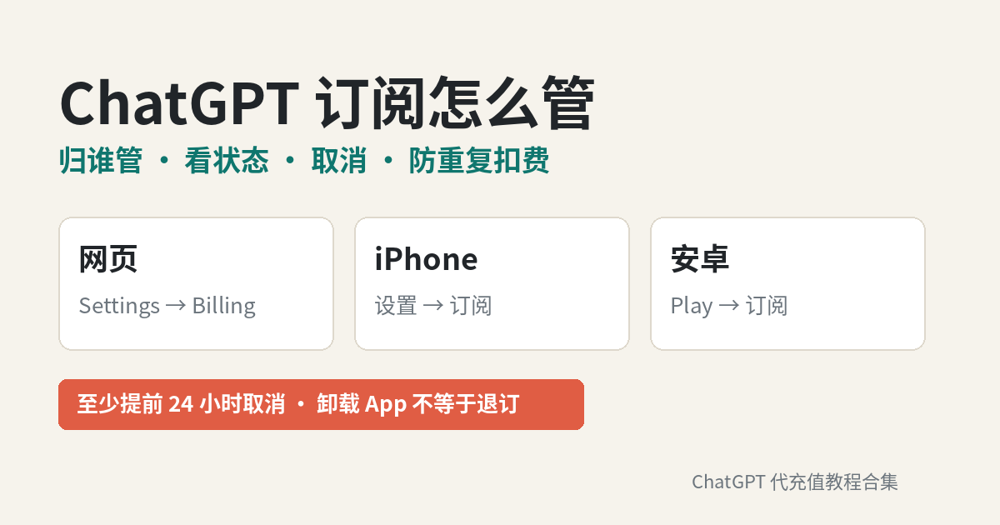

# ChatGPT 订阅怎么管：订阅在哪个平台、怎么看状态、取消与防重复扣费 + 国内开通订阅

**简短回答：** 「**ChatGPT 订阅**」最容易出问题的地方不是选哪个套餐，而是**订阅归哪个平台管**。官方规则很简单：在 chatgpt.com 买的，就在 ChatGPT 网页的 **Settings → Billing** 里管；在 iPhone 上买的归 **Apple** 管；在安卓 Google Play 买的归 **Google** 管。取消要在**当初付款的那个平台**操作，**至少提前 24 小时**；**卸载 App 不会退订**，**删 ChatGPT 账号也不一定退订**（Apple 订阅就不会）。在两个平台各买一次，就会被**扣两份钱**。以上均以 [OpenAI 帮助中心：Canceling your ChatGPT subscription](https://help.openai.com/en/articles/7232927-canceling-your-chatgpt-subscription) 和 [How do I avoid being charged twice](https://help.openai.com/en/articles/20001043-how-do-i-avoid-being-charged-twice-if-i-subscribe-to-chatgpt-on-ios-android-and-the-web) 为准（2026-11-10 核对）。

---

## 目录

1. ChatGPT 订阅有哪几种、各多少钱
2. 先搞清楚：你的订阅归谁管
3. 怎么查看当前订阅状态和下次扣费日
4. 怎么取消订阅（网页 / iPhone / 安卓）
5. 取消后会怎样：权益保留到哪天、会不会退钱
6. 三个最常见的误会：卸载 App、删账号、换账号
7. 怎么避免被重复扣费
8. 换套餐：Plus 升 Pro、Pro 档位之间切换
9. 续费扣款失败了，订阅是不是就没了？
10. 退款找谁
11. 国内开通 ChatGPT 订阅：价格对照与步骤
12. 订阅管理自查清单
13. 常见问题

---

## 1. ChatGPT 订阅有哪几种、各多少钱

个人用户能订阅的套餐主要是 Go、Plus 和 Pro（Pro 又分 100 / 200 / 500 三档）。官方价格和计费方式整理如下（来源：[What is ChatGPT Plus?](https://help.openai.com/en/articles/6950777-what-is-chatgpt-plus)、[About ChatGPT Pro tiers](https://help.openai.com/en/articles/9793128-about-chatgpt-pro-tiers)，2026-11-10 核对）：

| 套餐 | 官方价 | 计费方式 | 备注 |
|---|---|---|---|
| Plus | $20 / 月 | **按月** | 官方写明目前**不支持年付或多月预付** |
| Pro 100 | $100 / 月 | 按月 | 不含 Ultrafast |
| Pro 200 | $200 / 月 | 按月 | 额度高于 Pro 100，不含 Ultrafast |
| Pro 500 | $500 / 月 | 按月 | 三档最高额度，含 Ultrafast |

两点要记住：

- **官方 Plus、Pro 都只有月付**。Pro 的帮助页同样写明「年付和多月预付不可用」。所以你在第三方页面上看到的「年付」，是平台自己的商品形态，规则以平台说明为准，不能套用官方政策。
- **一个订阅跟着 ChatGPT 账号走，不跟设备走**。同一个账号在电脑、手机、平板上登录都能用，不用每台设备各买一份。

还没想好买哪档的，先看[《ChatGPT 会员怎么选：Go / Plus / Pro 对照》](https://amber-moose-14.github.io/chatgpt-daichong-guide/chatgpt-huiyuan-zenme-xuan-2026.html)，Pro 三档的额度差别看[《ChatGPT Pro 充值前必读》](https://amber-moose-14.github.io/chatgpt-daichong-guide/chatgpt-pro-chongzhi-edu-guize-2026.html)。

---

## 2. 先搞清楚：你的订阅归谁管

这是整篇最重要的一节。官方原则是：**订阅由你当初付款的平台管理**（[Avoiding duplicate subscription charges](https://help.openai.com/en/articles/20001043-how-do-i-avoid-being-charged-twice-if-i-subscribe-to-chatgpt-on-ios-android-and-the-web)）。

| 你在哪里付的钱 | 谁管这份订阅 | 去哪里改 / 取消 | 退款找谁 |
|---|---|---|---|
| chatgpt.com 网页 | OpenAI | ChatGPT 网页 → Settings → Billing | OpenAI Support |
| iPhone / iPad App（App Store） | **Apple** | iPhone 设置 → 你的名字 → 订阅 | **Apple** |
| 安卓 App（Google Play） | **Google** | Play 商店 → 付款和订阅 → 订阅 | OpenAI Support（用对应 ChatGPT 账号登录后提交） |
| ChatGPT Business（自助版） | 工作空间 | Workspace settings → Billing → Manage plan | 工作空间所有者联系 Support |

**不知道自己是在哪买的？** 官方建议翻**付款收据**，看是谁开的账单。还要注意：网页买的订阅**不会**出现在 Apple 或 Google Play 的订阅列表里；Google Play 订阅要**把手机上每个 Google 账号都查一遍**；Apple 订阅要确认登录的是**当初付款的那个 Apple ID**（来源：[Canceling your ChatGPT subscription](https://help.openai.com/en/articles/7232927-canceling-your-chatgpt-subscription)）。

---

## 3. 怎么查看当前订阅状态和下次扣费日

**看 ChatGPT 账号上是什么套餐：**

1. 登录 chatgpt.com，点头像 → **Settings**；
2. 在 **Account** 里先确认登录的是不是开通订阅的那个账号（收发票的邮箱可能和 ChatGPT 账号邮箱不同）；
3. 在 **Billing** 或 **My Plan** 里看当前套餐、可切换的套餐和账单。

（来源：[What is ChatGPT Plus?](https://help.openai.com/en/articles/6950777-what-is-chatgpt-plus) 的 Billing and Invoices 部分、[About ChatGPT Pro tiers](https://help.openai.com/en/articles/9793128-about-chatgpt-pro-tiers) 的 Managing your subscription 部分）

**看「下次扣费日」和「是否还会自动续」：** 要回到**付款的那个平台**看。官方原话是「在给你开账单的平台上确认订阅不再续订」。iPhone 上如果订阅详情里**没有取消按钮、而是显示一行红色的到期日期**，说明它已经取消了。

**付了钱但 ChatGPT 还显示 Free？** 官方给的排查顺序：

- 先看当前登录的 ChatGPT 账号邮箱（用 Apple「隐藏邮件地址」注册的，账号邮箱可能是 `@privaterelay.appleid.com`，要用「通过 Apple 继续」登录）；
- 在 iOS / 安卓 App 里点 **Settings → Restore purchases（恢复购买）** 同步订阅；
- 退出后重新登录正确的账号；
- 还不行，带上收据或扣款卡后四位联系官方支持。

---

## 4. 怎么取消订阅（网页 / iPhone / 安卓）

以下步骤整理自 [Canceling your ChatGPT subscription](https://help.openai.com/en/articles/7232927-canceling-your-chatgpt-subscription)（2026-11-10 核对）。

### 在 chatgpt.com 买的

1. 登录 ChatGPT；
2. 打开账号菜单 → **Settings**；
3. 选择 **Billing**；
4. 在 **Cancel plan** 下点 **Cancel**。

如果网页上找不到账单相关按钮，官方建议**换一个浏览器**登录同一个账号再试。

### 在 iPhone / iPad 上买的（Apple App Store）

1. 打开 iPhone 的 **设置**；
2. 点最上面 **你的名字**；
3. 点 **订阅**；
4. 选择 **ChatGPT**；
5. 点 **取消订阅** 并确认。

### 在安卓上买的（Google Play）

先确认登录的是**当初付款的 Google 账号**，然后：

1. 打开 **Google Play 商店**；
2. 点头像 → **付款和订阅 → 订阅**；
3. 选择 **ChatGPT**；
4. 点 **取消订阅**，按提示确认。

也可以在电脑上打开 Google Play 订阅页，在 ChatGPT 旁边点 **管理 → 取消订阅**。

### 登不上账号也想取消？

网页订阅如果你已经用不了账号邮箱，可以联系 OpenAI Support 代为取消，需要提供账号（或账单）邮箱，再加上以下**任意两项**：扣款卡后四位、卡片有效期、账单地址、最近一次扣款日期。**不要发完整卡号**。Apple / Google 订阅则要先找回对应的商店账号。

---

## 5. 取消后会怎样：权益保留到哪天、会不会退钱

- **至少提前 24 小时取消**。离下次扣费不到 24 小时才取消，下一期的钱可能已经扣了。
- **正常取消后，付费权益保留到本期结束**，不是马上降回 Free。Pro 帮助页还写明：预约取消不会立刻结束订阅，**本期结束前可以撤销取消**。
- **取消 ≠ 退款**。取消只是停止以后的续费，**不会自动退已经扣的钱**。如果退款获批，退款覆盖的那段权益通常会提前结束。

---

## 6. 三个最常见的误会：卸载 App、删账号、换账号

| 你以为 | 实际（官方说明） |
|---|---|
| 把 ChatGPT App 卸了就不扣了 | **不会退订**。Apple / Google 订阅照样续费 |
| 把 ChatGPT 账号删了就不扣了 | 网页订阅会随删号取消；**Apple 订阅不会取消**；Google Play 订阅要自己去查，还在就手动取消 |
| 换个 ChatGPT 账号重新买就行 | 改套餐必须用**原来那个账号**；而且 Apple ID / Google 账号用过一次 ChatGPT 订阅后，可能**挡住给另一个 ChatGPT 账号购买** |

最后一条来自 [Troubleshooting ChatGPT subscription access and account changes](https://help.openai.com/en/articles/20001056-troubleshooting-chatgpt-subscription-access-and-account-changes)：Apple ID 会一直和原来那个 ChatGPT 账号关联；Google Play 上即使旧订阅已经过期，也可能继续限制给别的账号购买，取消或等到期都不一定能解除。

所以**想删号，先退订**：先去 Apple / Google 把订阅取消，再删 ChatGPT 账号。

---

## 7. 怎么避免被重复扣费

重复扣费几乎都是同一个原因：**在一个平台的订阅还没取消，又在另一个平台开了新订阅**（[来源](https://help.openai.com/en/articles/20001043-how-do-i-avoid-being-charged-twice-if-i-subscribe-to-chatgpt-on-ios-android-and-the-web)）。

避免方法：

1. **换付款平台时按这个顺序**：先在旧平台取消 → **等本期付费时间用完** → 再在新平台订阅；
2. 电脑、手机都用的人，官方建议**直接在 chatgpt.com 订阅**，在网页上统一管理最省事；
3. **Apple 续费失败时特别小心**：扣款失败不等于订阅自动取消，Apple 会继续尝试恢复。如果你这时在网页或安卓上新开了订阅，之后又在 Apple 里更新了付款方式，Apple 可能拿新卡把旧订阅续上，结果就是**两份订阅、两份扣款**；
4. 已经被扣两份：先决定留哪个，到**对应平台**把另一个取消。官方提醒，**自己买了两份不等于自动有退款资格**，退款要另行申请审核。

---

## 8. 换套餐：Plus 升 Pro、Pro 档位之间切换

- 在 **Settings → My Plan** 查看当前订阅和可以切换的套餐（[About ChatGPT Pro tiers](https://help.openai.com/en/articles/9793128-about-chatgpt-pro-tiers)）；
- **换套餐要用原来的账号**，不要新开账号去买更高档，否则旧账号的订阅还在照扣；
- 如果 Pro 档位变化跟你确认的时间不一致，先对照 My Plan 里的档位和确认邮件上的生效日期；Apple / Google 购买的还要去商店订阅里核对；还对不上，带两个档位名称、日期和收据联系官方支持。

---

## 9. 续费扣款失败了，订阅是不是就没了？

不一定。官方说明：**续费扣款失败本身不代表订阅已经结束**（[About ChatGPT Pro tiers](https://help.openai.com/en/articles/9793128-about-chatgpt-pro-tiers)）。

- 网页订阅：按账单邮件里的付款恢复步骤处理；
- Apple / Google 订阅：去商店的付款设置里更新付款方式。

自己绑卡续费总是失败、提示卡被拒的，可以看[《ChatGPT 提示 Your card was declined 怎么办？》](https://amber-moose-14.github.io/chatgpt-daichong-guide/card-declined-fix.html)。

---

## 10. 退款找谁

| 购买渠道 | 退款申请 |
|---|---|
| chatgpt.com | 登录**被扣款的那个 ChatGPT 账号**，联系 OpenAI Support |
| Google Play | 同上，登录对应 ChatGPT 账号后联系 OpenAI Support |
| Apple App Store | **直接找 Apple** 申请 |
| 第三方代开通平台 | 按该平台的售后规则，带订单号联系平台客服 |

官方写明退款资格取决于购买方式和所在地；获批后一般 **5–10 个工作日**到账（[What is ChatGPT Plus?](https://help.openai.com/en/articles/6950777-what-is-chatgpt-plus)）。

---

## 11. 国内开通 ChatGPT 订阅：对照与步骤

没有境外信用卡、也不方便用外区 Apple ID 的，常见做法是用支付宝 / 微信找平台**把订阅开到你自己的账号上**。官方个人套餐价：Plus $20 / 月，Pro 三档 $100 / $200 / $500 / 月，Go 以[官方定价页](https://chatgpt.com/pricing/)为准，均无官方年付。国内开通可在 [GPT20X](https://gpt20x.com/) 打开对应下单页，人民币价格以页面实时显示为准：

| 套餐 | 官方价 | 下单页 |
|---|---|---|
| Go | 以官方定价页为准 | [Go 充值页](https://gpt20x.com/ChatGPTGo) |
| Plus 月付 | $20 / 月 | [Plus 充值页](https://gpt20x.com/ChatGPTPlus2) |
| Plus 年付 | 官方无年付（如有年付为平台预付商品） | [Plus 年付页](https://gpt20x.com/ChatGPTPlusYear) |
| Pro 100 | $100 / 月 | [Pro 100 充值页](https://gpt20x.com/ChatGPTPro5x) |
| Pro 200 | $200 / 月 | [Pro 200 充值页](https://gpt20x.com/ChatGPTPro20x) |
| Pro 500 | $500 / 月 | [Pro 500 充值页](https://gpt20x.com/ChatGPTPro500) |

**开通前先把订阅管理这件事理顺：**

1. **先查有没有正在扣费的旧订阅**。如果你之前在 iPhone 或安卓上订过，先按第 4 节在那个平台取消，等本期结束，避免新旧两份同时生效；
2. **确认要开通的是哪个 ChatGPT 账号**，以后改套餐、续费都要用同一个账号；
3. 选好套餐下单，用支付宝或微信付款。GPT20X 页面写明**全程无需提供账号密码**、**充值失败支持全额退款**，付款后可在[订单查询页](https://gpt20x.com/query)查看进度并下载收款凭证；
4. 开通后刷新 ChatGPT，到 **Settings → My Plan / Billing** 确认套餐名称正确；App 里没变就点 **Restore purchases** 或退出重登；
5. **记下到期日**。GPT20X 的 [Plus 充值价格指南](https://gpt20x.com/blog/chatgpt-plus-recharge-price-guide) 写明其自助充值订单**通常属于单次购买、不会默认连续扣款**，到期后按需重新购买，具体以商品页和订单页说明为准；这一点和自己绑卡的自动续费不同，有疑问直接问客服（每天 8:00–24:00）。

下单流程和卡密兑换细节看[《GPT 代充卡密怎么兑换？》](https://amber-moose-14.github.io/chatgpt-daichong-guide/gpt-daichong-kami-duihuan-2026.html)；怎么判断平台靠不靠谱看[《ChatGPT 代充怎么选？》](https://amber-moose-14.github.io/chatgpt-daichong-guide/choose-daichong-platform.html)；售后与到账问题可以看 GPT20X 的[常见问题](https://gpt20x.com/faq)。

---

## 12. 订阅管理自查清单

- [ ] 知道自己的订阅是在 **网页 / Apple / Google Play / 第三方平台** 哪一处开的
- [ ] 在 Settings → Account 确认过登录的是开通订阅的那个账号
- [ ] 知道下次扣费日（或代开通的到期日），想停的话**提前至少 24 小时**取消
- [ ] 没有在两个平台同时挂着订阅
- [ ] 想删 ChatGPT 账号前，已经先在 Apple / Google 退订
- [ ] 换套餐用的是原账号，没有另开新号重复买
- [ ] 代开通的订单号、收款凭证已保存

---

## 13. 常见问题

**Q：ChatGPT 订阅可以按年买吗？**  
官方 Plus 和 Pro 目前都只按月计费，不支持年付或多月预付。第三方平台的「年付」是平台自己的商品，规则以平台说明为准。

**Q：我在手机上订的，能在网页上取消吗？**  
不能。Apple 订阅只能在 iPhone 设置 → 订阅里取消，Google Play 订阅在 Play 商店里取消。网页只能管在网页上买的订阅。

**Q：取消订阅后马上就没有 Plus / Pro 了吗？**  
不会。正常取消后付费功能保留到本期结束，本期结束前还可以撤销取消。

**Q：取消了为什么还被扣了一次？**  
多半是离扣费日不到 24 小时才取消，或者另一个账号 / 平台还有一份订阅在续。先查取消确认和下次扣费日，再查别的账号。

**Q：卸载 App 能停止扣费吗？**  
不能。卸载 App 不会取消订阅，要到付款的平台去取消。

**Q：同一个订阅能在几台设备上用？**  
订阅跟着 ChatGPT 账号走，同一个账号登录多台设备都能用，不需要每台设备各买一份。共享账号密码给别人用则违反使用条款。

**Q：Apple ID 订阅过一次，给另一个 ChatGPT 账号买被拦住了怎么办？**  
这是官方写明的限制：Apple ID 会一直关联原来的 ChatGPT 账号，Google Play 也可能限制。可以改用网页订阅，或者用支付宝 / 微信走代开通，直接开到新账号上。

**Q：代开通的订阅到期前会自动续吗？**  
各平台做法不同。以 GPT20X 为例，其说明写的是自助充值订单通常为单次购买、不会默认连续扣款，到期后按需重新购买，以商品页和订单页为准。建议开通后记下到期日，有疑问带订单号问客服。

---

## 参考来源

- [OpenAI 帮助中心：Canceling your ChatGPT subscription](https://help.openai.com/en/articles/7232927-canceling-your-chatgpt-subscription)（网页 / Apple / Google Play 取消步骤、提前 24 小时、卸载与删号、登不上账号时取消、退款渠道）
- [OpenAI 帮助中心：How do I avoid being charged twice if I subscribe to ChatGPT on iOS, Android, and the web?](https://help.openai.com/en/articles/20001043-how-do-i-avoid-being-charged-twice-if-i-subscribe-to-chatgpt-on-ios-android-and-the-web)（订阅归属平台、重复扣费原因、Apple 续费失败恢复）
- [OpenAI 帮助中心：Troubleshooting ChatGPT subscription access and account changes](https://help.openai.com/en/articles/20001056-troubleshooting-chatgpt-subscription-access-and-account-changes)（Apple ID / Google 账号关联与购买限制、用原账号改套餐）
- [OpenAI 帮助中心：What is ChatGPT Plus?](https://help.openai.com/en/articles/6950777-what-is-chatgpt-plus)（Plus $20/月按月计费、无年付、账单查看、付费仍显示 Free 的排查、退款 5–10 个工作日）
- [OpenAI 帮助中心：About ChatGPT Pro tiers](https://help.openai.com/en/articles/9793128-about-chatgpt-pro-tiers)（Pro 三档美元价、My Plan、预约取消可撤销、续费失败不等于结束、Pro 无年付）
- [GPT20X 首页](https://gpt20x.com/)、[Go](https://gpt20x.com/ChatGPTGo)、[Plus](https://gpt20x.com/ChatGPTPlus2)、[Plus 年付](https://gpt20x.com/ChatGPTPlusYear)、[Pro 100](https://gpt20x.com/ChatGPTPro5x)、[Pro 200](https://gpt20x.com/ChatGPTPro20x)、[Pro 500](https://gpt20x.com/ChatGPTPro500) 公开开通页（2026-11-14 核对）
- [GPT20X：ChatGPT Plus 充值价格与教程](https://gpt20x.com/blog/chatgpt-plus-recharge-price-guide)（自助充值订单通常为单次购买、不默认连续扣款）

> 本文为个人整理，非 OpenAI 官方内容。订阅、价格和政策会变化，请以 OpenAI 帮助中心、账号内显示和结算页为准。

---

*最后更新：2026-11-10*　｜　[返回教程首页](https://amber-moose-14.github.io/chatgpt-daichong-guide/)
