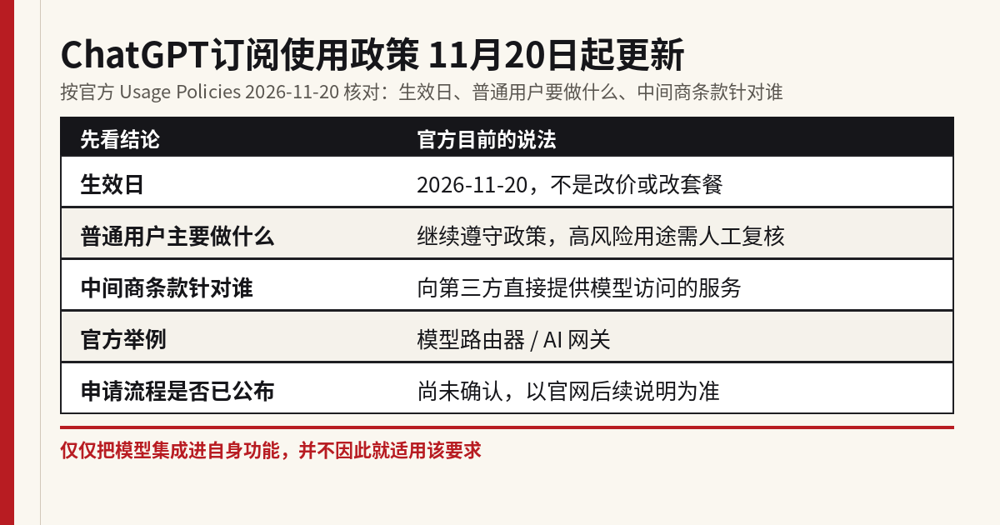

# ChatGPT订阅使用政策11月20日起更新，普通用户要改什么｜GPT20X

chatgpt订阅交了费，不等于使用时没有规则。OpenAI 的《使用政策》（Usage Policies）从 2026 年 11 月 20 日起按新版本生效，政策页页眉写明 Effective: November 20, 2026。这次改的是使用规则，不是套餐价格，也不是额度怎么计算。本文按 OpenAI 帮助中心、使用政策页，以及 2026 年 10 月 21 日发布的配套说明，在 2026-11-20 核对后，把普通个人订阅用户真正要看的部分分开整理：生效日、四项更新、「提供模型访问」针对谁，以及用模型或输出训练「替代模型」时的限制。正在考虑用人民币续费或新开通的人，可以先把政策要点看完，再决定要不要做 [GPT充值](https://gpt20x.com/chatgpt-plus)。本文由 GPT20X 根据官方原文整理，不是 OpenAI 官方内容，也不会把尚未公布的申请流程写成已经确定的步骤。

---

## 目录

1. 先看结论：今天生效，但不是涨价
2. 官方帮助中心怎么说
3. 「提供模型访问」原文和官方举例
4. 用模型或输出训练替代模型的限制
5. 儿童青少年保护与高风险用途
6. 普通 ChatGPT 订阅用户实际要做什么
7. 和开通、续费的关系
8. 常见误区
9. 相关教程
10. 官方来源

---

## 1. 先看结论：今天生效，但不是涨价

先把已经写进官方页面的内容压成一张表。官方还没公布的申请流程、审批标准或处理时限，一律标成「尚未确认」，不会按传闻补细节。

| 你想确认的事 | 官方目前的说法（2026-11-20 核对） |
|---|---|
| 生效日 | 2026-11-20；政策页页眉写 Effective: November 20, 2026 |
| 更新文本何时发布 | 使用政策页 changelog 日期为 2026-10-21；生效日仍是 11 月 20 日 |
| 是不是涨价或改套餐 | 不是。这次是使用政策更新，三篇来源都没有改写官方售价 |
| 普通个人订阅用户主要做什么 | 继续遵守使用政策；不要用模型或输出去训练替代模型；高风险自动决策需要人工复核 |
| 中间商条款针对谁 | 向第三方提供直接访问 OpenAI 模型的平台或服务；官方举例为 model routers（模型路由器）或 AI gateways（AI 网关） |
| 仅仅把模型集成进自己的应用功能，是否因此就要先审批 | 官方写明：并不仅仅因为应用把模型集成进自身功能，就适用这项要求 |
| 申请流程、审批标准、处理时限是否已公布 | 尚未确认；以官网后续说明为准 |
| 旧协议还算不算 | 帮助中心写明：现有协议及其他适用条款和政策继续适用，包括协议中已写明的明确许可 |

---

## 2. 官方帮助中心怎么说

OpenAI 帮助中心文章《我们正在更新使用政策》（We're updating our Usage Policies，编号 12092907）把这次更新概括成四项：

1. 澄清了已有限制：不得用 OpenAI 模型及其输出，去训练旨在作为 OpenAI 模型或服务替代品的模型。
2. 澄清了对儿童和青少年的保护，以及对高风险用途的要求。
3. 把已有的国家安全原则及其审批要求，纳入国家安全和执法用途。
4. 对模型访问中间商提出审批要求。

同一篇文章写明：这些更改于 2026 年 11 月 20 日生效；在此之前，仍适用上一版本。现有协议及其他适用条款和政策继续适用，包括适用协议中已写明的明确许可。

使用政策页的 changelog 在 2026-10-21 这一条里，把上述四点又写了一遍，并再次标明 These changes are effective November 20, 2026。也就是说，更新文本是 10 月 21 日发布的，生效日是 11 月 20 日。到 2026-11-20 核对，新版本已经生效。帮助中心还说明，他们偶尔更新这些规则，是为了避免限制过严，同时加强对用户的保护。本次核对只依据这三篇官方来源，不把法律博客或自媒体里的推断写成已确认事实。

---

## 3. 「提供模型访问」原文和官方举例

使用政策里专门有一段「向他人提供模型访问」（Providing access to our models）。按原文转述如下：

如果你运营的是模型访问中间商平台，或其他能让第三方直接访问 OpenAI 模型的服务，必须先获得 OpenAI 的事先审查和批准。

这项要求并不仅仅因为某个应用把 OpenAI 模型集成进去、用来驱动自身功能，就自动适用。

OpenAI 在 2026 年 10 月 21 日的说明《通过一致标准实现广泛访问》（Broad access through consistent standards）里，把需要事先审查和批准的对象举例为：提供直接访问其模型的服务，例如 model routers（模型路由器）或 AI gateways（AI 网关）。同一篇还写到，向他人提供 OpenAI 模型访问的合作伙伴，需要维持与官方一致的安全措施，调查潜在违规并采取适当行动，同时在执行上保持协调。

这里要按官方句子来理解「中间商」：指的是向第三方提供直接访问 OpenAI 模型的平台或服务；官方举例是模型路由器或 AI 网关。仅仅把模型集成进自己应用的功能，并不因此就适用该要求。

在本次核对使用的三篇官方来源里，没有看到申请表格、审批标准、处理时限，也没有看到所谓「祖父条款」或具体处罚细则。这些细节目前尚未确认，请以官网后续说明为准。本文只介绍官方已经写明的条文，不会自行判断某一类业务是否被这项条款覆盖，也不会把任何第三方说成已经获批或尚未获批。

---

## 4. 用模型或输出训练替代模型的限制

这是帮助中心四项更新里的第一项，政策正文写得更细。核心限制按原文转述是：

不得使用 OpenAI 模型或其输出，去生成、准备、选择或提供训练材料或训练信号，用于那些旨在作为 OpenAI 模型或服务的替代品或替代方案的模型。

按原文，这包括：

- 创建或准备训练数据、训练任务、评分细则（rubrics）或强化学习环境；
- 提供用于训练的反馈，包括标签、分数、排序、偏好、奖励或纠正；
- 选择、过滤或验证训练数据、任务或轨迹（trajectories）。

同时，不得试图通过未经授权的访问、逆向工程或规避安全措施，来提取受保护的推理过程（protected reasoning）。

这些限制的适用范围也写得很明确：无论你是自己做、为另一方做，还是通过他人代为操作，即使你本人并不训练最终那个模型，限制同样适用。产品使用或评测中产生的输出，如果后来被拿去用于上述训练目的，同样适用。

官方同时保留了边界内允许的用途：在上述边界内，你可以把 OpenAI 模型用于研究、软件开发、模型评估和基准测试，以及产品开发。这些限制也不禁止你与 OpenAI 的适用协议中已明确允许的用途，包括服务协议下的 Permitted Exception（允许的例外）。

哪些情况算「旨在作为替代品的模型」，官方在这三篇来源里没有再给出一份逐项清单，本文不会自行划线。拿不准的用途，以使用政策原文和你与 OpenAI 的适用协议为准。

---

## 5. 儿童青少年保护与高风险用途

帮助中心把第二项概括为：澄清对儿童和青少年的保护，以及对高风险用途的要求。细节以使用政策页为准，这里只做概括，完整规则请直接看官方政策，本文不把禁止清单逐条展开成渲染性描述。

关于未成年人：政策写明，服务不得被用来危害 18 岁以下的任何人，并单独写了对儿童性剥削相关内容的禁止，以及对向未成年人展示不宜内容等行为的限制。普通订阅用户需要知道的是：ChatGPT 订阅账号同样要遵守这些保护规则，不能因为已经付费就忽略。

关于高风险用途：政策不允许在没有人工复核的情况下，在敏感领域自动执行高风险操作。这包括会实质性影响一个人的权利、安全、基本服务获取或其他重大利益的行动、决定、交易、提交等步骤。官方点名的领域包括：

- 关键基础设施
- 教育
- 住房
- 就业
- 金融活动和信贷
- 保险
- 法律
- 医疗
- 基本政府服务
- 产品安全部件
- 国家安全、情报和执法
- 移民

帮助中心的第三项还提到：把已有的国家安全原则及其审批要求，纳入国家安全和执法用途。使用政策里相应写到，不得在未经 OpenAI 审查和批准的情况下，将服务用于国家安全、执法或情报目的。普通个人订阅用户一般不会遇到这类审批；若你的用途确实涉及这些领域，以官方政策原文和后续说明为准，本文不补充未公布的申请步骤。

---

## 6. 普通 ChatGPT 订阅用户实际要做什么

对大多数只是日常对话、写作或学习的 chatgpt订阅用户来说，这次更新并不是要你去提交一份「中间商许可」。官方把事先审查和批准的要求，写给向第三方提供直接访问模型的平台或服务，并举例为模型路由器或 AI 网关。个人用订阅账号使用 ChatGPT，和这项条款不是同一件事。

普通用户实际要做的，主要是继续把使用政策当作使用规则来遵守：

1. 继续遵守使用政策，不要用服务去从事政策已禁止的伤害、欺诈、规避安全措施等行为。
2. 不要把模型或输出拿去训练「替代 OpenAI 模型或服务」的模型，也不要为此准备数据、标注、排序或验证材料。若只是在边界内做研究、软件开发、评估或产品开发，政策写明这是允许的，但仍要停在上述边界之内。
3. 如果把 ChatGPT 用在教育、就业、金融、医疗、法律等敏感领域的自动决策上，需要有人工复核，不能把系统输出直接当成最终决定。
4. 这不是要求普通个人用户去申请中间商许可。申请流程目前也尚未由官方公布。

付了费，只是开通了对应套餐的功能，并不等于获得额外的政策豁免。帮助中心也提醒：现有协议和其他适用条款继续有效，包括协议里已经写明的明确许可。

---

## 7. 和开通、续费的关系

这次更新不等于改套餐价格，也不等于改额度怎么计算。帮助中心这篇更新说明、使用政策页和 10 月 21 日的配套说明，都没有改写官方售价，也没有宣布新的个人套餐档位。不要把「政策生效」理解成「要重新付款」或「旧订阅作废」。

如果你只是按原计划续费或新开通 chatgpt订阅，需要额外做的，是把新版使用政策看一眼，确认自己的用法没有踩到训练替代模型、高风险自动决策、未成年人保护这些已经写清的规则。开通或续费本身，不会自动变成中间商审批。

用支付宝、微信等人民币方式开通时，同样要先看清官方规则，再决定支付方式；也不要把第三方页面上的套餐名或宣传，直接当成 OpenAI 官方政策。ChatGPT 对账号使用地区有要求，开通前建议先看一下 OpenAI 官方的支持地区说明。

---

## 8. 常见误区

**误区 1：这是一次涨价。**  
不是。这是使用政策更新。2026-11-20 核对的三篇官方来源，都没有把这次更新写成改价或改套餐档位。

**误区 2：所有用了 OpenAI 模型的应用，都要先申请中间商许可。**  
官方明确写了例外口径：并不仅仅因为应用把模型集成进自身功能，就适用这项要求。需要事先审查和批准的，是向第三方提供直接访问模型的平台或服务，官方举例为模型路由器或 AI 网关。

**误区 3：普通个人订阅用户也要去申请批准。**  
官方没有这样写。个人遵守使用政策，和中间商平台需事先审批，是两条不同的要求。

**误区 4：申请表格、审批标准和处理时限已经对外公布。**  
在本次核对使用的三篇官方来源里，没有看到申请表、审批标准、处理时限或祖父条款。这些目前尚未确认，请以官网后续说明为准。不要把非官方解读里的推断当成已确认事实。

**误区 5：10 月 21 日发布更新，等于当天就已经生效。**  
changelog 日期是 2026-10-21，写的是发布这次更新；生效日是 2026-11-20。帮助中心也写了：在生效日之前，仍适用上一版本。到今天核对，新版本已经生效。

**误区 6：新政策一生效，以前签过的协议就全部作废。**  
不是。帮助中心写明：现有协议及其他适用条款和政策继续适用，包括适用协议中已写明的明确许可。使用政策正文也写了，限制并不禁止协议中已明确允许的用途。

**误区 7：完全不能把输出用于研究或评测。**  
官方允许在上述边界内，把模型用于研究、软件开发、模型评估和基准测试，以及产品开发。被限制的是：用模型或输出去训练旨在替代 OpenAI 模型或服务的模型，以及为这类训练准备材料或信号。两者不要混为一谈。

---

## 9. 相关教程

- [ChatGPT 订阅怎么管：订阅在哪个平台、怎么看状态、取消与防重复扣费](https://amber-moose-14.github.io/chatgpt-daichong-guide/chatgpt-dingyue-guanli-quxiao-2026.html)
- [ChatGPT 会员怎么选：Go / Plus / Pro 对照](https://amber-moose-14.github.io/chatgpt-daichong-guide/chatgpt-huiyuan-zenme-xuan-2026.html)
- [chatgpt会员额度12月会和Codex共享吗](https://amber-moose-14.github.io/chatgpt-daichong-guide/chatgpt-huiyuan-codex-gongxiang-2026.html)
- [ChatGPT Plus 充值怎么选：谁适合月付](https://amber-moose-14.github.io/chatgpt-daichong-guide/chatgpt-plus-chongzhi-yuefu-2026.html)
- [ChatGPT 代充用支付宝 / 微信怎么付](https://amber-moose-14.github.io/chatgpt-daichong-guide/chatgpt-daichong-zhifubao-weixin-2026.html)

---

## 10. 官方来源

- [OpenAI 帮助中心：我们正在更新使用政策（We're updating our Usage Policies）](https://help.openai.com/en/articles/12092907-were-updating-our-usage-policies)（2026-11-20 核对：四项更新摘要；更改于 2026-11-20 生效；此前适用上一版本；现有协议及明确许可继续适用）

- [OpenAI 使用政策（Usage policies）](https://openai.com/policies/usage-policies)（页眉 Effective: November 20, 2026；提供模型访问的事先审批要求，以及「仅仅集成到自身功能并不因此适用」；训练替代模型的限制；儿童青少年保护与高风险用途；changelog 2026-10-21 发布、2026-11-20 生效）

- [OpenAI：通过一致标准实现广泛访问（Broad access through consistent standards）](https://openai.com/index/broad-access-through-consistent-standards/)（2026-10-21：使用政策于 2026-11-20 生效；对提供直接访问的服务如 model routers 或 AI gateways 须先审查批准；合作伙伴需维持一致的安全措施并协调执行）

> 非 OpenAI 官方内容。使用政策仍可能再次更新，申请流程等未公布细节以官网后续说明为准。请以 OpenAI 帮助中心、使用政策页和你账号里的提示为准。

---

*最后更新：2026-11-20*　｜　[返回教程首页](README.md)　｜　本文由 [GPT20X](https://gpt20x.com/) 整理
