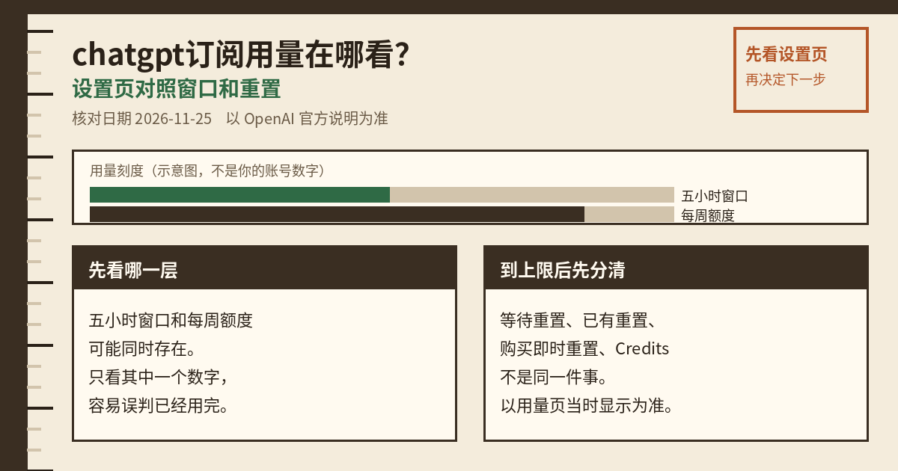

# chatgpt订阅用量在哪看？设置页对照窗口和重置｜GPT20X

chatgpt订阅开通之后，最常见的困扰不是套餐名字，而是用量页读不懂：你以为额度已经用完，其实只是某一层窗口到了。若你正在考虑[ChatGPT充值](https://gpt20x.com/)，建议先打开官方的「设置 → 用量」，看清还剩多少、何时重置，再决定下一步。本文按 OpenAI 英文帮助中心在 2026-11-25 的核对，整理用量页怎么看、五小时和每周窗口如何并存，以及重置和 Credits 有何不同。具体以官方页面和账号当时显示为准。

ChatGPT 对账号使用地区有要求，开通前建议先看一下 OpenAI 官方的支持地区说明。

## 先看结论：先读用量页，再决定等、换还是买

先把今天能核对的内容压成一张表。帮助中心没写的，一律标成「尚未确认」。

| 你想确认的事 | 官方目前的说法（2026-11-25 按英文帮助中心核对） |
|---|---|
| 个人账号先看哪里 | 打开「设置 → 用量」（Settings → Usage），查看剩余额度和重置时间 |
| 已保存重置在哪用 | 桌面是 Settings > Usage & billing，网页是 Usage settings；移动应用目前没有这项操作 |
| 12 月起哪些套餐共享用量 | Plus、Pro、Business 将在 ChatGPT 和 Codex 之间共享；Free、Go、Enterprise、Edu 是否同样合并尚未确认 |
| 即时聊天 | 英文原文：Instant chat will not draw from your usage。意思是即时聊天不会消耗这笔用量额度 |
| 五小时和每周窗口 | 视套餐而定，两者可能同时存在；都适用时，两边都要有剩余才能继续 |
| Pro 100 / 200 / 500 | 目前在「工作」和 Codex 没有五小时限额，但仍有套餐内含用量；不要理解成无限 |
| 到上限后怎么选 | 等待重置、升级套餐，或购买 Credits 以继续使用适用功能；符合条件时还可能使用已保存重置或购买即时重置 |

12 月共享规则的完整说明见已发布对照教程。本页只解决：用量页怎么看，以及到上限后这几条路分别是什么。

## 用量页在哪里打开

日常查看入口写在 Settings → Usage。登录要核对的那个 ChatGPT 账号，打开设置再进入「用量」，应能看到剩余量和重置时间。若还没切到合并视图，以当时实际显示为准，不要把「暂时看不到某项」理解成规则已经取消。

处理已保存重置或购买即时重置时，入口更细：桌面打开 Settings > Usage & billing，网页打开 Usage settings。这项操作目前在移动应用里不可用。若只在手机里找不到「1 reset available」「Full reset」或「Buy an instant reset」，先改到桌面或网页再判断。

在「工作」或 Codex 里接到用量提示时，也先回到用量页，分清是五小时限额、每周限额，还是内含用量已经用完。切换模型不会在共享用量池里把额度补回来。

## 五小时窗口、每周窗口和套餐内含用量怎么区分

英文说明写的是：视套餐而定，用量限制可能同时覆盖五小时窗口和每周窗口。两者都适用时，必须两边都还有剩余，才能继续在「工作」或 Codex 里使用内含用量。

五小时窗口决定每个窗口里包含多少用量。上一个窗口结束后，你在「工作」或 Codex 发出第一条消息时，才会开始新窗口。你也可能在五小时尚未走完之前就达到限额，即使每周用量仍有剩余。每周限制控制每周周期内的内含工作量，结束时间也可以不同。如果只有一层是满的、另一层已经见底，不要只看其中一个数字。

套餐内含用量要单独看。帮助中心写明：Pro 100、Pro 200 和 Pro 500 目前在「工作」和 Codex 没有五小时限额，但英文紧接着写了 Your plan still has an included usage allowance，意思是套餐仍有内含用量。没有五小时窗口，不等于可以不限量使用。

从 12 月起，Plus、Pro 和 Business 还将在 ChatGPT 和 Codex 之间共享用量，并以 token 计量；更强的模型和更复杂的任务通常会更快接近上限。即时聊天不会消耗这笔用量，但不要把这句话理解成所有对话都不计入。用量页若出现 App limits，那是给连接应用设置的每周上限，是封顶而不是另给一包额度。

## 到上限之后：等待、已有重置、即时重置和 Credits 不是同一回事

这几条路不要混成同一种充值。

| 选项 | 它实际做什么 | 今天能核对的限定 |
|---|---|---|
| 等待自动重置 | 等用量页显示的下次重置时间到来 | 重置时间以用量页为准，不要自行推算 |
| 使用已保存重置 | 把已经存在账号里的重置拿来用，恢复其覆盖且符合条件的额度 | 收到重置不等于已经刷新用量；移动应用目前不能操作；所覆盖额度至少要有一项剩余不足 80%，否则会提示暂不需要并继续保留 |
| 购买即时重置 | 结账成功后立即恢复适用的五小时和每周用量 | 只面向符合条件的个人 Plus 和 Pro；Free、Go、Business、Enterprise、Edu 不可买；同套餐也不保证都有入口；购买后立即生效，不能预存，并会改写每周周期 |
| 购买 Credits | 套餐内含用量用完后，为适用功能支付按量额度 | 能不能买、能用在哪些功能，以用量页当时显示为准 |
| 升级套餐 | 换到更高档或调整 Pro 档位 | 会不会立刻扩大当前周期剩余量，以换档时的账号提示为准 |

一次完整已保存重置大概覆盖：Go 主要是月度额度；Plus 和 Business Standard 是五小时和每周额度；Pro 100、200 和 500 是每周额度。低于 100% 的被覆盖额度会回到 100%；已经是 100% 的那一层不会因此重新计时。已保存重置是酌情发放的促销权益，不保证每个账号都有。

购买即时重置则把正常的每周额度提前，而不是另外加一包额度。新的每周周期从重置后第一次「工作」或 Codex 请求开始计算，下一次自动重置是这次请求之后的 7 天，不一定是付款后的 7 天。只用尽五小时限额，不会弹出付费重置横幅。官方写明这类购买一般不退款，本页也不列出未在结账页核对的价格。

Credits 不是重置，重置也不会变成 Credits 余额。先确认看的是正确账号并刷新用量页，不要为了测试再使用或再购买一次重置。

## 不同使用情况怎么处理

**主要用即时聊天的人。** 即时聊天不会消耗这笔用量额度。若几乎只在普通即时对话里使用，先分清提示是不是来自「工作」、Codex 或其他会消耗内含用量的功能，再决定要不要换档。

**同时使用「工作」和 Codex 的人。** 先看清是五小时窗口到了，还是每周额度到了。只到五小时窗口时，更宜等待重置或查看已保存重置，不要理解成必须立刻购买即时重置。

**Plus 用户。** 五小时和每周窗口可能同时存在。使用已保存重置前，先看它覆盖哪一层、何时到期，以及剩余是否已低于 80% 门槛。能不能购买即时重置，以用量设置里实际出现的选项为准。

**Pro 100 / 200 / 500 用户。** 目前在「工作」和 Codex 没有五小时限额，但仍有套餐内含用量；已保存的完整重置主要恢复每周额度。看到提示时优先看每周剩余，不要推论现在没有任何限制。

**经第三方渠道开通的人。** 用量、重置和 Credits 入口都属于被开通的那个 ChatGPT 账号，请登录同一账号查看。本文由 GPT20X 按公开说明整理，只供对照，不替代官方页面或结算页。

## 常见问题

**用量页暂时看不到合并后的剩余量，是不是 12 月规则取消了？**  
不是。官方写的是从 12 月起共享，并提到一小部分账号可能提前看到变化。暂时看不到合并视图，不能理解成规则已取消。

**我换了一个更轻的模型，额度会不会立刻回来？**  
不会。切换模型不会在共享用量池里恢复额度。若已经到达某一层限额，应到用量页查看是哪一层、何时重置。

**账号里显示还有重置，为什么点不了？**  
先确认你在桌面或网页操作，而不是在移动应用里找。所覆盖额度至少要有一项剩余不足 80%，否则会提示当前还不需要重置，并继续为你保留。

**五小时到了，但没有弹出购买即时重置的横幅，是不是入口坏了？**  
不一定。那条付费横幅由每周额度用尽触发，而不是只由五小时限额触发。有没有「Buy an instant reset」，因账号和账单国家而异。

**买了即时重置，为什么下周重置日期变了？**  
这是官方写明的预期结果。新周期从重置后第一次「工作」或 Codex 请求开始，下一次自动重置是这次请求之后 7 天。

## 相关教程

- [chatgpt会员额度12月会和Codex共享吗](https://amber-moose-14.github.io/chatgpt-daichong-guide/chatgpt-huiyuan-codex-gongxiang-2026.html)
- [ChatGPT Plus充值后怎么买Credits](https://amber-moose-14.github.io/chatgpt-daichong-guide/chatgpt-plus-credits-jifen-2026.html)
- [ChatGPT Pro充值前必读：额度怎么算](https://amber-moose-14.github.io/chatgpt-daichong-guide/chatgpt-pro-chongzhi-edu-guize-2026.html)

## 官方来源

- [了解 ChatGPT 和 Codex 的用量限制（Understanding ChatGPT and Codex usage limits）](https://help.openai.com/en/articles/20001625-understanding-chatgpt-and-codex-usage-limits)。说明 12 月起的共享范围、即时聊天是否计入，以及用量页入口。
- [在「工作」和 Codex 中管理 GPT-6 Astra 用量（Managing usage with GPT-6 Astra in Work and Codex）](https://help.openai.com/en/articles/20001516-managing-usage-with-gpt-6-astra-in-work-and-codex)。说明五小时与每周窗口如何并存，以及 Pro 档目前没有五小时限额、但仍有内含用量。
- [Codex 重置如何运作（How resets work in Codex）](https://help.openai.com/en/articles/20001498-how-resets-work-in-codex)。说明三类重置的区别，以及桌面、网页和移动应用入口上的限定。

> 本页为 [GPT20X](https://gpt20x.com/) 整理，非 OpenAI 官方内容。价格、额度和政策以 OpenAI 官方和结账页为准。

*最后更新：2026-11-25*
