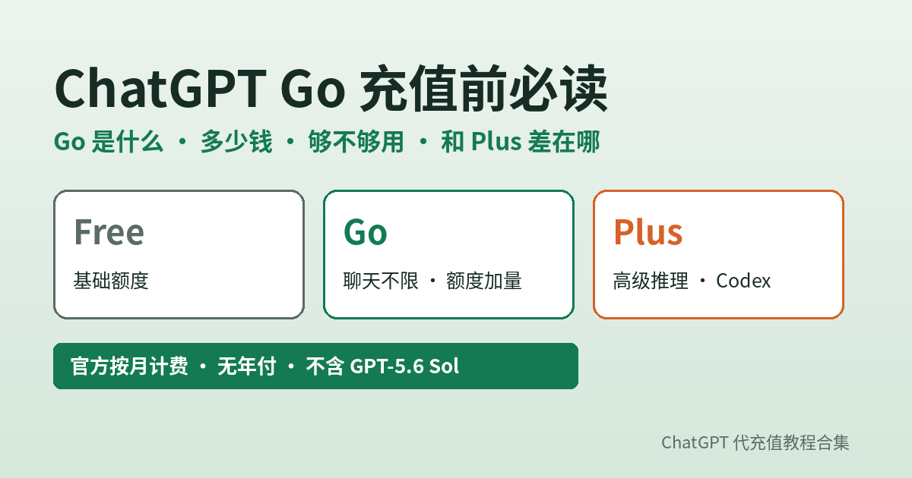

# ChatGPT Go 充值前必读：Go 是什么、多少钱、够不够用、和 Plus 差在哪 + 国内开通

**简短回答：** **ChatGPT Go** 是 OpenAI 的**低价付费档**，定位在 Free 和 Plus 之间：日常文字聊天和 Free 一样不限次数，但作图、传文件、数据分析的额度比 Free 高，记忆和上下文更长，还能用 Projects、任务和自定义 GPT。它**不包含 GPT-5.6 Sol**，也**不能用 4o 等旧模型**；官方**按月自动扣费，没有年付**，美国价为 $8/月、部分国家是本地化定价，实际以结账页为准。如果你主要是「每天聊聊、偶尔作图和看文件」，Go 往往够用；要写长文、做深度研究、经常写代码，直接看 Plus 更省事。以上以 [OpenAI 帮助中心：What is ChatGPT Go?](https://help.openai.com/en/articles/11989085-what-is-chatgpt-go) 为准（2026-11-11 核对）。

---

## 目录

1. ChatGPT Go 是什么：一句话定位
2. Go 包含什么、不包含什么
3. Go 多少钱：官方价与国内参考价
4. Go 和 Free、Plus 差在哪（对照表）
5. 谁适合 Go，谁应该直接上 Plus
6. 从 Plus / Pro 降到 Go 会怎样
7. 国内充值开通 Go：分步骤
8. 开通后怎么确认是 Go
9. Go 充值前自查清单
10. 常见问题

---

## 1. ChatGPT Go 是什么：一句话定位

Go 的官方定义是「低价订阅档，扩展 ChatGPT 功能的使用」。现在 Go 已经在**所有支持 ChatGPT 的国家和地区**开放。

可以把它理解成「**Free 的加量版**」，而不是「便宜版 Plus」。这两个说法差别很大：

- 「Free 加量版」：用的模型和 Free 接近，主要是**额度更高、记忆更长、多了 Projects 等功能**；
- 「便宜版 Plus」：这是很多人的误会。Plus 有的高级推理模型 GPT-5.6 Sol，Go **没有**。

所以买 Go 之前要先想清楚：你要的是「**用得更多**」，还是「**用得更强**」。前者 Go 合适，后者要看 Plus。

---

## 2. Go 包含什么、不包含什么

以下整理自 [What is ChatGPT Go?](https://help.openai.com/en/articles/11989085-what-is-chatgpt-go)（2026-11-11 核对），具体额度官方没有公布固定数字，会随负载调整。

| 项目 | Go 是否有 | 说明 |
|---|---|---|
| 日常文字聊天 | ✅ 不限次数 | 和 Free 一样不限，仍受防滥用规则约束 |
| 作图 | ✅ 额度高于 Free | 「扩展的图片生成」 |
| 文件上传与分析 | ✅ 额度高于 Free | 文档、表格等 |
| 数据分析（Python） | ✅ 额度高于 Free | 高级数据分析用得更频繁 |
| 记忆与上下文 | ✅ 更长 | 个性化回答更连贯 |
| Projects、任务、自定义 GPT、Library | ✅ | 受功能开放情况和存储上限限制 |
| Think 推理 | ✅ | 网页和手机端可用，Think 使用 **GPT-5.6 Luna** |
| GPT-5.6 Sol | ❌ | 官方写明 Go 不包含 |
| 4o 等旧模型 | ❌ | 官方写明 Go 不包含旧模型 |
| API 额度 | ❌ | API 单独计费，和 Go 订阅无关 |
| 部分高级产品 / 插件 | ⚠️ 视情况 | 官方说有些能力需要 Plus 或更高档 |

还有两点容易忽略：

- **广告测试**：官方写明，部分地区正在对符合条件的 Go 用户**测试广告**。介意的话开通前留意一下。
- **语音**：Go 帮助页写的是语音额度与 Free 相同；而 [ChatGPT Voice 帮助页](https://help.openai.com/en/articles/20001274-chatgpt-voice) 的表格写的是 Go 每滚动 24 小时 **3 小时 GPT-Live-1.1 Quip**、Plus 为 3 小时 GPT-Live-1.1。两页表述不完全一致，**以账号内实际显示为准**。

---

## 3. Go 多少钱：官方价与国内参考价

**官方价：** OpenAI 在 [Go 全球上线公告](https://openai.com/index/introducing-chatgpt-go/) 里写的是**美国价 $8/月**，并注明「Go 在部分市场为本地化定价」。帮助中心说明 Go 以美元结算、少数国家支持本地货币，**价格可能随时调整**，实际金额看 [ChatGPT 定价页](https://chatgpt.com/pricing/) 和结账页。计费方式是**按月自动续费、随时可取消**，官方 Go / Plus / Pro **都不支持年付或多月预付**。

**国内代开通参考价（GPT20X 公开页面，2026-11-11 核对，以下单页实时显示为准）：**

| 套餐 | 官方价 | GPT20X 价格 | 时长 |
|---|---|---|---|
| Go | $8/月（美国价，其他地区以官方为准） | ¥79 | 30 天 |
| Plus 月付 | $20/月 | ¥168 | 30 天 |
| Plus 年付 | 官方无年付 | ¥1988 | 一年 |
| Pro（三档） | $100 / $200 / $500 每月 | ¥818 / ¥1480 / ¥3880 | 30 天 |

一个直观的算法：Go 和 Plus 月付的差价是 **¥89 / 30 天**，大约每天 3 元。如果每天真的要用到 Sol 推理、深度研究或者 Codex，这 3 元基本都值；如果只是聊天、问问题、偶尔做张图，Go 省下来的钱更实在。

---

## 4. Go 和 Free、Plus 差在哪（对照表）

| 维度 | Free | Go | Plus |
|---|---|---|---|
| 日常文字聊天 | 不限 | 不限 | 不限（高峰期优先） |
| 作图 / 文件 / 数据分析 | 基础额度 | 高于 Free | 再高一档（「Expanded」） |
| 高级推理模型 | 有限 | Think（GPT-5.6 Luna），**无 Sol** | 含 GPT-5.6 Sol 等高级推理 |
| 深度研究 | 有限 | 以官方为准 | 扩展额度 |
| Codex | 以官方为准 | 以官方为准 | 扩展 Codex 用量 |
| Projects / 自定义 GPT | 部分 | ✅ | ✅（另含定时任务等） |
| 官方月价 | 免费 | $8（美国价） | $20 |

表里「以官方为准」的格子，是官方帮助页没有写死、或者会随版本变化的地方。定价页把 Plus 写成「在 Go 的基础上」增加高级推理、扩展深度研究、Projects 和定时任务、扩展 Codex 用量等，所以**凡是「重推理、重研究、写代码」的需求，Go 都不是最佳选择**。Codex 各档的具体区别可以看[《Codex 代充前必读》](https://amber-moose-14.github.io/chatgpt-daichong-guide/codex-daichong-yongliang-kaitong-2026.html)。

---

## 5. 谁适合 Go，谁应该直接上 Plus

**适合 Go 的人：**

- 每天用 ChatGPT 聊天、查资料、翻译、改改文案，Free 常被作图或上传文件额度卡住；
- 学生、家长、轻办公用户，主要需求是「多传几个文件、多做几张图」；
- 想先付费体验一个月，预算有限，不确定自己会不会重度使用。

**应该直接看 Plus 的人：**

- 要写论文、长报告，需要 GPT-5.6 Sol 这类高级推理；
- 经常用深度研究、定时任务；
- 要用 Codex 写代码，或者想用 ChatGPT Work；
- 依赖某个旧模型（Go 不提供旧模型）。

**还拿不准？** 用 Free 正常用一周，记下自己被「额度用完」挡住了几次、挡在哪个功能上：

- 挡在作图、文件上 → Go 能解决；
- 挡在推理模型、深度研究上 → Go 解决不了，选 Plus；
- 几乎没被挡 → 继续用 Free 也行。

### 按场景估一估：一周下来 Go 够不够

| 你的一周 | Go 够不够 | 理由 |
|---|---|---|
| 每天问答、翻译、写朋友圈和邮件 | 够 | 文字聊天不限次数，这是 Go 的强项 |
| 每周做十几张配图、海报草稿 | 多半够 | 作图额度高于 Free，但不是无限，高峰期可能变慢 |
| 每天上传 PDF、表格让它总结 | 多半够 | 文件上传和数据分析额度都高于 Free |
| 写毕业论文、长篇报告，反复改结构 | 偏紧 | 需要更强推理和更长的稳定输出，Plus 的 Sol 更合适 |
| 每周跑几次深度研究 | 不够 | 深度研究的扩展额度在 Plus |
| 用 Codex 改代码、跑任务 | 不够 | 扩展 Codex 用量写在 Plus 权益里 |

### 三个常见误区

**误区 1：Go 就是便宜一半的 Plus。** 不是。Go 解决的是「次数和额度」，不是「模型强度」。Sol 这类高级推理模型 Go 没有，拿 Go 去写复杂代码或做长推理，体验会和 Plus 有明显差距。

**误区 2：Go 不限聊天，就等于什么都不限。** 官方说的「不限」只针对日常文字聊天，作图、文件、数据分析仍有上限，而且所有档位都受防滥用规则和高峰期临时限制约束。

**误区 3：先买 Go，不够再说，反正可以随时升级。** 升级确实随时可以，但代开通通常按 30 天计，中途升 Plus 等于两份钱都花了。如果你已经能确定要用深度研究或 Codex，一开始就选 Plus 更划算。

Go / Plus / Pro 三档的整体选型思路见[《ChatGPT 会员怎么选》](https://amber-moose-14.github.io/chatgpt-daichong-guide/chatgpt-huiyuan-zenme-xuan-2026.html)。

---

## 6. 从 Plus / Pro 降到 Go 会怎样

很多人是「Plus 用不完，想降到 Go 省点钱」。官方说明是（来源同上）：

1. 在 ChatGPT 里点头像 → **Settings → Account** 管理或更改订阅；
2. **降级不退差价**：当前 Plus / Pro 会保留到本计费周期结束，到期后账号切换到 Go，之后按 Go 的价格扣费；
3. 降到 Go 后，**Sol 和旧模型就用不了了**，依赖这些模型的 GPT 或对话要提前想好替代方案。

如果当初是在 iPhone 或安卓上订阅的，改套餐要去 Apple / Google Play 的订阅管理里操作，详见[《ChatGPT 订阅怎么管》](https://amber-moose-14.github.io/chatgpt-daichong-guide/chatgpt-dingyue-guanli-quxiao-2026.html)。走代开通的，到期后不续、改买 Go 即可，**不用另开新账号**。

---

## 7. 国内充值开通 Go：分步骤

**官方自付：** 登录 ChatGPT → 头像 → **Upgrade Plan** → 选 **Try Go**，用当地支持的付款方式付款。付款方式因国家而异，没有可用的境外卡就会卡在这一步。自付被拒的排查见[《Your card was declined 怎么办》](https://amber-moose-14.github.io/chatgpt-daichong-guide/card-declined-fix.html)。

**国内代开通（以支付宝 / 微信为例）：**

1. **确认账号**：用浏览器登录你要开通 Go 的 ChatGPT 账号，在 Settings → Account 看一眼邮箱，浏览器里登了多个账号的先退出多余的；
2. **查旧订阅**：之前在 Apple / Google Play 订过 Plus 或 Go 的，先在原平台取消，避免两份同时扣费；
3. **选套餐下单**：在 [gpt20x.com](https://gpt20x.com/) 选「ChatGPT Go」（页面写 ¥79/30 天），用支付宝或微信付款，填一个能收通知的手机号或邮箱；
4. **验证订单兑换码**：付款后拿到本站订单兑换码，按[代开通流程说明](https://gpt20x.com/blog/chatgpt-plus-pro-recharge-guide)进入自助页面验证，**核对页面显示的套餐是 Go**、账号是自己的；
5. **提交并等待**：提交后不要用同一个兑换码反复提交；平台页面写明**全程无需提供账号密码**、**充值失败支持退款**；
6. **刷新确认**：处理完成后退出重登 ChatGPT，按第 8 节核对。

卡密兑换的细节和兑换失败的情况，见[《GPT 代充卡密怎么兑换？》](https://amber-moose-14.github.io/chatgpt-daichong-guide/gpt-daichong-kami-duihuan-2026.html)；挑平台的方法见[《ChatGPT 代充怎么选？》](https://amber-moose-14.github.io/chatgpt-daichong-guide/choose-daichong-platform.html)。

---

## 8. 开通后怎么确认是 Go

- **看套餐名**：Settings → Account（或 My Plan）显示 **Go**，而不是 Free 或 Plus；
- **看模型**：模型选择器里有 Think，但没有 Sol，这是正常的 Go 表现，不是开错了；
- **App 没变**：官方说明通过 App Store / Play 订阅的，升级可能要等几分钟，重启 App 即可；网页没变就退出重登，检查是不是登错了账号（Google / Apple / 邮箱登录可能是不同账号）；
- **记到期日**：代开通一般按 30 天计，到期前 1–2 天决定续不续。GPT20X 的价格指南写明其自助充值订单**通常是单次购买、不会默认连续扣款**，以商品页和订单页说明为准。

---

## 9. Go 充值前自查清单

- [ ] 已确认自己要的是「用得更多」而不是「用得更强」
- [ ] 知道 Go 不含 GPT-5.6 Sol 和旧模型，日常不依赖它们
- [ ] 知道官方 Go 没有年付，价格以结账页为准
- [ ] 已在 Settings → Account 确认要开通的账号邮箱
- [ ] Apple / Google Play 上没有还在扣费的旧订阅
- [ ] 代开通平台写明开通到自己账号、不要密码、失败可退款
- [ ] 下单页套餐名是「Go」，时长和价格已核对
- [ ] 订单号、兑换码、付款记录已保存，记下到期日

---

## 10. 常见问题

**Q：ChatGPT Go 和 Plus 最大的区别是什么？**  
最大的区别是模型和深度功能。Go 有 Think（GPT-5.6 Luna）但没有 GPT-5.6 Sol，深度研究、定时任务、Codex 等扩展额度主要在 Plus。只是聊天、作图、传文件，Go 往往够用。

**Q：Go 聊天真的不限次数吗？**  
官方写的是「日常文字聊天不限次数」，Free 也一样；但仍受防滥用规则约束，高峰期可能临时限制。作图、文件、数据分析是有额度的，只是比 Free 高。

**Q：Go 能年付吗？**  
官方不能。帮助中心写明 Go、Plus、Pro 目前都不支持年付或多月预付，按月自动扣费。

**Q：我现在是 Plus，降到 Go 会退钱吗？**  
不会。Plus 保留到本期结束，之后切换为 Go 并按 Go 价格扣费。

**Q：Go 包含 API 吗？**  
不包含。API 是单独计费的，和 ChatGPT 订阅不是一回事。

**Q：代开通 Go 之后多久能用？怎么查进度？**  
多数订单提交后较短时间内完成，遇到系统繁忙会更久。可以带订单号[用订单号查询开通进度](https://gpt20x.com/query)，长时间没变化再联系客服（每天 8:00–24:00）。

---

## 参考来源

- [OpenAI 帮助中心：What is ChatGPT Go?](https://help.openai.com/en/articles/11989085-what-is-chatgpt-go)（Go 包含与不包含的功能、Think 使用 GPT-5.6 Luna、无 Sol 和旧模型、广告测试、按月计费无年付、降级不退款、API 不含）
- [OpenAI：Introducing ChatGPT Go, now available worldwide](https://openai.com/index/introducing-chatgpt-go/)（美国价 $8/月、部分市场本地化定价）
- [ChatGPT 定价页](https://chatgpt.com/pricing/)（Plus 在 Go 基础上增加的功能）
- [OpenAI 帮助中心：What is ChatGPT Plus?](https://help.openai.com/en/articles/6950777-what-is-chatgpt-plus)（Plus $20/月按月计费、无年付）
- [OpenAI 帮助中心：ChatGPT Voice](https://help.openai.com/en/articles/20001274-chatgpt-voice)（各套餐语音额度）
- GPT20X 首页及 Go、Plus 月付、Plus 年付公开页面（人民币价格，2026-11-11 核对）

> 本文为个人整理，非 OpenAI 官方内容。价格、额度和功能会变化，请以 OpenAI 帮助中心、账号内显示和结账页为准。

---

*最后更新：2026-11-11*　｜　[返回教程首页](README.md)
