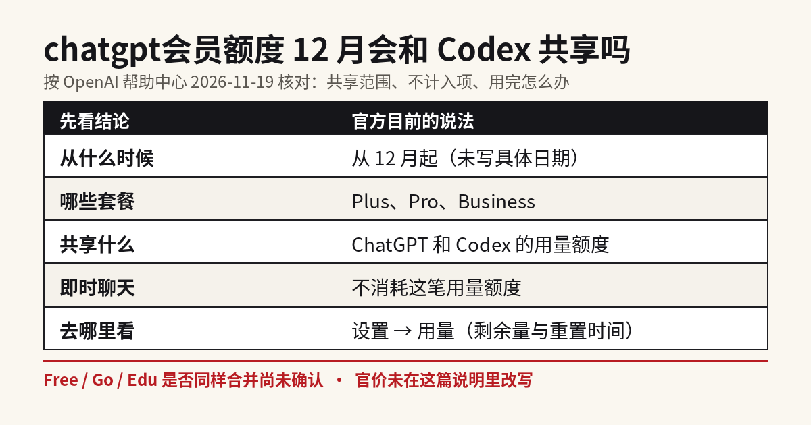

# chatgpt会员额度12月会和Codex共享吗｜GPT20X

chatgpt会员从 12 月起，用量额度还会不会分开计算？OpenAI 帮助中心《了解 ChatGPT 和 Codex 的用量限制》（Understanding ChatGPT and Codex usage limits）写明：从 12 月起，随着把工作模式的智能体能力融入 ChatGPT 的主要使用体验，Plus、Pro 和 Business 套餐的用量额度将在 ChatGPT 和 Codex 之间共享。本文按该说明的中文页和英文页（2026-11-19 核对，两边表述一致）把已经写清的规则、明确不计入的部分，以及官方还没给出日期或数字的地方分开整理。若你还在考虑用人民币开通或升级 [GPT会员](https://gpt20x.com/chatgpt-plus)，建议先把这条额度规则看完，再决定要不要换档。

需要提前说明两点：第一，官方只写了「从 12 月起」，**没有写 12 月的哪一天**，本文不会自行补一个日期；第二，帮助中心点名的是 Plus、Pro 和 Business，Free、Go、Enterprise、Edu 是否同样合并，**尚未确认**，不要把下面的对照直接套到这些套餐上。

---

## 目录

1. 先看结论：会共享，但即时聊天不计入
2. 官方帮助中心怎么说
3. 哪些 chatgpt会员套餐会受影响
4. 什么会消耗额度，什么不会
5. 用量怎么计量，为什么有时扣得更快
6. 剩余额度和重置时间在哪里看
7. 额度用完了怎么办
8. 要不要为此提前升级或重新开通
9. 常见问题
10. 官方来源

---

## 1. 先看结论：会共享，但即时聊天不计入

先把官方已经写明的内容压成一张表，对号入座后再看细节。没有写进帮助中心的，一律标成「尚未确认」。

| 你想确认的事 | 官方目前的说法（2026-11-19 核对） |
|---|---|
| 从什么时候开始 | 从 12 月起；没有写具体日期 |
| 哪些套餐会共享 | Plus、Pro、Business |
| 共享范围 | 用量额度在 ChatGPT 和 Codex 之间共享 |
| 怎么计量 | 以 token（词元）计量；消耗多少取决于你选择的模型和任务 |
| 即时聊天 | **不会消耗**用量额度 |
| 在哪里查看 | 「设置 → 用量」，可查看共享的剩余用量额度及重置时间 |
| 达到上限后怎么办 | 等待额度重置、升级套餐，或购买额度以继续使用适用功能 |
| 对大多数人的影响 | 官方预计，大多数用户无需比现在更频繁地等待重置 |
| 有没有改官方售价 | 这篇说明没有改价格；个人套餐官价见下文已核对数字 |

---

## 2. 官方帮助中心怎么说

这条规则写在帮助中心专题页，不是一条单独的涨价或新套餐公告。中文页标题是《了解 ChatGPT 和 Codex 的用量限制》，英文页是 *Understanding ChatGPT and Codex usage limits*，编号同为 20001625。2026-11-19 核对两页时，关键表述是对齐的。

中文页把调整原因和范围写成：从 12 月起，随着将工作模式的智能体能力融入 ChatGPT 的主要使用体验，Plus、Pro 和 Business 套餐的用量额度将在 ChatGPT 和 Codex 之间共享。英文页对应表述是：Starting in December, Plus, Pro, and Business plans’ usage allowance will be shared across ChatGPT and Codex as we bring the agentic capabilities of Work into the main ChatGPT experience.

同一页还写了计量方式、即时聊天不消耗额度、大多数用户不必更频繁等待重置，以及到「设置 → 用量」查看合并后的剩余额度和重置时间。达到上限后的三种办法（等待重置、升级套餐、购买额度以继续使用适用功能）也写在同一段里。

这篇说明没有给出 12 月的具体日期，也没有列出各套餐的 token 配额数字。下面凡是帮助中心没写清的，都会直接标「尚未确认」，不会按传闻补数字。

---

## 3. 哪些 chatgpt会员套餐会受影响

按帮助中心已经点名的范围：

- **Plus**：在共享名单里。官方个人 Plus 为每月 20 美元，按月计费，目前不支持官方年付或多月预付。来源：[什么是 ChatGPT Plus？（What is ChatGPT Plus?）](https://help.openai.com/en/articles/6950777-what-is-chatgpt-plus)（2026-11-19 核对）。
- **Pro**：在共享名单里。帮助中心这篇用量说明没有再把 Pro 100、Pro 200、Pro 500 拆开写例外，因此不要自行理解成「某一档不参与共享」。三档官方月费仍是 100 / 200 / 500 美元，按月计费，官方没有年付。来源：[关于 ChatGPT Pro 档位（About ChatGPT Pro tiers）](https://help.openai.com/en/articles/9793128-about-chatgpt-pro-tiers)（2026-11-19 核对）。
- **Business**：在共享名单里。企业或团队具体席位怎么显示，以工作空间和账号内说明为准，本文不展开未核对的商务条款。

以下套餐**尚未确认**是否按同一规则合并，本文不把它们写入「会共享」的结论：

- Free（免费版）
- Go（帮助中心对 Go 的标价只写「见[定价页](https://chatgpt.com/pricing)」，本文不写未经官方页核对的具体数字）
- Enterprise
- Edu

ChatGPT 对账号使用地区有要求，开通前建议先看一下 OpenAI 官方的支持地区说明。

---

## 4. 什么会消耗额度，什么不会

官方已经写清楚的只有这几条，不要自行扩展成一张「全功能计费表」：

- 在 ChatGPT 和 Codex 中的用量，将以 token（词元）计量。token 是模型处理和生成信息的单位。
- 消耗多少额度，取决于你选择的模型，以及要求它完成的任务。更先进的模型和更复杂的任务，通常会消耗更多用量额度。
- **即时聊天不会消耗用量额度。**

这里要避免两个常见误会。第一，不要把「即时聊天不计入」理解成「所有对话都不计入」。官方用的是「即时聊天」（Instant chat）这个说法，它和需要更长推理、工具或工作模式的任务不是同一回事；帮助中心没有在这篇说明里给「即时聊天」逐项下定义，超出原句的部分只能算尚未确认。第二，12 月之前，普通聊天、工作模式和 Codex 各自怎么分账，这篇说明没有做逐项对照，本文也不自行推测「现在已经全部合并」或「现在还是完全分开」。

---

## 5. 用量怎么计量，为什么有时扣得更快

从 12 月起的这套共享额度，官方明确改成按 token 计量，而不是按「条数」给一个固定表格。同样说一句话，选更重的模型、让它处理更长的上下文、做更复杂的任务，通常都会更快接近上限。反过来，官方也写了：他们在为这次过渡做准备，预计大多数用户无需比现在更频繁地等待重置。

因此，不要把「共享」理解成额度一定立刻减半，也不要理解成「合并之后一定更够用」。帮助中心没有给出可引用的配额数字，任何「还能用多少条」的换算，目前都无法从官方页核实。

---

## 6. 剩余额度和重置时间在哪里看

官方写明：你将能在「设置 → 用量」（Settings → Usage）中查看**共享的剩余用量额度及重置时间**。

操作上就是打开 ChatGPT，进入设置，再打开「用量」。页面上应能看到合并后的剩余量和下次重置时间；若你的账号还没切换到新视图，以账号里实际显示为准。不要把「暂时看不到合并视图」理解成规则已经取消，也不要要求客服手动改数字——[关于 ChatGPT Pro 档位](https://help.openai.com/en/articles/9793128-about-chatgpt-pro-tiers) 写明，客服不能重置 ChatGPT 或 Codex 的用量限制，只能在计数有误或重置后仍无法恢复时协助核查。

---

## 7. 额度用完了怎么办

帮助中心把达到上限后的办法写成三选一，没有写第四种「找客服清零」：

1. **等待额度重置。** 重置时间以「设置 → 用量」显示为准。
2. **升级套餐。** 例如从 Plus 升到 Pro，或在 Pro 各档之间调整。升级是否立刻扩大当前周期的剩余量，这篇用量说明没有写细，请以换档时账号内提示和帮助中心的换档说明为准。
3. **购买额度（Credits），以继续使用适用功能。** 官方用的是「适用功能」，这篇说明没有列出清单。因此不能写成「买了额度就一定能继续所有对话」，也不能写成「买了也完全不能用在 ChatGPT 里」。能否购买、能用于哪些功能，以账号「设置 → 用量」或 Codex 的用量与账单页当时显示为准。

用完额度本身不等于订阅被取消，也不等于账号被限制。它只说明当前共享额度已经用完，需要等待重置、换档或按官方提供的方式购买适用额度。

---

## 8. 要不要为此提前升级或重新开通

不必仅仅因为看到「共享」两个字就立刻换更高档。官方已经写了两点：一是大多数用户预计不必更频繁地等待重置；二是这篇说明没有改官方售价。2026-11-19 核对自己常用的个人套餐官价仍是：Plus 每月 20 美元；Pro 100 / 200 / 500 分别为每月 100 / 200 / 500 美元；Plus、Pro、Go 目前都没有官方年付。

更稳妥的做法是：先从 12 月起（具体日期以官方和账号显示为准）观察「设置 → 用量」里的剩余量和重置节奏，再决定要不要换档。若你平时几乎只用即时聊天，按官方说明，这一部分本来就不会消耗这笔共享额度。若你同时高强度使用 Codex 和 ChatGPT 里较重的任务，共享之后两边会从同一笔额度里扣除，更值得提前养成看用量页的习惯。

还没开通、或计划用支付宝、微信把套餐开到自己账号上的人，可以先把官方规则看清楚，再考虑 [ChatGPT代充](https://gpt20x.com/) 这类用人民币开通的方式。GPT20X（gpt20x.com）只是其中一种选择，下单前仍要以官方套餐说明和你自己的用量需求为准，也不要把第三方页面上的年付或套餐名，直接当成 OpenAI 官方政策。

---

## 9. 常见问题

**Q：12 月的哪一天开始共享？**  
尚未确认。帮助中心只写「从 12 月起」，没有给出具体日期。请以届时帮助中心更新和账号「设置 → 用量」的实际显示为准。

**Q：我是 Go 或免费版，会不会一起合并？**  
尚未确认。官方这篇说明点名的是 Plus、Pro 和 Business，没有写 Free 或 Go。不要提前按同一张表理解。

**Q：即时聊天是不是就完全不限？**  
官方只保证「即时聊天不会消耗你的用量额度」。这不等于所有对话都不计入，也不等于没有任何其他限制。防滥用规则仍然可能适用；超出「即时聊天」这几个字的部分，本文不延伸解释。

**Q：这是不是变相涨价？**  
这篇用量说明没有改官方售价。2026-11-19 已核对 Plus 每月 20 美元，Pro 三档月费不变。共享的是用量怎么计算，不是把月费数字改掉。

**Q：买了额度（Credits）能不能继续在普通聊天里用？**  
这篇说明只写「购买额度以继续使用适用功能」，没有给出适用功能清单，因此尚未确认到具体功能。请以账号用量页当时提供的购买说明为准。

**Q：中文帮助页和英文页现在一致吗？**  
2026-11-19 核对，这一篇中文页已经写明 12 月共享规则，并与英文页对齐。以后若两页出现差异，以当时页面和账号内显示为准。

**Q：要不要专门再开一个 Codex 订阅，才能避开共享？**  
这篇说明讨论的是 Plus、Pro、Business 套餐内，ChatGPT 与 Codex 的用量额度将共享。它没有提供「再买一份就能把额度拆开」的办法。是否需要更高档套餐，应看你自己的实际用量，而不是寻找未经验证的绕过方式。

---

## 10. 官方来源

- [OpenAI 帮助中心：了解 ChatGPT 和 Codex 的用量限制（Understanding ChatGPT and Codex usage limits）](https://help.openai.com/zh-hans-cn/articles/20001625-understanding-chatgpt-and-codex-usage-limits)（2026-11-19 核对中文页：12 月起 Plus、Pro、Business 在 ChatGPT 与 Codex 之间共享用量；按 token 计量；即时聊天不消耗；设置 → 用量；用完后等待重置、升级或购买适用额度）
- [同一篇英文页](https://help.openai.com/en/articles/20001625-understanding-chatgpt-and-codex-usage-limits)（2026-11-19 核对，表述与中文页一致）
- [OpenAI 帮助中心：什么是 ChatGPT Plus？（What is ChatGPT Plus?）](https://help.openai.com/en/articles/6950777-what-is-chatgpt-plus)（Plus 每月 20 美元、按月计费，无官方年付）
- [OpenAI 帮助中心：关于 ChatGPT Pro 档位（About ChatGPT Pro tiers）](https://help.openai.com/en/articles/9793128-about-chatgpt-pro-tiers)（Pro 100 / 200 / 500 月费；官方无年付；客服不能重置用量限制）
- [OpenAI 帮助中心：什么是 ChatGPT Go？（What is ChatGPT Go?）](https://help.openai.com/en/articles/11989085-what-is-chatgpt-go)（Go 标价以定价页为准）
- [ChatGPT 定价页](https://chatgpt.com/pricing)

> 非 OpenAI 官方内容。生效日期、共享范围和用量页展示仍可能更新，请以 OpenAI 帮助中心和你账号里实际显示的选项为准。

---

*最后更新：2026-11-19*　｜　[返回教程首页](README.md)　｜　本文由 [GPT20X](https://gpt20x.com/) 整理
