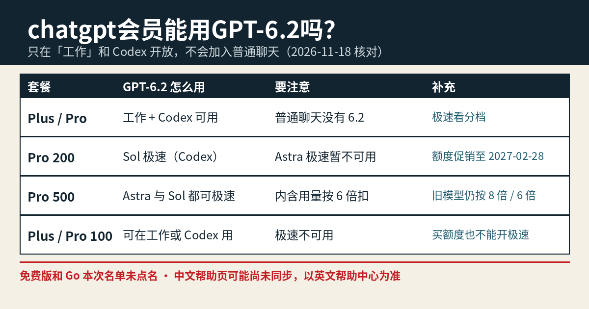

# chatgpt会员能用GPT-6.2吗？Work和Codex对照｜GPT20X

chatgpt会员这几天最常被问的，是刚发布的 GPT-6.2 到底能不能用、要不要为此再充一次值。2026 年 11 月 17 日，OpenAI 发布了 GPT-6.2 Astra 和 GPT-6.2 Sol，并写明：从当天起，向 Plus、Pro、Enterprise 和 Edu 用户，在 ChatGPT「工作」（Work）和 Codex 中开放。官方帮助中心《ChatGPT 工作和 Codex（ChatGPT Work and Codex）》随后补充，这次滚动开放还覆盖 Business、ChatGPT for Healthcare 和 FedRAMP 工作空间，但**不会把这两个模型加入普通聊天（Chat）**。能否看到新模型，还取决于套餐、工作空间权限，以及滚动进度有没有轮到你的账号。下面按官方公告和帮助中心英文页（2026-11-19 核对）把套餐对照、极速（Ultrafast）规则和找不到模型时怎么做写清楚。若要用人民币付款开通或升级会员，可以先看 [ChatGPT充值](https://gpt20x.com/) 的说明。

需要提前说明两点：第一，同编号的中文帮助页在 2026-11-19 核对时尚未同步这次 GPT-6.2 滚动更新，条文仍停留在上一轮模型说明，**请以英文帮助中心和官方公告为准**；第二，以下只整理官方已经写明的规则，没有写进公告或帮助中心的，会直接标成「尚未确认」，不会按传闻补数字。

---

## 目录

1. 先看结论：能用，但不在普通聊天里
2. 官方公告和帮助中心分别说了什么
3. chatgpt会员哪些套餐能用 GPT-6.2
4. 在哪里选模型：工作、Codex，以及桌面应用怎么更新
5. 极速模式（Ultrafast）分档对照
6. 用量怎么看，倍率代表什么
7. 要不要为此升级或重新开通
8. 找不到 GPT-6.2 时怎么排查
9. 常见问题
10. 官方来源

---

## 1. 先看结论：能用，但不在普通聊天里

把官方已经写明的内容压成一张表，先对号入座，再往下看步骤。

| 你想确认的事 | 官方目前的说法（2026-11-19 核对） |
|---|---|
| GPT-6.2 有哪些模型 | GPT-6.2 Astra（偏复杂专业工作和编程）、GPT-6.2 Sol（偏日常工作、多步骤流程，支持文本、图像和工具） |
| 在 ChatGPT 的哪里用 | 「工作」（Work）和 Codex；**这次不会加入普通聊天** |
| 哪些个人套餐写进了开放名单 | Plus、Pro（帮助中心写明滚动覆盖 Plus、Pro；公告同样点名 Plus、Pro） |
| 哪些团队 / 机构套餐写进了开放名单 | 公告写了 Enterprise、Edu；帮助中心补充 Business、ChatGPT for Healthcare、FedRAMP，并强调要等滚动到达，且常需工作空间管理员开启 |
| 免费版和 Go | 公告和帮助中心的本次名单都没有点名，是否后续开放**尚未确认**，请以账号里的模型选择器为准 |
| 极速（Ultrafast） | Pro 500 可用 GPT-6.2 Astra 和 Sol 的极速；Pro 200 目前是 GPT-6.2 Sol 极速，且帮助中心写明在 Codex；Plus、Pro 100 和 Business 即使买额度也不能开极速 |
| 普通聊天还用什么 | 帮助中心写明：普通聊天里的 GPT-6 由 GPT-6 Sol 驱动，本次滚动不把 GPT-6.2 加进去 |

一句话：**已经开通 Plus 或 Pro 的 chatgpt会员，应到「工作」或 Codex 里找 GPT-6.2，不要在普通聊天的模型列表里空等。**

---

## 2. 官方公告和帮助中心分别说了什么

先看 2026 年 11 月 17 日的产品公告《介绍 GPT-6.2 Astra 和 Sol（Introducing GPT-6.2 Astra and Sol）》。OpenAI 把 GPT-6.2 Astra 写成面向更难项目的前沿模型，把 GPT-6.2 Sol 写成更高效、适合日常工作的模型，并强调两者在较重任务上能用更少的输出 token 完成，从而在同一套用量限额里多做一些事。公告的「定价与可用性（Pricing and availability）」一节写得很具体：

- 从当天起，GPT-6.2 Astra 和 Sol 向所有 Plus、Pro、Enterprise 和 Edu 用户，在 ChatGPT「工作」和 Codex 中开放。
- Pro 500 订户可以对这两个模型使用极速。
- **第一次**把极速带给 Pro 200 订户，先从 GPT-6.2 Sol 开始。
- 符合条件的 Enterprise 和 Edu 用户，需等工作空间管理员开启后才能获得同样的访问。
- 开发者可在 API 中使用 `gpt-6.2-astra` 和 `gpt-6.2-sol`，发布时两个模型都提供极速。

官方 X 账号 @OpenAI 在 2026-11-17 17:54 UTC（北京时间 2026-11-18 01:54）发帖，表述与公告一致。公告还给出了 API 标价（每百万 token）：GPT-6.2 Astra 为输入 8 美元、缓存输入 0.40 美元、输出 40 美元；GPT-6.2 Sol 沿用 GPT-6.1 Sol 的 2 美元 / 0.10 美元 / 10 美元。**这些是 API 价格，不等于 ChatGPT 会员月费，也不等于套餐内含用量。** ChatGPT Plus 仍是帮助中心写明的每月 20 美元、按月计费；Pro 仍是帮助中心《关于 ChatGPT Pro 档位（About ChatGPT Pro tiers）》写明的三档月费：Pro 100 为 100 美元、Pro 200 为 200 美元、Pro 500 为 500 美元。Go 的具体标价以 ChatGPT 定价页和结算页为准，本文不另行估写。

帮助中心比公告多写了操作细节，也更值得动手前再读一遍：

- 这是一次**滚动开放**。桌面应用请通过「菜单 → 检查更新（Menu > Check for Updates）」更新到最新版并重启；若使用 Codex CLI，也要更新到最新版。更新后仍看不到，可能是账号尚未轮到。
- 滚动名单除了公告中的套餐，还写了 Business、ChatGPT for Healthcare 和 FedRAMP 工作空间。
- 当滚动到达你的账号时，已有的、正在使用 Astra 或 Sol 的工作对话，可能会出现是否切换到新默认模型的可选提示，你可以继续用当前模型。已经通过「默认（Default）」使用 Astra 或 Sol 的新工作对话，会在原地升级，没有切换按钮。
- 工作主页在「默认」设为 GPT-6 Luna、或你手动指定了某个模型时，不会显示这条公告；使用其他模型的已有对话也不会收到升级提示。

---

## 3. chatgpt会员哪些套餐能用 GPT-6.2

这里说的 chatgpt会员，日常可能指 Plus，也可能笼统包括 Go 和 Pro。套餐名字不同，官方给的权限也不同，不要互相套用。

**Plus。** 公告和帮助中心都把它写进了「工作」和 Codex 的开放名单。Plus 用户应到「工作」的模型选择器里寻找 GPT-6.2 Astra 或 GPT-6.2 Sol。帮助中心同时保留了一条与日常聊天有关的界限：Plus 可以在「工作」和 Codex 中使用 Astra，但**普通聊天里没有 GPT-6 Pro**。这次滚动也没有把 GPT-6.2 加进普通聊天，所以「我已经是 Plus，为什么聊天里看不到 6.2」并不是开通失败。

**Pro 100、Pro 200、Pro 500。** 三档都在开放名单里，都可以在「工作」和 Codex 中使用 GPT-6.2，区别主要在极速和用量，而不是「有的档位完全没有 6.2」。Pro 的普通聊天里，帮助中心仍把 GPT-6 Pro 写成由 Astra 驱动，并且这条消息限额和「工作 / Codex」的共享用量是分开计算的。

**Business、Enterprise、Edu，以及帮助中心补充的 Healthcare、FedRAMP。** 能不能用，除了滚动进度，还取决于工作空间权限。Enterprise 和 Edu 按公告要由管理员开启。团队账号如果看不到新模型，应先问工作空间所有者或管理员，而不是反复取消再订阅。

**免费版和 Go。** 本次公告和帮助中心的开放名单都没有点名这两档。这不等于永远不能用，只是**官方还没有确认**。请直接看账号里的模型选择器，不要把别人 Plus 或 Pro 截图里的模型，当成自己套餐一定有的功能。

---

## 4. 在哪里选模型：工作、Codex，以及桌面应用怎么更新

ChatGPT 现在至少要分清三种用法，帮助中心的划分是：

- **聊天（Chat）**：问问题、搜索、头脑风暴、日常对话。本次滚动**不加** GPT-6.2。
- **工作（Work）**：调研、分析资料，或生成文档、表格、演示文稿、报告、站点。工作模式在符合条件的付费套餐里，可在网页、移动端和桌面应用中使用。
- **Codex**：写代码、调试、跑测试和命令、查看改动、处理代码库。桌面应用里是单独的视图；另有 Codex 云端任务。

当你的账号已经轮到这次滚动时，打开「工作」，在模型选择器里挑选 GPT-6.2 Astra 或 GPT-6.2 Sol。Astra 更适合跨服务追查问题、把原始材料做成演示文稿这类重活；Sol 适合带工具的日常工作和多步骤流程。具体显示哪些模型、有哪些推理档位，仍以你账号和工作空间当时给出的选项为准。

桌面应用如果还停留在旧版，模型选择器可能暂时是空的。按帮助中心的步骤：打开 ChatGPT 桌面应用 →「菜单 → 检查更新」→ 安装后重启。即使用过自动更新通知或侧边栏更新图标，也建议再检查一次。使用 Codex CLI 的人，需要把 CLI 更新到最新版；旧版可能根本列不出新模型。

工作可以在网页和手机上用，也可以在桌面应用里从「聊天」切到「工作」。Codex 在桌面应用里仍是单独入口，历史记录也和 ChatGPT 对话分开。找错入口，容易误以为「会员没开通成功」。

---

## 5. 极速模式（Ultrafast）分档对照

极速不是「所有付费档位的按钮」，而是按套餐开放的低延迟选项。帮助中心《ChatGPT 工作和 Codex》把 GPT-6.2 发布后的规则写得很细，和几天前仍写着「极速只在 Pro 500」的旧说明已经不同。**下面以 2026-11-19 仍在更新的英文帮助中心为准。**

| 套餐 | GPT-6.2 极速怎么用 | 内含用量怎么扣 | 买额度（Credits）之后 |
|---|---|---|---|
| Plus | 不可用，买额度也不能开 | — | 不能用额度解锁极速 |
| Pro 100 | 不可用，买额度也不能开 | — | 不能用额度解锁极速 |
| Pro 200 | 可用 GPT-6.2 Sol 极速，帮助中心写明是在 Codex、沿用现有套餐限额；GPT-6.2 Astra、GPT-6 Astra、GPT-6.1 Sol 的极速仍不可用 | 该模型按标准模式的 6 倍消耗内含用量 | 到 2027 年 2 月 28 日之前，按标准模式额度费率的 3 倍促销计费 |
| Pro 500 | GPT-6.2 Astra 和 GPT-6.2 Sol 都可用极速 | 按所选模型标准模式的 6 倍消耗内含用量 | 同样到 2027 年 2 月 28 日之前，按标准模式额度费率的 3 倍促销计费 |
| Business | 不可用，买额度也不能开 | — | 不能用额度解锁极速 |
| Enterprise / Edu | 符合条件的工作空间可用，还取决于管理员权限 | 以工作空间规则为准 | 极速用量记入工作空间额度 |

再补两条很容易看错的说明：

- 在 Pro 500 上，**旧模型** GPT-6 Astra 和 GPT-6.1 Sol 的极速，仍按帮助中心原来的规则：内含用量按标准模式的 8 倍扣，买额度后按 6 倍扣。不要把 GPT-6.2 的 6 倍 / 3 倍促销，套到旧模型上。
- 账号和工作空间都有权限时，先选中可用的 GPT-6.2 Astra、GPT-6.2 Sol、GPT-6 Astra 或 GPT-6.1 Sol，再选择极速。按钮灰掉或根本没有，通常是套餐或滚动尚未覆盖，不是设置里藏了一个开关。

---

## 6. 用量怎么看，倍率代表什么

「工作」和 Codex **共用**套餐内含用量。能做多少事，取决于模型、任务内容和设置，**不是固定条数的对话次数**。剩余用量和重置时间，以 ChatGPT「设置 → 用量」显示为准。

Plus 和 Pro 在「工作」和 Codex 都有 5 小时窗口，也有每周限制，两个窗口都要有剩余才能继续。5 小时窗口从上一窗口结束后的第一条「工作」或 Codex 消息开始算，有可能不到 5 小时就用完。各档还剩多少，以「设置 → 用量」为准。

倍率只说明扣用量的速度，不保证更快，也不保证同样的任务一定少花次数。对 GPT-6.2 的极速，Pro 200 和 Pro 500 的内含用量按标准模式的 6 倍扣；用完后再走已购买的额度，促销期到 2027 年 2 月 28 日按 3 倍计。帮助中心在其他 Pro 说明里也提醒过：用量变多，并不等于能完成的任务数正好翻倍。任务大小、推理档位、是否用工具，都会让实际消耗不一样。

官方没有在本次说明里给出 GPT-6.2 的固定消息条数。帮助中心为 Plus 和 Business 标准席位列出的 5 小时窗口估算（例如 GPT-6 Astra 约 5–45 条、GPT-6.1 Sol 约 15–160 条）针对的是表里那些已有模型，而且写明是估算、不是保证。**不要把这些数字直接写成 GPT-6.2 的限额。**

普通聊天里的每周 GPT-6 Pro 消息限额，和「工作 / Codex」的共享用量是分开的。Pro 档位如果在聊天里看到限额提示，并不自动等于 Codex 也用完了，反过来也一样。

---

## 7. 要不要为此升级或重新开通

先分清你真正缺的是哪一样：

- **只想在日常聊天里用 GPT-6.2**：这次滚动明确不加进普通聊天。升级到更高档 Pro，也不会仅仅因此让普通聊天出现 6.2。这条如果以后有变，只能等官方再发说明。
- **已经在用「工作」或 Codex，只是列表里还没有 6.2**：优先做第 8 节的排查，尤其是更新桌面应用和 CLI，并等待滚动，而不是先取消订阅再开通一次。
- **需要极速**：Plus 和 Pro 100 即使购买额度也不能开极速。Pro 200 目前是 GPT-6.2 Sol 极速（帮助中心写明在 Codex），不是 Astra 极速。两个 6.2 模型的极速都要用，才需要看到 Pro 500 的说明。升档前先看「设置 → 我的套餐（My Plan）」和官方定价页，费用、生效时间和是否补差价以当时页面为准。
- **只是普通聊天和轻量写作**：现有 Plus 已经在本次名单里，不必只为「有没有 6.2」立刻升到 Pro。

没有境外信用卡、想用支付宝或微信开通或升级 chatgpt 会员时，可以把套餐开到你自己的账号上，再在「工作」或 Codex 里查看模型选择器。Pro 档位以你下单时的套餐说明为准。GPT20X（gpt20x.com）只是国内付款的选项之一，开通后同样要等官方滚动到达，不会额外「加塞」出新模型。

不要为了「刷新权限」先取消再订阅。帮助中心对 Pro 200 额度调整的说明是：订阅仍有效就不必取消；预约取消也不会立刻停用，只是到账期结束才失效。找模型、更新应用和等待滚动，比反复下单更有效。

ChatGPT 对账号使用地区有要求，开通前建议先看一下 OpenAI 官方的支持地区说明。

---

## 8. 找不到 GPT-6.2 时怎么排查

按下面的顺序检查，多数情况不必重复付款。

1. **先确认你进的是「工作」或 Codex，而不是普通聊天。** 普通聊天里没有 GPT-6.2，这是官方原文，不是页面故障。
2. **确认套餐是否在本次名单里。** Plus 和 Pro 个人套餐已写明；免费版和 Go 尚未被点名。团队账号还要看管理员是否开启。
3. **更新并重启 ChatGPT 桌面应用**（菜单 → 检查更新）。使用 Codex CLI 的，同步更新 CLI。
4. **看工作对话的模型设置。** 如果「默认」停在 GPT-6 Luna，或你手动锁死了某个旧模型，工作主页可能不显示升级提示，已有对话也不会自动出现切换按钮。可新开一个「工作」对话，再看模型选择器。
5. **仍没有选项，就当作滚动尚未到达。** 帮助中心写明：可用性取决于套餐、工作空间权限和滚动进度。过一段时间再看「设置 → 用量」和模型列表即可，不要在此期间反复更换付款方式。
6. **极速按钮没有出现。** 先对照第 5 节的分档表：Plus、Pro 100 本来就没有；Pro 200 目前应对着 GPT-6.2 Sol，并且帮助中心写的是 Codex。选错模型或进错入口，按钮就不会出现。

---

## 9. 常见问题

**Q：我已经是 chatgpt会员，为什么聊天里还是只有 GPT-6？**  
因为这次开放的是「工作」和 Codex。帮助中心写明：普通聊天里的 GPT-6 由 GPT-6 Sol 驱动，本次滚动不把 GPT-6.2 Astra 或 Sol 加进普通聊天。

**Q：Plus 能用 GPT-6.2 Astra 吗？**  
公告和帮助中心把 Plus 写进了「工作」和 Codex 的开放名单，模型选择器里应能看到已对你开放的 GPT-6.2 选项。具体何时出现，仍取决于滚动进度。Plus 不能使用极速，也不能靠买额度打开极速。

**Q：Pro 200 现在有极速了，是不是两个新模型都能开？**  
不是。帮助中心写明：Pro 200 包含 GPT-6.2 Sol 极速，位置在 Codex，并沿用现有套餐限额；GPT-6.2 Astra、GPT-6 Astra 和 GPT-6.1 Sol 的极速在 Pro 200 上仍不可用。

**Q：要不要为了 GPT-6.2 去买额度？**  
额度用于套餐内含用量用完之后，继续做符合条件的「工作」、Codex 等任务，并不能给 Plus 或 Pro 100 解锁极速，也不能把模型加进普通聊天。买之前先看「设置 → 用量」和官方《通过额度灵活使用 ChatGPT（个人套餐）》说明。

**Q：中文帮助中心还在写极速只给 Pro 500，哪边才算数？**  
2026-11-19 核对中国页尚未同步 GPT-6.2 这一轮更新。套餐对照和极速规则请以英文帮助中心《ChatGPT Work and Codex》以及 11 月 17 日的产品公告为准，并以你账号里实际出现的选项为准。

**Q：API 里的 GPT-6.2 和 chatgpt会员是一回事吗？**  
不是。API 按 token 另行计费，公告给出的 8 / 0.40 / 40 美元（Astra）和 2 / 0.10 / 10 美元（Sol）只适用于 API。ChatGPT 订阅费用和套餐内含用量是另一套规则。

---

## 10. 官方来源

- [OpenAI 公告：介绍 GPT-6.2 Astra 和 Sol（Introducing GPT-6.2 Astra and Sol）](https://openai.com/index/introducing-gpt-6-2-astra-sol/)（2026-11-17：在「工作」和 Codex 中向 Plus、Pro、Enterprise、Edu 开放，Pro 500 两个模型可用极速，Pro 200 首次从 GPT-6.2 Sol 开始提供极速，并给出 API 标价）
- [OpenAI 帮助中心：ChatGPT 工作和 Codex（ChatGPT Work and Codex）](https://help.openai.com/en/articles/20001275-chatgpt-work-and-codex)（2026-11-19 核对：滚动开放范围、不加入普通聊天、桌面应用和 CLI 更新、极速分档与倍率、促销截止 2027-02-28）

> 非 OpenAI 官方内容。模型开放范围、极速规则和用量窗口仍在滚动调整，请以 OpenAI 公告、帮助中心和你账号里实际显示的选项为准。

相关教程：

- [chatgpt会员怎么选：Go / Plus / Pro 对照](https://amber-moose-14.github.io/chatgpt-daichong-guide/chatgpt-huiyuan-zenme-xuan-2026.html)
- [ChatGPT Plus 充值怎么选](https://amber-moose-14.github.io/chatgpt-daichong-guide/chatgpt-plus-chongzhi-yuefu-2026.html)
- [ChatGPT Pro 充值前必读](https://amber-moose-14.github.io/chatgpt-daichong-guide/chatgpt-pro-chongzhi-edu-guize-2026.html)
- [Codex 代充前必读](https://amber-moose-14.github.io/chatgpt-daichong-guide/codex-daichong-yongliang-kaitong-2026.html)
- [chatgpt会员额度12月会和Codex共享吗](https://amber-moose-14.github.io/chatgpt-daichong-guide/chatgpt-huiyuan-codex-gongxiang-2026.html)

---

*最后更新：2026-11-19*　｜　[返回教程首页](README.md)　｜　本文由 [GPT20X](https://gpt20x.com/) 整理
