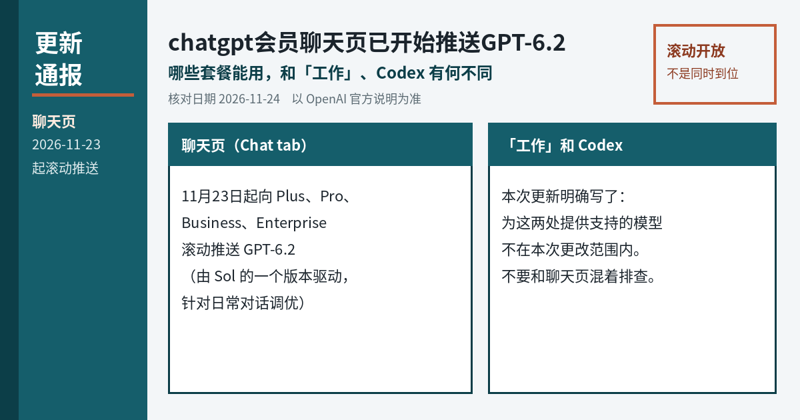

# chatgpt会员聊天页已开始推送GPT-6.2｜GPT20X

chatgpt会员最近最常问的，是普通聊天里能不能用上 GPT-6.2，以及要不要为此再去做 [ChatGPT充值](https://gpt20x.com/)。2026 年 11 月 23 日，OpenAI 在帮助中心《ChatGPT 发布说明（ChatGPT release notes）》里写明：开始向 Plus、Pro、Business 和 Enterprise 套餐，在聊天页（Chat tab）滚动推送一个针对聊天页优化的 GPT-6.2 版本。本文按该英文发布说明和同日系统卡，把官方已经写清的范围、和 11 月 17 日那次开放的差别，以及聊天里暂时看不到时该怎么判断写清楚。核对日期为 2026-11-24，具体以 OpenAI 官方页面和你账号里实际显示的选项为准。

先记住三点：这是滚动推送，名单内账号也不一定同时看到；发布说明列出的是 Plus、Pro、Business 和 Enterprise，同日系统卡开头只写 Plus 和 Pro，本文以发布说明名单为主并注明这一差异，不把未点名套餐补进去；免费版和 Go 未出现在名单里，是否后续开放尚未确认。

## 先看结论：改的是聊天页，而且是滚动开放

把已经能核对的内容先压成一张表，对上号再往下看细节。

| 你想确认的事 | 官方目前的说法（2026-11-24 按英文发布说明核对） |
|---|---|
| 这次更新了什么 | 向聊天页推送一个针对聊天页优化的 GPT-6.2 版本 |
| 从哪天开始 | 2026 年 11 月 23 日开始全球滚动推送 |
| 发布说明点名的套餐 | Plus、Pro、Business、Enterprise |
| Enterprise 的额外条件 | 是否可用取决于工作空间管理员设置 |
| 系统卡开头怎么写 | 写的是向 Plus 和 Pro 用户发布这个针对聊天页优化的版本；未在开头点名 Business、Enterprise |
| 由哪个模型驱动 | 发布说明写明：ChatGPT 里的 GPT-6.2 由 GPT-6.2 Sol 的一个版本驱动，并针对日常对话调优 |
| 「工作」和 Codex 这次变了吗 | 没有。发布说明写明，为「工作」和 Codex 提供支持的模型不在本次更新范围内 |
| 免费版和 Go | 本次名单未点名，是否开放尚未确认，以账号里实际显示为准 |

已经在官方名单里的 chatgpt会员，应到聊天页查看有没有轮到自己；不要把它理解成「工作」或 Codex 又换了一批模型，也不要以为所有账号都会立刻出现。

## 官方说聊天页上的 GPT-6.2 强在哪里

发布说明概括：它更擅长处理包含详细指令、或需要上网查找信息的复杂请求。官方举例：比较周末出行酒店时，它可以帮助权衡价格和位置，并按你的优先事项给出建议。

它也更会判断何时跟进。官方举例：若你问某样东西是否在打折，ChatGPT 可以提出降价时再通知你。这是官方对自己产品的说明，不构成到价提醒保证。

发布说明还给出了官方在聊天页测试中、与 GPT-6 的几组对比。这些数字来自 OpenAI 的测试或内部评估，不是本页实测，也不是对每次对话的承诺：

- 图像理解：GPT-6.2 为 71.7%，GPT-6 为 47.4%。
- 在尤其困难的提示词上遵循指令：GPT-6.2 为 78.1%，GPT-6 为 62.5%。
- 在官方测试的最低推理设置下，专家级任务的内部评估：GPT-6.2 为 65%，GPT-6 为 52%。
- 在内部版 BrowseComp（偏难的网页检索任务）上，四个推理设置都高于 GPT-6；在 Extra high 设置下约为 64.5% 对 54.4%，也就是发布说明所说的大约高出 10 个百分点。

安全方面，发布说明写到 GPT-6.2 在青少年安全评估上有明显提升，较大增益出现在情感依赖、饮食障碍，以及年龄限制商品、服务和危险活动等项目。在有挑战性的对话里，回复符合其安全政策的比例为 91%–94%，GPT-6 为 77%–80%。更完整评估见同日系统卡；本文不把其中专项评测展开成使用教程。

## 这次改的是聊天体验，「工作」和 Codex 先维持原样

11 月 17 日那一轮，官方把 GPT-6.2 Astra 和 Sol 放到「工作」（Work）和 Codex 中预览，并写明普通聊天仍保持原来的模型选择。当时对照页的结论是：能用，但不在普通聊天里。

11 月 23 日这一轮，方向正好补上了聊天页。发布说明有一句英文原文：

> The models powering Work and Codex are not changing

这 9 个词的意思是：为「工作」和 Codex 提供支持的模型，不在本次更新范围内。聊天页开始滚动推送针对日常对话调优的 GPT-6.2 Sol 版本；此前在「工作」和 Codex 开放的 Astra / Sol，不因此一并更换。两边不要混着排查。

ChatGPT 对账号使用地区有要求，开通前建议先看一下 OpenAI 官方的支持地区说明。

## 聊天里暂时看不到，先按这四步判断

名单内账号也不一定已经看到新模型。这条发布说明没有写出模型选择器的具体按钮文案，下面只按已写明的范围判断，不编造点击路径。

1. 先确认你看的是聊天页，而不是「工作」或 Codex。后者本来就可能已有 GPT-6.2，但不能用来证明这次聊天页更新已经到达。
2. 再对一下套餐是否在发布说明名单中：个人套餐目前写明的是 Plus 和 Pro；团队侧还写了 Business 和 Enterprise。免费版和 Go 未点名，看不到并不等于开通失败。
3. 若你使用 Enterprise，还要看工作空间管理员是否已允许使用。
4. 若套餐符合名单却仍未在聊天页看到变化，更常见的解释是滚动尚未到达，或客户端需要先更新。发布说明没有写过靠反复取消再开通来“刷新”资格。

Business 何时能在聊天页看到，仍以账号和帮助中心最新说明为准。系统卡开头未点名 Business，并不自动取消发布说明名单，只说明两份材料表述不完全一样。

## 对不同用户意味着什么

**已经开通 Plus 或 Pro 的人。** 按发布说明，你属于这次聊天页滚动推送的对象，打开聊天页查看是否已经轮到即可。发布说明没有把“必须再升一档”写成使用条件。若你主要在「工作」或 Codex 里用 Astra / Sol，这次也不会自动改掉那边的模型。

**Business 或 Enterprise 工作空间里的人。** 发布说明把这两类写进了聊天页推送名单，但 Enterprise 还取决于管理员设置。若同事已经看到、你还没有，先问管理员，不要自行理解成账号坏了。与系统卡开头表述不一致时，以账号实际显示和帮助中心最新文本为准。

**使用免费版或 Go 的人。** 这两档没有出现在本次名单里，能不能用尚未确认。不要把别人 Plus 账号里的聊天页截图，当成自己也一定能开。若本来就在考虑开通名单中的套餐，先看官方支持地区和结账页再决定；本页不把未证实的功能当成开通理由。

**经第三方渠道开通的人。** 能否看到这次更新，取决于被开通的那个 ChatGPT 账号套餐，以及滚动是否到达。请登录同一个账号查看聊天页。本文由 GPT20X 按公开说明整理，只供对照，并不替代官方页面或结算页。

## 常见问题

**这是不是全员立刻都能在聊天里用 GPT-6.2？**  
不是。官方写的是从 11 月 23 日起全球滚动推送。即使套餐在名单里，也可能还没轮到你的账号。

**聊天页里的 GPT-6.2，和「工作」、Codex 里的是不是同一个？**  
不能简单等同。发布说明写明，聊天页这个版本由 GPT-6.2 Sol 的一个版本驱动并针对日常对话调优，同时明确本次不改变「工作」和 Codex 所用模型。

**我只有免费版或 Go，会不会过几天自动加上？**  
官方这次没有点名这两档，会不会后续开放尚未确认。请以账号实际显示和帮助中心最新说明为准，不要按传闻提前下结论。

**为了用聊天页的 GPT-6.2，必须再升到 Pro 吗？**  
发布说明把 Plus 和 Pro 都写进了名单，并没有把升级到 Pro 写成前提。Pro 在用量或速度上是否还有未写明的差异，本页不推测。

**系统卡只写 Plus 和 Pro，Business、Enterprise 到底算不算？**  
帮助中心发布说明点名了这四档，其中 Enterprise 还取决于管理员设置；系统卡开头则只写 Plus 和 Pro。表述不一致时请同时参考，并以账号实际显示和帮助中心最新文本为准，本页不擅自删减或扩大名单。

**11 月 18 日那篇“不能在普通聊天里用”是不是写错了？**  
不是写错。当时依据的是 11 月 17 日公告：GPT-6.2 先在「工作」和 Codex 开放，普通聊天保持原来的模型选择。11 月 23 日才新增聊天页滚动推送。旧文反映当时范围，本页反映这次新变化。

## 相关教程

- [chatgpt会员能用GPT-6.2吗？Work和Codex对照](https://amber-moose-14.github.io/chatgpt-daichong-guide/chatgpt-huiyuan-gpt6-2-2026.html)
- [ChatGPT会员怎么选](https://amber-moose-14.github.io/chatgpt-daichong-guide/chatgpt-huiyuan-zenme-xuan-2026.html)
- [ChatGPT Plus充值怎么选月付](https://amber-moose-14.github.io/chatgpt-daichong-guide/chatgpt-plus-chongzhi-yuefu-2026.html)

## 官方来源

- [ChatGPT 发布说明](https://help.openai.com/en/articles/6825453-chatgpt-release-notes)。2026 年 11 月 23 日条目说明聊天页开始滚动推送 GPT-6.2、适用套餐，以及本次不改变「工作」和 Codex 所用模型。
- [GPT-6.2 in ChatGPT 系统卡](https://deploymentsafety.openai.com/gpt-6-2-chatgpt)。2026 年 11 月 23 日发布，介绍这个针对聊天页优化的版本，开头写明面向 Plus 和 Pro 用户，并提供安全评估说明。

> 本页为 [GPT20X](https://gpt20x.com/) 整理，非 OpenAI 官方内容。价格、额度和政策以 OpenAI 官方和结账页为准。

*最后更新：2026-11-24*
