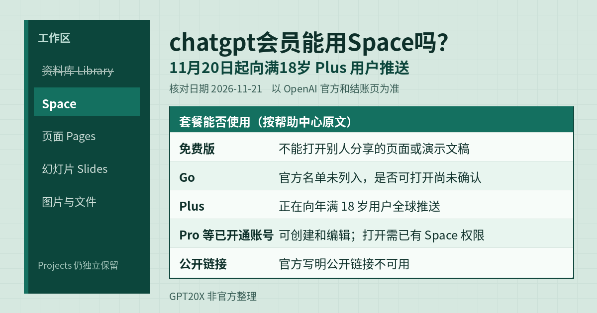

# chatgpt会员能用Space吗？11月20日起向满18岁Plus用户推送｜GPT20X

已经开通或准备开通 chatgpt会员的人，如果想确认能不能使用 Space，需要先分清两件事：你的套餐是否在官方名单里，以及侧边栏现在看不看得到入口。2026-11-20 起，ChatGPT Space 开始向年满 18 岁的 Plus 用户全球推送；能否创建页面，或打开别人分享的内容，仍要看账号有没有开通这项功能。核对日期：2026-11-21，具体以 OpenAI 官方和结账页为准。

## 11月20日官方更新是什么

帮助中心版本说明在 2026-11-20 的条目里写了这句原文：

> Starting today, ChatGPT Space is rolling out globally to Plus users ages 18 and older.

这 15 个词的意思是：从当天起，ChatGPT Space 开始向年满 18 岁的 Plus 用户全球推送。推送不等于每个 Plus 账号当天都能看到入口。

在 Space 里，可以用 ChatGPT 创建互动页面和演示文稿，并邀请同样拥有 Space 访问权限的人一起编辑。页面和幻灯片可根据已连接的应用和工具自动更新。官方举例包括：会自动更新的待办、带 3D 模型的学习指南，以及能跟上 Slack 决定的项目计划。你可以在评论中 @ ChatGPT；若有 dot，也可以邀请它协作。

开始使用时，从侧边栏打开 Space。对已开通账号，它会替换 Library（资料库），成为 pages、slides、images 和上传文件的新位置。Projects（项目）仍独立存在，不会被 Space 取代。网页、桌面应用、iOS 和 Android 都可以创建和编辑页面；手机上也可以查找、阅读、分享页面，并在页面与子页面之间导航。

## 套餐对照：谁能创建、打开和分享

下表只整理帮助中心已经写明的范围。创建和编辑可以在 Pro、Business、Enterprise，以及「一旦你的账号开通 Space」的 Plus 上进行。打开别人分享的页面或演示文稿时，需要查看权限，并且必须登录已开通 Space 的 Plus、Pro、Business 或 Enterprise 账号。必须年满 18 岁才能开始使用 Space。官方写明 Public links aren’t available，也就是公开链接不可用。

| 套餐 | 创建和编辑 | 打开别人分享的内容 | 目前能核对到的说明 |
|---|---|---|---|
| 免费版 | 官方未把它列入可创建名单 | 不能打开 | 原文写明免费版不能打开分享的页面或演示文稿 |
| Go | 官方名单未列入 | 官方名单未列入 | 是否可打开尚未确认，以官方为准 |
| Plus | 账号开通 Space 之后可以 | 需已开通 Space，且有查看权限 | 正在向符合条件的 Plus 账号推送；须年满 18 岁 |
| Pro | 可以 | 需已开通 Space，且有查看权限 | 须年满 18 岁 |
| Business / Enterprise | 可以，但托管工作区还要看组织设置 | 需已开通 Space，且有查看权限 | 管理员可能需要先开启分享；加拿大或阿联酋数据驻留的工作区，Space 即将推出 |

Go 没有出现在这份打开名单里，所以不要写成「Go 一定不能」或「Go 一定能」。本次来源没有宣布改价或改套餐，也不要据此推断价格变化。

## 怎么开始用

可按下面的步骤卡开始。

| 步骤 | 做什么 | 如果看不到或不确定 |
|---|---|---|
| 1 | 在侧边栏打开 Space | 桌面应用里没有时，先更新到最新版；更新后仍没有，可能账号还没轮到 |
| 2 | 先分清页面和 space | 页面是可编辑文档，例如项目简报或会议记录；space 用来归组相关内容。你有个人 space，也可以按主题或团队建立其他 space。space 可含文件夹和页面，页面还可以有子页面 |
| 3 | 创建 space 或页面 | 可让 ChatGPT 创建 space 并命名；也可从 Work 和 Codex 的对话生成页面、直接在 Space 里写，或使用 Space 首页模板 |
| 4 | 自己改，或请 ChatGPT 改 | 到 Plus 消息限额后，仍可手工编辑页面和幻灯片 |
| 5 | 需要演示文稿时再看 Slides | Slides 正在向已有 Space 访问权限、符合条件的账号（含 Plus）推送，可能还看不到。Sheets 即将推出 |

网页端可以把演示文稿导出为 PowerPoint、PDF 或 Google Slides。电脑如果安装了 PowerPoint 或 Keynote，也可以打开。演示可直接在 ChatGPT 里进行。Windows 设备如果没有所需的 MXC 组件，桌面端本地 AI 幻灯片会改用 .pptx 文件；Windows 10 不支持该组件。这是桌面端注意事项，不是所有用户的默认限制；缺少该组件时，可用网页端创建和编辑协作演示文稿。

## 分享、权限与隐私要注意什么

你可以分享单个页面，也可以分享整个 space。有编辑权限的人可实时共同编辑。子页面会继承父页面的权限。去掉一次直接邀请，并不会同时去掉从父页面或 space 继承来的权限；要改继承权限，需要到授予权限的父页面或 space 里调整。

打开别人分享的页面或演示文稿，除了查看权限，还必须登录已开通 Space 的 Plus、Pro、Business 或 Enterprise 账号。免费版不能打开。公开链接不可用。上线时也还没有仅评论（Comment-only）权限。托管工作区的分享选项由组织设置决定；Enterprise 管理员可能需要先开启分享，成员才能协作。

每位协作者使用自己的 ChatGPT。分享页面不会把你的私人聊天或 Memory 分享出去；但写在页面上的信息，能查看该页的人都能看到。若 Memory 开启，ChatGPT 可能用个人上下文帮你写页面，一旦写上去，查看者就能读到。训练方面，个人账号跟随操作者自己的设置；协作者的训练和 Memory 设置，对「其自己的 ChatGPT 使用共享内容」生效。Business 和 Enterprise 默认不用于训练。

上传进页面的文件跟随该页权限；只放链接，不会自动授权对方打开原文件。如果从源文件复制或摘要到共享页面上，查看者仍能读到这些内容。删除页面会把它和子页面移到垃圾桶，包括别人拥有的子页面，删除前要先检查。锁定对话里的文件，在解锁前不会出现在 Space。

## 对你有什么影响，你该怎么做

- 免费用户：按官方原文，不能打开别人分享的页面或演示文稿，也不要等待公开链接。如果确实需要创建或协作，再对照上表看列入名单的套餐。
- 还没看到 Space 的 Plus：先确认自己已年满 18 岁，并在桌面应用里更新到最新版。更新后仍然没有，更可能是账号尚未轮到，不必把它理解成开通失败，也不必为此先取消再订阅。
- 已经出现 Space 的 Plus：可以从侧边栏进入，创建和编辑页面，并邀请同样拥有 Space 访问权限的人协作。到了 Plus 消息限额，仍可手工改页面和幻灯片。Slides 可能还没推到你的账号，这与页面能不能用不是同一件事。
- Pro：官方已把 Pro 列入可创建、可打开分享内容的名单，同样须年满 18 岁，并已开通 Space。打开别人的内容前，仍要确认自己有查看权限。
- Business / Enterprise：先看组织的分享设置。管理员可能需要先开启分享，成员才能协作。若工作区是加拿大或阿联酋数据驻留，官方写的是 Space 即将推出，不要按已经全量开放来安排协作。
- 正在考虑开通的人：先确认你要的是创建和协作，还是只是日常聊天。Go 是否能打开分享内容，官方名单未列入，尚未确认。若你需要的是名单中的 Plus，可以用人民币了解 [GPT会员](https://gpt20x.com/chatgpt-plus) 怎么开到自己的账号上；GPT20X 只是付款选项之一，开通后同样要等官方推送，不会提前加塞。ChatGPT 对账号使用地区有要求，开通前建议先看一下 OpenAI 官方的支持地区说明。具体以 OpenAI 官方和结账页为准。

## 常见问题

**Plus 侧边栏没有 Space，是不是开通失败了？**  
不一定。Space 正在向符合条件的 Plus 账号推送，并不是所有人同一天看到入口。桌面应用如果看不到，先更新到最新版；更新后仍没有，可能你的账号还没轮到，先不必重复付款。

**免费用户能不能打开别人分享的页面？**  
不能。官方写明，打开分享内容需要查看权限，并且必须登录已开通 Space 的 Plus、Pro、Business 或 Enterprise 账号。免费版不能打开，公开链接也不可用。

**Go 现在能用 Space 吗？**  
这份官方名单打开分享内容时写的是 Plus、Pro、Business 和 Enterprise，Go 没有出现在名单里。因此是否可打开尚未确认，不要写成一定能或一定不能，以官方为准。

**分享页面会不会把我的私人聊天和 Memory 也给出去？**  
不会直接分享你的私人聊天或 Memory。每位协作者使用自己的 ChatGPT。但写在页面上的内容，能查看该页的人都能读到；若 Memory 开启并被写进页面，查看者也能看到这些文字。

**到了 Plus 消息限额，或还看不到 Slides，怎么办？**  
到 Plus 消息限额后，仍可手工编辑页面和幻灯片。Slides 正在向已有 Space 访问权限、符合条件的账号推送，可能暂时看不到；Sheets 即将推出。这两件事都不等于页面功能失效。

## 相关教程

- [会员怎么选](https://amber-moose-14.github.io/chatgpt-daichong-guide/chatgpt-huiyuan-zenme-xuan-2026.html)
- [Plus月付怎么选](https://amber-moose-14.github.io/chatgpt-daichong-guide/chatgpt-plus-chongzhi-yuefu-2026.html)
- [订阅使用政策更新](https://amber-moose-14.github.io/chatgpt-daichong-guide/chatgpt-dingyue-shiyong-zhengce-2026.html)

## 官方来源

- [ChatGPT 版本说明（Space 向 Plus 推送）](https://help.openai.com/en/articles/6825453-chatgpt-release-notes)。2026-11-20 条目写明 Space 开始向年满 18 岁的 Plus 用户全球推送，并说明分享打开条件和公开链接不可用。
- [Space 入门说明](https://help.openai.com/en/articles/20001549-getting-started-with-space-in-chatgpt)。说明谁能创建和编辑、侧边栏找不到时先更新应用、页面与 space 的组织方式，以及分享、权限和隐私规则。

更多整理见 [GPT20X](https://gpt20x.com/)。

> 本页为 GPT20X 整理，非 OpenAI 官方内容。价格、推送进度和开通范围以 OpenAI 官方和结账页为准。

*最后更新：2026-11-21*
