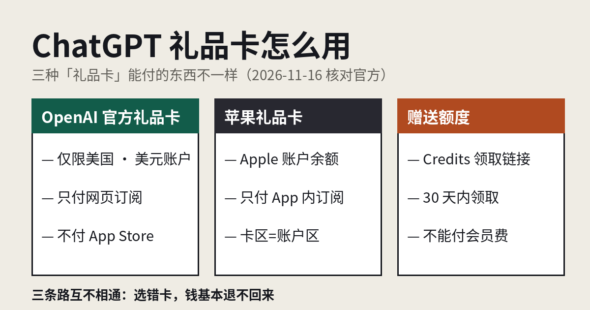

# ChatGPT礼品卡怎么用？三种卡一次分清｜GPT20X

ChatGPT礼品卡最近被搜得很多，但大家说的「礼品卡」其实是三种不同的东西：**OpenAI 官方的 ChatGPT 礼品卡**、**苹果的 Apple Gift Card（App Store 充值卡）**，以及 ChatGPT 里新出的**赠送额度（Gifting credits）**。三者能付的东西不同、能用的地区不同、出问题找的人也不同。买错了，钱基本退不回来。下面全部按 OpenAI 帮助中心和 Apple 支持页的原文整理（2026-11-16 核对），没有官方说法的地方会直接写「以页面显示为准」。如果礼品卡走不通、只是想用人民币把套餐开到自己账号上，也可以先了解 ChatGPT代充 这类开通方式。

---

## 目录

1. 先看结论：三种「礼品卡」一张表
2. OpenAI 官方 ChatGPT 礼品卡：谁能用
3. 官方礼品卡兑换步骤与余额怎么扣
4. 苹果礼品卡能不能付 ChatGPT
5. 赠送额度：Credits 礼物链接怎么领
6. 兑换失败的 7 个常见原因
7. 国内用户怎么选：3 个场景
8. 礼品卡相关的 5 个坑
9. 常见问题

---

## 1. 先看结论：三种「礼品卡」一张表

| 对比项 | OpenAI 官方礼品卡 | 苹果礼品卡（Apple Gift Card） | 赠送额度（Gifting credits） |
|---|---|---|---|
| 本质 | 美元储值卡，兑换后进 ChatGPT 钱包余额 | Apple 账户余额 | 一次性领取链接，领取后变成 Credits |
| 在哪兑换 | 网页 chatgpt.com/redeem | App Store 的「兑换代码」 | 打开购买者发来的链接 |
| 能付什么 | 网页订阅、升级、续费、一次性购买 Credits | App Store 里订的 ChatGPT 订阅等 | 只能在套餐用量用完后抵扣 Codex、Work 等用量 |
| 不能付什么 | App Store / Google Play 订阅、API | 网页订阅 | 会员月费 |
| 地区限制 | 只限美国、美元计费账户 | 卡和 Apple 账户的国家或地区要一致 | 限首发地区，币种须与购买时一致 |
| 有效期 | 卡本身不过期 | 以 Apple 条款为准 | 30 天内领取；领取后 12 个月有效 |
| 退款 | 兑换后不退回卡、不换现金 | 一般不能换现金 | 领取后不退；30 天没人领自动退给购买者 |

一句话：**官方礼品卡只管网页订阅，苹果礼品卡只管 App Store 订阅，赠送额度只管超出套餐后的用量。**三条路互相不通。

---

## 2. OpenAI 官方 ChatGPT 礼品卡：谁能用

帮助中心《购买和兑换 OpenAI 礼品卡》的说法很直接：

- 它是**以美元计价、不可再充值的储值卡**，通过 Best Buy 等授权零售商销售，目前以电子卡为主；没有另行说明时，面额在 **15 至 250 美元**之间。
- **只能在美国购买和兑换。**兑换时人必须在美国，账户必须是美元计费。帮助中心还专门提醒：别给不满足条件的人买美国礼品卡，把电子卡或实体卡寄到别的国家，并不会因此变得可用。
- 支持兑换的账户：免费版、Go、Plus、Pro 个人账户；Business 只有所有者或个人工作空间能兑换。部分赠送的订阅即使套餐名对得上，也可能不支持。
- 卡本身**不过期**，但兑换后**不能拆分、不能转到别的账号、不能提现**。

所以对大多数国内用户来说，官方礼品卡基本用不上：账号不在美国、也不是美元计费，卡就兑不进去。网上看到有人卖「ChatGPT 官方礼品卡代兑」，先对照这几条，再决定要不要碰。

---

## 3. 官方礼品卡兑换步骤与余额怎么扣

满足条件的话，兑换只有四步：

1. 用浏览器打开 **chatgpt.com/redeem**（只能在网页版兑换）；
2. 登录要充值的那个 ChatGPT 账号，先确认账号和工作空间没选错；
3. 输入礼品卡的 **PIN 码**；
4. 确认兑换，然后到 **设置 > 账单** 看余额。交易记录里出现一条「礼品卡」，说明兑换成功。

兑换完要注意，**余额不等于会员**。帮助中心写明：兑换礼品卡只是往账户里加钱，**不会自动开通订阅，也不会改变套餐**。你还要在同一个账号的网页上自己选套餐下单。

余额的扣法也有几条硬规则：

- **自动优先扣余额**：结账时系统先用余额抵扣，差额再从你绑定的卡扣，**不能自己选这次用多少余额**。比如订单 30 美元、余额 10 美元，剩下 20 美元走别的付款方式。
- **续费要留够钱**：用余额续费的，续费日前余额不够、又没有备用付款方式，订阅可能不会续上。
- **试用和促销**：即使余额够，有的结账仍要求填付款方式。
- **币种必须是美元**：出国旅行时，以欧元等其他币种计费的订单，余额抵扣不了。
- **退款回余额**：用余额付的订单如果符合退款条件，退的是钱包余额，不会退回卡上，也不换现金。

还要分清：钱包里的**美元余额**和 Codex、Work 用的 **Credits（额度）** 是两种东西。余额可以拿去一次性买 Credits，但兑换礼品卡本身不会变成 Credits。

---

## 4. 苹果礼品卡能不能付 ChatGPT

能，但只能付 **App Store 里订的** ChatGPT。

Apple 支持页《使用 Apple Gift Card 或 Apple 账户余额可以购买哪些项目》写明，Apple 账户余额可以「为来自 App Store 的 App 中的订阅付款」。也就是说，在 iPhone 的 ChatGPT App 里订 Plus，扣的是 Apple 账户的钱，先用余额，余额不够再走你登记的付款方式。

几个关键限制：

- **卡和账户的地区要一致。**Apple 的条款写明，在中国大陆购买的 App Store 与 iTunes 充值卡**只能兑换到中国大陆的 Apple 账户**；美国卡也注明只适用于美国的 Apple 服务。
- **App 本身要在你那个区的 App Store 上架。**中国大陆不在 OpenAI 公布的 ChatGPT 支持国家和地区名单里，国区 App Store 一般搜不到 ChatGPT 官方 App。
- **有些购买仍要求登记一张卡**，即使余额够付，Apple 也写了这一点。
- **改 Apple 账户地区前**，要先用完余额、取消会阻止更改的订阅，并等订阅期结束。
- **反过来也不通**：OpenAI 官方礼品卡的余额不能付 App Store 订阅；苹果余额也付不了网页订阅。

苹果渠道订的会员，**改套餐、取消、退款都要找 Apple**，不是找 OpenAI。

兑换步骤（iPhone）：打开 App Store → 点右上角头像 → 「兑换代码」→ 用摄像头扫描或手动输入 16 位代码 → 「兑换」。

---

## 5. 赠送额度：Credits 礼物链接怎么领

这是 ChatGPT 里正在**逐步开放**的功能，帮助中心叫 Gifting credits（赠送额度），**不是礼品卡**：

- **谁能买**：Plus、Pro 个人账户，以及 Business 账户关联的个人工作空间，只能在网页上买。免费版和 Go 不能买。
- **谁能领**：免费版、Go、Plus、Pro 个人账户都能领；Business 工作空间和 Enterprise 不能领。
- **怎么领**：打开对方发来的领取链接 → 登录要接收的个人账户 → 确认选中的是个人账户或个人工作空间 → 点「兑换」。
- **期限**：领取链接 **30 天内有效**，过期没人领，钱自动退回购买者；领取后的额度 **12 个月内用完**。帮助中心另注：2026 年 11 月 13 日之后在日本兑换的，有效期缩短为 180 天。
- **币种**：接收账户的计费币种必须和购买时一致。
- **用法**：先用完套餐自带的用量，超出部分才从这笔额度里扣，可用于 Codex 等支持额度的功能。它**不能拿来付会员月费**。

链接就是钱。帮助中心提醒：**填写收件人邮箱并不会把链接锁定给对方**，谁拿到完整链接谁就可能先领走，所以只走私下可信的渠道发送。

---

## 6. 兑换失败的 7 个常见原因

把帮助中心的排查清单整理成表：

| 现象 | 常见原因 | 怎么处理 |
|---|---|---|
| 官方礼品卡提示不可用 | 人不在美国，或账户不是美元计费 | 不满足条件就别继续试，也别改国家地址绕过 |
| 提示 PIN 无效 | 输错、卡未激活或已停用 | 核对 PIN；未激活找零售商 |
| 提示已兑换 | 卡已被用过 | 带上 19 或 20 位**序列号**（不是 PIN）联系 OpenAI 支持 |
| 余额没看到 | 登错账号或工作空间 | 退出后用目标邮箱重新登录再看 |
| 余额显示「加载中」 | 页面没刷新出来 | 不代表兑换失败，刷新稍后再看，不要重复兑换 |
| 想付 App 里的订阅 | 礼品卡余额不支持应用商店 | 改走网页订阅，或改用 Apple 余额 |
| 当天兑换多张失败 | 碰到余额或每日充值上限 | 等一段时间再试 |

联系客服时，帮助中心要求提供：账号邮箱、礼品卡序列号、错误信息和发生时间（含时区）、打了码的截图。**完整 PIN 和完整领取链接都不要发。**

---

## 7. 国内用户怎么选：3 个场景

**场景 A：人在美国、有美国账户。**官方礼品卡是最顺的一条路：自己买或收亲友送的卡，网页兑换，到期前看一眼余额够不够续费。

**场景 B：手上有外区 Apple 账户和同区的苹果礼品卡。**可以在 App 里订阅，扣 Apple 余额。但卡区、账户区、App 上架区要三者一致，后续改套餐和退款都在 Apple 那边办，提前想好。

**场景 C：在国内，没有境外卡，也没有外区账户。**礼品卡这几条路基本都走不通。常见做法是用支付宝、微信找代充平台，把套餐直接开到你自己的 ChatGPT 账号上：先确认要开的是 Plus 还是别的档位，再通过 [ChatGPT Plus充值](https://gpt20x.com/chatgpt-plus) 这类页面用人民币下单，整个过程不需要买任何礼品卡。代充给的是平台订单的兑换码，不是 OpenAI 官方礼品卡，区别见[《GPT 代充卡密怎么兑换》](https://amber-moose-14.github.io/chatgpt-daichong-guide/gpt-daichong-kami-duihuan-2026.html)。

不管走哪条路，都别让同一个账号同时有两份订阅在扣费：App Store 订阅和网页订阅可以叠加扣费，先查清楚再下单，方法见[《ChatGPT 订阅怎么管》](https://amber-moose-14.github.io/chatgpt-daichong-guide/chatgpt-dingyue-guanli-quxiao-2026.html)。

---

## 8. 礼品卡相关的 5 个坑

1. **「低价官方礼品卡」**：官方卡按面值卖，明显低于面值的要警惕来源；帮助中心把「无效、未激活或已停用的卡」列为兑换失败的常见原因，来路不明的卡很可能兑不进去。
2. **把 PIN 发给别人「代兑」**：PIN 一旦被兑换，OpenAI 无法退回礼品卡。代兑等于把钱交给对方。
3. **地区不符硬兑**：帮助中心明确说，不要用别的国家或账单地址去绕过资格要求。
4. **以为余额就是会员**：兑换完不下单，套餐不会变。
5. **公开晒领取链接或 PIN**：被别人抢先兑换，基本追不回来。

---

## 9. 常见问题

**Q：ChatGPT 官方礼品卡在中国能用吗？**
不能。官方礼品卡只限美国购买和兑换，账户须为美元计费，人也要在美国。

**Q：礼品卡余额能付 Pro 吗？**
能付网页上符合条件的订阅、升级和续费，包括 Pro；App Store 和 Google Play 的订阅不行。价格以 [ChatGPT 定价页](https://chatgpt.com/pricing) 为准，目前 Go 8 美元/月、Plus 20 美元/月、Pro 100 美元/月起（2026-11-16 核对）。

**Q：余额可以留着下个月续费吗？**
可以，余额会留在账户里，但有可扣的订单时会自动先扣，不能「这次不用、留到下次」。

**Q：赠送额度能抵会员费吗？**
不能。它只抵扣套餐用量用完后的 Codex 等额度，领取后 12 个月内要用完。

**Q：苹果礼品卡买错区怎么办？**
Apple 规定充值卡只能用于发行地区的账户，一般不能换现金。先看清卡面区域再买。

---

## 参考来源

- [OpenAI 帮助中心：购买和兑换 OpenAI 礼品卡](https://help.openai.com/zh-hans-cn/articles/20001491)（仅限美国、15–250 美元、chatgpt.com/redeem、不支持应用商店、不过期、不可拆分转让）
- [OpenAI 帮助中心：使用你的 ChatGPT 余额](https://help.openai.com/zh-hans-cn/articles/20001508)（余额自动抵扣、续费、交易记录、不要改地址绕过资格）
- [OpenAI 帮助中心：在 ChatGPT 中赠送额度](https://help.openai.com/zh-hans-cn/articles/20001417)（谁能买和领、30 天领取、12 个月有效、日本 180 天）
- [OpenAI 帮助中心：通过额度灵活使用 ChatGPT（个人套餐）](https://help.openai.com/zh-hans-cn/articles/12642688)（额度用途、12 个月有效、不可转让）
- [OpenAI 帮助中心：ChatGPT 支持的国家和地区](https://help.openai.com/zh-hans-cn/articles/7947663-chatgpt-supported-countries)
- [Apple 支持：使用 Apple Gift Card 或 Apple 账户余额可以购买哪些项目](https://support.apple.com/zh-cn/118245)
- [Apple 支持：兑换 Apple Gift Card 或 App Store 与 iTunes 充值卡](https://support.apple.com/zh-cn/118242)
- [Apple 支持：更改 Apple 账户国家或地区](https://support.apple.com/zh-cn/118283)
- [Apple：iTunes 充值卡和充值码条款（中国）](https://www.apple.com/legal/internet-services/itunes/giftcards/cn/terms.html)
- [ChatGPT 定价页](https://chatgpt.com/pricing)

> 非 OpenAI 官方内容。礼品卡、余额和额度规则仍在调整，请以 OpenAI 帮助中心、Apple 支持页和结账页显示为准。

---

*最后更新：2026-11-16*　｜　[返回教程首页](README.md)　｜　本文由 [GPT20X](https://gpt20x.com/) 整理
