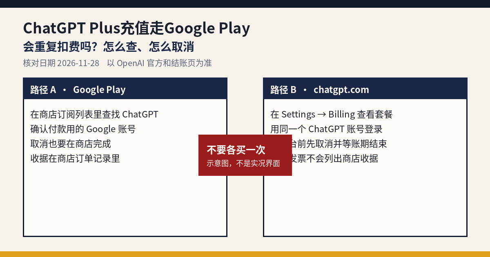

# ChatGPT Plus充值走Google Play会重复扣费吗？怎么查、怎么取消｜GPT20X

在 Android 上做 ChatGPT Plus充值时，订单可能由 Google Play 管理，而不是 chatgpt.com 的账单设置。若你正在考虑[ChatGPT Plus充值](https://gpt20x.com/chatgpt-plus)，建议先查清 Google Play、Apple 和网页有没有已经在扣费的订阅，再决定是继续使用已有会员，还是改在网页查看开通和付款方式。本文按 2026-11-28 英文帮助中心核对，具体以官方页面、商店订单和结账页当时显示为准。

ChatGPT 对账号使用地区有要求，开通前建议先看一下 OpenAI 官方的支持地区说明。商店是否提供应用和订阅，以当时登录的 Google 账号所见为准，不要把改地区当成开通办法。

## 先看结论：先确认订阅归谁管，再决定开通或取消

| 你想确认的事 | 官方目前的说法（2026-11-28 按英文帮助中心核对） |
|---|---|
| 订阅归谁管 | 在哪个平台购买，就由哪个平台管理：Google Play、Apple App Store 或 chatgpt.com |
| 已经有订阅，换设备还要再买吗 | 先用同一个 ChatGPT 账号登录新设备，通常可以直接使用已有订阅，不必再买一次 |
| 怎样避免重复扣费 | 若要换到另一个平台付费，先在原来的平台取消，等到已付费周期结束后，再在新平台订阅 |
| Play 显示已订阅，ChatGPT 仍是 Free | 先确认 Play 订阅仍有效，再登录当初购买时用的 ChatGPT 账号；邮箱可能和商店收据不同。若仍是 Free，先联系 Support，不要再买一次 |
| 想给另一个 ChatGPT 账号开通 | 订阅不能在账号之间转移或共享。Google Play 若已关联过订阅，可能阻止再给另一个账号购买，即使旧订阅已经到期 |
| 收据在哪看 | Play 订单看 Google Play 的付款与订单记录；网页订阅的发票才出现在 ChatGPT 的 Billing |
| 卸载应用能取消吗 | 不能。取消要在当初付款的平台操作 |

本页只解决 Plus 走 Google Play 时如何核对开通、避免跨平台各扣一笔，以及商店已付费但账号仍是免费时先看什么。三平台日常管理和退款细则见文末相关教程。

## Google Play 账号和 ChatGPT 账号不是同一回事

一笔移动端订阅会同时关联两个账号：用于付款的 Google 账号，以及购买当时选中的 ChatGPT 账号。官方写明：Your ChatGPT account and your Apple Account or Google Play account are separate. 意思是：ChatGPT 账号和 Apple 或 Google Play 账号是分开的，不能把商店登录当成 ChatGPT 登录。

商店收据上的邮箱不一定等于 ChatGPT 账号邮箱。若另一台设备已经能用 Plus，先在那台设备打开 Settings → Account 和 Billing 查看邮箱与套餐，然后再退出当前仍显示 Free 的账号。不要在尚未确认原账号之前重新付款。

Google Play 的付款方式以当时商店结账页为准。本文不把商店付款写成支付宝或微信，也不编写未在当页展示的价格。

## 开通前先查有没有已经在扣费的订阅

官方建议：如果会在多个设备使用 ChatGPT，在 chatgpt.com 订阅往往更容易统一管理，因为不必再到 Apple 或 Google 后台操作。这不是唯一付款方式，主要是为了减少跨平台各买一次。

1. Google Play：打开 Play 商店，确认登录的是当初付款的 Google 账号，进入头像 → Payments & subscriptions → Subscriptions，查看有没有 ChatGPT。
2. Apple：在 iPhone 的设置里进入 Apple 账号的订阅列表，查看有没有 ChatGPT。
3. 网页：登录 chatgpt.com，打开 Settings → Billing，查看是否有由网页管理的有效套餐。

如果其中一处已经有有效订阅，先用同一个 ChatGPT 账号登录正在使用的设备。官方写的是：You can use your existing subscription there without buying another one. 意思是：同一账号在新设备上可以使用已有订阅，不必再买一份。

若打算从 Google Play 换到网页付款，或从网页换到商店，官方要求先在原来的平台取消，等到已付费周期结束，再在新平台订阅。英文原文是：wait until the paid period ends, then subscribe on the new platform. 意思是：要等当前已付费周期结束，再在新平台订阅。不要在旧订阅仍可能续费时又开一笔。

## Play 显示已订阅，但 ChatGPT 仍是免费，先不要再买

1. 在付款用的 Google 账号里打开 Google Play 订阅，确认 ChatGPT 订阅仍是有效状态。
2. 登录你购买当时使用的那个 ChatGPT 账号。它的邮箱可以和 Google Play 收据上的邮箱不同。

如果订阅确实有效，而这个原账号仍然显示 Free，再次购买前先联系 Support，并尽可能提供购买日期和 Google Play 订单号。官方提醒：Purchasing another subscription may lead to duplicate charges. 意思是：尚未找回原订阅时再买一次，可能造成重复扣费。

官方为 Apple 订阅写了应用内 Restore purchases 的步骤；对 Google Play，则是确认商店订阅有效、登录原账号，若仍为 Free 再联系支持。不要把苹果的恢复购买步骤套到 Google Play。

如果 Google Play 账号曾经为某个 ChatGPT 账号买过订阅，之后可能无法再给另一个账号购买，即使旧订阅已经取消或到期。卸载或重装应用也不会改变订阅归属。若要给另一个账号开通，可先到 chatgpt.com 登录目标账号查看可买套餐，并在换平台前按取消和等待规则处理。本文不把这写成一定能绕过商店限制。

## 取消 Google Play 订阅要在商店里操作

取消必须通过购买时使用的 Google 账号，在 Google Play 完成。卸载应用或删除 ChatGPT 账号，都不会自动取消商店订阅。取消只停止后续续费，不会自动退还已经产生的费用。

在应用里取消的步骤是：打开 Google Play Store，打开 Subscriptions，选择 ChatGPT，选择 Cancel subscription，并按提示确认。

在网页取消的步骤是：打开 Google Play 订阅管理页，用付款的 Google 账号登录，在 ChatGPT 旁选择 Manage，再选择 Cancel subscription；如询问原因，按提示继续。

若已经无法登录那个 Google 账号，需要向 Google 申请账号恢复，而不是只在 ChatGPT 设置里找取消按钮。网页订阅应在 chatgpt.com 的 Settings → Billing → Cancel plan 取消，不要和商店订阅混用。

## 不同情况怎么处理

**准备在 Android 上开通 Plus 的人。** 先完成上面的三入口查询。若已经有有效订阅，用同一 ChatGPT 账号登录即可。若确认还没有订阅，再在当时可见的官方入口开通，并看清结账页上的价格、币种和付款方式。

**已经在 Google Play 付过款，但界面仍是 Free 的人。** 先核对是不是购买时的 ChatGPT 账号，以及付款用的 Google 账号。两步都对但仍显示 Free 时，带上购买日期和订单号联系支持，不要再下一单。

**想从商店改到网页付款，或想用人民币了解网页开通选项的人。** 先在 Google Play 取消，并等到已付费周期结束，再在 chatgpt.com 查看套餐和结账方式。GPT20X 只是可以用人民币、支付宝或微信了解开通选项的途径之一，不能替代官方平台归属规则，也不能把商店订单纯迁移到另一个账号。网页发票在 ChatGPT 账单设置里查看，Play 订单纯看商店订单，不要把两份收据当成同一份。

**只想停掉后续扣费的人。** 到当初付款的平台取消。取消不等于退款。若认为存在核实过的重复扣费，需登录被扣费的 ChatGPT 账号，通过官方帮助中心联系支持，并提供已付款订单的日期和金额。资格和办理时间以官方退款说明为准；两笔分开购买的订阅并不自动获得退款。

**需要收据做报销的人。** Google Play 会把购买确认发到付款用的 Google 账号邮箱。也可以在 Play 商店打开头像 → Payments & subscriptions → Budget & history，查找 ChatGPT 订单。网页账单设置里的 Invoices 不会列出商店收据。

## 常见问题

**在 Google Play 买了 Plus，换手机还要再买一次吗？**  
不必先假设要再买。用同一个 ChatGPT 账号登录新设备，先看套餐是否已经生效。若已有有效订阅，再买一次就可能重复扣费。

**商店收据邮箱和 ChatGPT 登录邮箱不一样，是不是买错了？**  
不一定。官方写明商店收据邮箱可以和 ChatGPT 账号邮箱不同。先找回购买时用的 ChatGPT 账号，在 Settings → Billing 查看套餐，不要只凭收据邮箱再注册新号去付款。

**Play 里还能看到 ChatGPT 订阅，但我想给另一个账号开通 Plus，取消旧的就行吗？**  
不一定。官方说明：Google Play 若已关联过 ChatGPT 订阅，即便订阅到期，也可能继续阻止给另一个账号购买。订阅也不能在账号之间转移。先核对不同账号，再决定是找回原账号，还是改在网页给目标账号查看套餐。

**卸载 ChatGPT 或在网页点取消，能停掉 Google Play 扣费吗？**  
不能只靠卸载。Google Play 订阅要在 Play 商店的订阅页取消。网页 Billing 里的取消，只管网页订阅。删掉 ChatGPT 账号也不会自动取消商店订阅。

**我被扣了两笔，取消其中一笔就会自动退款吗？**  
不会自动退。先确认要保留哪一笔，并在对应平台取消不再需要的订阅。官方写明：Having two separately purchased subscriptions does not automatically qualify you for a refund. 意思是：两笔分开购买的订阅，并不自动具备退款资格。若要申请，按官方退款路径办理，细节见退款教程。

## 相关教程

- [ChatGPT 订阅怎么管：取消与防重复扣费](https://amber-moose-14.github.io/chatgpt-daichong-guide/chatgpt-dingyue-guanli-quxiao-2026.html)
- [ChatGPT充值后退款怎么申请？官方规则一次看清](https://amber-moose-14.github.io/chatgpt-daichong-guide/chatgpt-chongzhi-tuikuan-2026.html)
- [ChatGPT Plus 充值怎么选：谁适合月付](https://amber-moose-14.github.io/chatgpt-daichong-guide/chatgpt-plus-chongzhi-yuefu-2026.html)

## 官方来源

- [如何避免在 iOS、Android 和网页重复订阅扣费](https://help.openai.com/en/articles/20001043-how-do-i-avoid-being-charged-twice-if-i-subscribe-to-chatgpt-on-ios-android-and-the-web)。说明三个平台各自管理订阅，换平台需先取消并等到已付费周期结束。
- [取消 ChatGPT 订阅](https://help.openai.com/en/articles/7232927-canceling-your-chatgpt-subscription)。给出 Google Play 应用和网页的取消步骤，并说明卸载应用不会取消订阅。
- [排查订阅无法使用和账号变更](https://help.openai.com/en/articles/20001056-troubleshooting-chatgpt-subscription-access-and-account-changes)。说明商店账号与 ChatGPT 账号分离，以及 Play 显示已订阅但账号仍为 Free 时先不要再买。

> 本页为 [GPT20X](https://gpt20x.com/) 整理，非 OpenAI 官方内容。价格、额度和政策以 OpenAI 官方和结账页为准。

*最后更新：2026-11-28*
