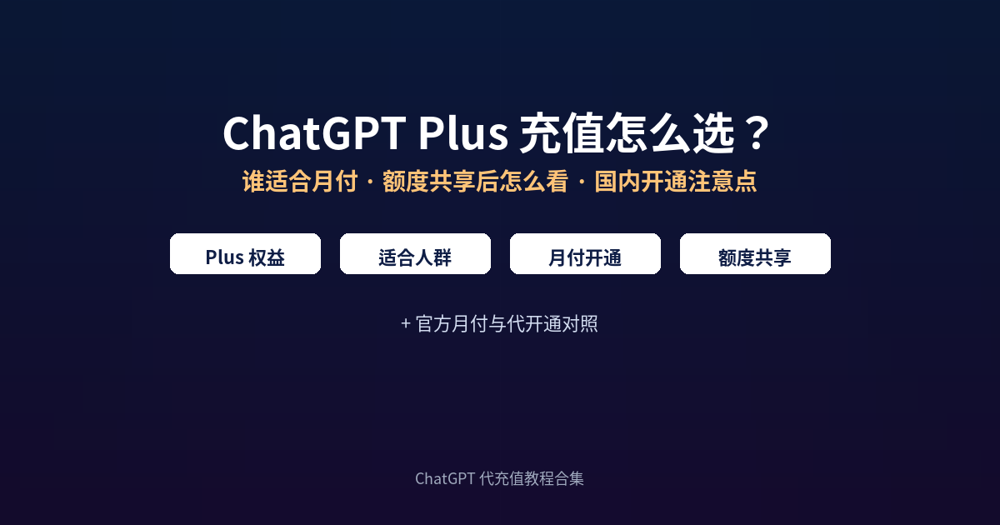

# ChatGPT Plus 充值怎么选：谁适合月付、额度共享后怎么看、国内开通注意点

**简短回答：** ChatGPT Plus 充值先确认自己需要的是 Plus 的月付权益，而不是 Go 或 Pro。官方价是每月 20 美元、按月计费；没有境外卡或不想绑卡时，可用支付宝/微信走代开通，把会员开到**你自己的账号**上。2026 年 12 月起 Plus/Pro 等套餐的用量额度会与 Codex 共用同一池，选月付前先对照自己的聊天与编程用量，再决定是否开通。

---

## 目录

1. 为什么这几天又在聊 Plus 充值
2. Plus 有哪些权益、谁更适合
3. 月付怎么开通：官方与代开通对照
4. 额度共享后怎么看自己的用量
5. 开通前自查清单
6. 月付开通的分步骤流程
7. 开通后要核对的 4 件事
8. 常见问题

---

## 1. 为什么这几天又在聊 Plus 充值

2026 年 11 月初，多家媒体与用户邮件反馈：OpenAI 正推进把 ChatGPT 里的 Chat 与 Work 体验合并；随合并推进，从约 **2026 年 12 月**起，Plus、Pro、Business 等套餐的用量额度将在 **ChatGPT 与 Codex 之间共享**（即时模型对话不计入该共享额度）。TechCrunch 在 11 月 2 日报道了这一变化，并指出多数用户影响有限，但高频同时用对话和 Codex 的人，可能更早碰到重置等待（来源：[TechCrunch：OpenAI is finally merging ChatGPT's Chat and Work tabs](https://techcrunch.com/2026/11/02/openai-is-finally-merging-chatgpts-chat-and-work-tabs/)；官方说明见 [OpenAI 帮助中心：Understanding ChatGPT and Codex usage limits](https://help.openai.com/en/articles/20001625-understanding-chatgpt-and-codex-usage-limits)）。

对打算开通 Plus 月付的人，含义很直接：月付不只是「聊天额度变多」，还要一并考虑 Codex / Work 侧的用量。权益与限额仍以 [OpenAI 帮助中心 · What is ChatGPT Plus](https://help.openai.com/en/articles/6950777-what-is-chatgpt-plus) 和 [ChatGPT Pricing](https://chatgpt.com/pricing/) 实时页面为准。

还在挑平台，先看[《ChatGPT 代充怎么选》](choose-daichong-platform.md)。

---

## 2. Plus 有哪些权益、谁更适合

根据官方帮助页与套餐页，Plus 相对免费版大致包括：高峰期更优先访问、更高模型与消息额度、推理模型、更快响应，以及语音、图像生成、文件分析、Deep Research（视开放情况）等。套餐页还列出更大上传与会话容量、扩展记忆与上下文、Projects / 定时任务 / 自定义 GPT、扩展 Codex 与 ChatGPT Work 等（以账号内模型选择器和套餐页为准）。

| 维度 | 更适合 Plus | 可能不够 / 可考虑其他档 |
|---|---|---|
| 使用强度 | 每周多次写作、办公、轻度编程 | 偶尔问问 → 免费或 Go；重研究/高强度 Codex → 对照 Pro |
| 支付与续费 | 接受按月续费，方便随时停 | 需要「官方年付」→ 官方目前写明 Plus **不支持年付** |
| 账号归属 | 希望会员开在自己账号、隐私独立 | 被人推销「共享号 / 合租」→ 不建议当作正规开通 |
| 工具组合 | 同时用对话 + 轻度 Codex / Work | 12 月后额度共享，双端都极高频时要预留余量 |

**谁更适合月付：** 工作学习里每周都要用到进阶模型或工具，但还没到重度研发强度的人；想先试用一个月再决定是否续的人；没有稳定境外卡、但希望把 **chatgpt 会员** 开在自己账号上的人。

---

## 3. 月付怎么开通：官方与代开通对照

官方帮助中心写明：ChatGPT Plus 为 **$20/月、按月计费**；目前**不支持年付或多月预付**。自行开通路径通常是：登录 ChatGPT → 头像 → Upgrade Plan → 选择 Get Plus，并用可用的境外支付方式完成（详见帮助中心原文）。

国内常见诉求是用支付宝或微信完成 **chatgpt 充值**。此时「代开通」指由第三方平台完成付款与开通流程，会员落在**你自己的账号**上，而不是购买别人的成品号。以 GPT20X 公开页面为例（以下单页实时显示为准，2026-11-06 核对）：

| 对比项 | 官方月付 | 代开通（以 GPT20X Plus 页为例） |
|---|---|---|
| 标价 | $20 / 月 | ¥168 / 30 天（[ChatGPT Plus 充值](https://gpt20x.com/ChatGPTPlus2) 页） |
| 支付方式 | 主要信用卡等官方支持方式 | 支付宝 / 微信等（见站点说明） |
| 年付 | 官方明确暂不支持 | 页面当前主推 30 天月付；其他套餐另页说明 |
| 账号密码 | 在自己账号内升级 | 页面写明无需提供账号密码 |
| 失败处理 | 按官方账单与退款规则 | 页面写明充值失败支持退款 |
| 票据 | 官方收据 / 发票规则 | 可报销收据；企业批量可联系客服 |

价格、到账时效与售后以各自页面为准；需要对照多种开通路径费用时，可看[各开通方式费用参考](https://gpt20x.com/blog/chatgpt-plus-recharge-price-guide)。不确定的条款，一律以官方帮助中心和平台当前下单页为准。

---

## 4. 额度共享后怎么看自己的用量

结合公开报道，可先这样自查，避免「开了 Plus 却总觉得很快触顶」：

1. **分清即时模型对话与共享池用量。** 报道提到即时模型聊天不计入该共享限额；重推理、Codex、Work 类任务更容易吃额度。
2. **看是否双端并行。** 白天对话、晚上用 Codex，12 月后会从同一池扣减，应预留缓冲。
3. **高峰期限额会变。** 官方帮助页说明 Plus 高峰时可能有消息上限，以当时规则为准。
4. **触顶不等于账号坏了。** 先等重置；频繁触顶再对照是否需要更高档套餐（以官方套餐页为准）。

---

## 5. 开通前自查清单

动手前对照一遍，能少走很多弯路：

- [ ] 确认目标套餐是 **Plus 月付**，不是 Go / Pro
- [ ] 已知官方为 **$20/月、无官方年付**（以帮助中心为准）
- [ ] 已准备好要开通的 **ChatGPT 账号邮箱**（自己的号）
- [ ] 若走代开通：确认页面写明**开通到自己账号**、可查订单、有失败退款说明
- [ ] 不会把账号密码、邮箱验证码、2FA 恢复码交给陌生人
- [ ] 已想清楚 12 月后对话与 Codex 可能**共用额度**
- [ ] 已保存订单号 / 卡密查询入口（代开通场景）
- [ ] 知道客服工作时间（GPT20X 页面写的是每天 8:00–24:00）

---

## 6. 月付开通的分步骤流程

### 路径 A：官方月付

1. 使用要开通会员的账号登录 [ChatGPT](https://chatgpt.com/)。
2. 点击头像 → Upgrade Plan（或设置中的升级入口）。
3. 选择 Get Plus，确认价格为 $20/月。
4. 用官方支持的支付方式完成付款。
5. 回到设置核对套餐名称与续费日期。

### 路径 B：代开通（卡密自助，以 GPT20X 说明为例）

1. 打开 [GPT20X 的 Plus 月付下单页](https://gpt20x.com/ChatGPTPlus2)，确认套餐为 ¥168/30 天。
2. 填写用于查询订单的手机号或邮箱，完成支付宝/微信付款。
3. 付款后领取卡密；页面关闭可到订单查询页找回。
4. 按订单提示在自助页粘贴卡密，核对套餐与当前登录的 ChatGPT 账号。
5. 提交后等待处理，**不要用同一卡密反复提交**。
6. 刷新或重登 ChatGPT，确认 Plus 已生效。

兑换失败排查见[《GPT 代充卡密怎么兑换》](gpt-daichong-kami-duihuan-2026.md)。主要拿 Plus 写代码的，Codex 每 5 小时大概能用多少见[《Codex 代充前必读》](codex-daichong-yongliang-kaitong-2026.md)。

---

## 7. 开通后要核对的 4 件事

1. **套餐名称**：设置里显示为 Plus（或你购买的对应档位）。
2. **到期 / 续费日**：记下日期，提前 1–2 天决定是否续。
3. **功能抽样**：试一条进阶模型对话、一次图像或文件能力（以账号开放为准）。
4. **凭证归档**：官方收据或代开通的订单号、卡密、付款截图放一起，报销按平台说明下载。

---

## 8. 常见问题

**Q：官方 Plus 能不能一次付一年？** 按 OpenAI 帮助中心当前说明，Plus 为每月 $20、按月计费，**暂不支持年付或多月预付**。看到「官方 Plus 年付」宣传时，先回到帮助中心核对。

**Q：没有境外卡，怎么完成 chatgpt 充值？** 可考虑把会员开到自己账号上的代开通服务，用支付宝或微信付款。选择前确认：开通对象是自己的号、能查订单、失败有退款说明，并避免索要密码的渠道。

**Q：12 月额度与 Codex 共享后，Plus 还值得开吗？** 多数轻度到中度用户影响有限；若你长期双开对话与 Codex 且经常触顶，需要按实际用量评估，必要时对照更高档套餐。具体限额以官方当时规则为准。

**Q：代开通要不要提供 ChatGPT 账号密码？** 不需要。正规流程一般通过卡密自助或客服引导完成，索要密码、验证码或 2FA 恢复码时应先停手核实。

**Q：付了款但 ChatGPT 里还是免费版怎么办？** 先确认登录的是下单时的同一个账号，退出重登后再看设置。代开通场景带订单号查进度；官方自付场景按帮助中心「已扣款仍显示免费」排查步骤处理。

**Q：Plus 和 chatgpt 会员是一回事吗？** 日常说的 chatgpt 会员常笼统指付费档；严格说 Go / Plus / Pro 等是不同套餐。下单时认准「Plus 月付」字样，避免买错档。

---

*最后更新：2026-11-06*　｜　[返回教程首页](README.md)
