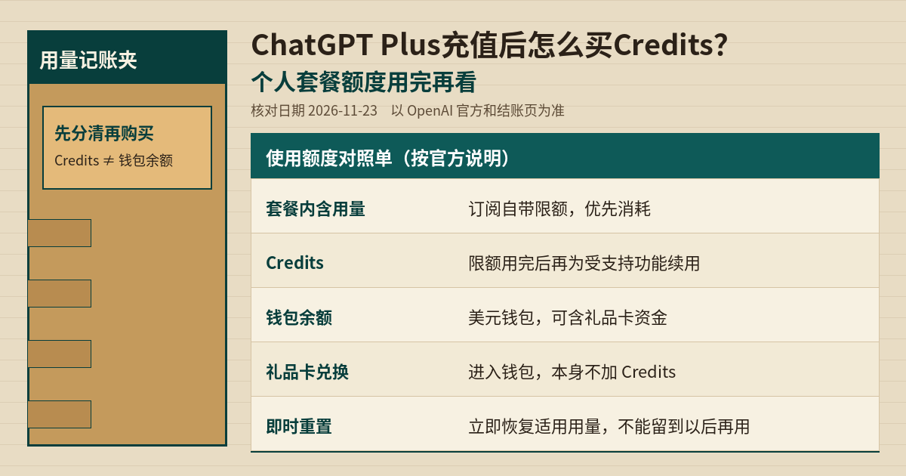

# ChatGPT Plus充值后怎么买Credits？个人套餐额度用完再看｜GPT20X

已经开通 ChatGPT Plus 或 Pro，套餐内含用量用完后还想继续使用 Codex、「工作」或办公插件的人，需要先分清：接下来买的是用量 Credits，还是再次办理订阅。本文按 OpenAI 帮助中心个人套餐说明，整理 Credits 能用在哪些功能、在哪里查看和购买、自动充值要注意什么，以及它和钱包余额、礼品卡有何不同。若你还在考虑[ChatGPT Plus充值](https://gpt20x.com/chatgpt-plus)，可以先看清套餐内含用量和官方结账页，再决定要不要另买 Credits；核对日期：2026-11-23，具体以 OpenAI 官方和结账页为准。

## Credits 是额外用量，不是把套餐改掉

帮助中心把个人套餐里的 Credits 写成套餐内含限额用完后，用来继续使用符合条件功能的即用即付额度。官方写明：套餐本身不会因此改变，你仍然先用套餐内含用量；只有达到限额后，受支持功能才会从 Credits 余额里扣。受支持功能包括 Codex、ChatGPT「工作」、Word、Excel 和 PowerPoint，具体取决于你的套餐和账户。

这类 Credits 不是 API 额度，也不会提高套餐内含限额，更不会把 Free 或 Go 改成 Plus 或 Pro。Plus 和 Pro 在相关功能对当前账户开放时，Codex、「工作」、Excel 和 PowerPoint 可以共用同一份智能体用量，Word 也会使用这份用量。把「使用额度前先询问我」写进自定义指令，并不会增加账单审批步骤；套餐用量用尽后若继续使用「工作」或 Codex，已有 Credits 仍可能被自动扣用。

## 和钱包余额、礼品卡、即时重置怎么区分

Credits、ChatGPT 钱包余额、礼品卡兑换，以及为「工作」和 Codex 购买的即时重置，在官方说明里是分开的。

| 项目 | 官方怎么定位 | 常见误解 |
|---|---|---|
| 套餐内含用量 | 订阅自带的限额，优先消耗 | 买了 Credits 就等于把套餐限额提高一档 |
| 使用额度 Credits | 限额用完后，为受支持功能付费续用的余额 | 可以当成 API 额度，或在任意功能上通用 |
| ChatGPT 钱包余额 | 以美元计价的钱包，可包含已兑换的礼品卡资金 | 钱包有钱就等于已经有 Credits |
| 礼品卡兑换 | 兑换后进入钱包资金，本身不会增加使用额度 | 兑换礼品卡就等于充进了 Credits |
| 即时重置 | 立即恢复适用的「工作」和 Codex 用量，并开始新的一周周期 | 买了重置就等于多了一笔可留到以后再用的 Credits |

帮助中心有一句英文原文：

> Redeeming a gift card does not itself add usage credits.

这 11 个词的意思是：兑换礼品卡本身不会增加使用额度。在 ChatGPT 网站上符合条件的一次性 Credits 购买，结账时有可能用到钱包资金；确认前要核对应扣金额。能看到钱包余额，并不表示每一次购买都会用到钱包。若结账页没有显示已使用钱包资金，不要默认这次会从钱包扣款。

即时重置会立即恢复适用用量，并把下一次自动的每周重置安排到你在重置生效后第一次使用「工作」或 Codex 起算的 7 天后。它不会增加 Credits 余额，也不能先买下来留着以后再用。价格和是否开放都以账户里实际显示的选项为准，本文不编造未写明的数字。

## 在哪里查看，以及怎么买

如果你的账户支持购买 Credits，可在 ChatGPT 的「设置 → 用量」，或 Codex 应用的「用量与账单」里查看余额并购买。Plus 或 Pro 用户在 Codex 达到限额时，也可能会看到「添加额度」。若没有这个入口，说明当前账户还不能买。

购买时按页面实际选项操作：若出现 Other 或 Other amount，按显示的币种输入金额并查看 Credits 预览；若出现 Custom credits，则输入要买的数量。自定义金额必须满足最低购买量；若系统要求整数 Credits，还要能换算成整数。付款前核对数量、价格和应付总额。

12 月起，Plus、Pro 和 Business 的用量将在 ChatGPT 与 Codex 之间共享，并用 token 计量；更先进的模型和更复杂的任务通常会消耗更多用量。官方写明，即时聊天不会占用这笔用量。达到限额时，可以等待重置、升级套餐，或购买 Credits 以继续使用符合条件的功能。

## 自动充值打开前先核对这几项

如果账户支持自动充值，同样在上述用量页打开。当 Credits 余额低于你设定的最低余额时，系统会用已保存的默认付款方式，只购买把余额补回目标值所需的数量。若打开时余额已经低于最低值，系统可能会立即扣款。官方举例：最低余额设为 100、目标余额设为 500，打开时余额是 40，则差额是 460；每月限额可能会减少实际购买量，且只适用于自动充值。

任务开始时余额还是正数，但并发用量在结束前把余额耗尽，余额也可能变成负数；之后再买或触发自动充值时，可能先冲抵负余额。若记录和余额对不上，先登录当时付款的同一账户再核对，仍无法解释时再向官方客服提供购买日期和收据编号。

## 对不同用户意味着什么

**已经开通 Plus 的人。** 先在用量页确认内含用量、重置时间和是否出现「添加额度」。Credits 只用于官方写明的受支持功能，不能理解成解锁当前套餐没有的模型，也不能把两个订阅的用量合并。ChatGPT 对账号使用地区有要求，开通前建议先看一下 OpenAI 官方的支持地区说明。

**已经开通 Pro 的人。** 同样先消耗套餐内含用量，再视账户情况购买 Credits。各档在「工作」和 Codex 上的限额写法，以英文帮助中心最新用量说明为准；没有五小时限额并不等于用量无限，也不等于可以跳过 Credits 或重置规则。

**使用 Free 或 Go 的人。** Credits 购买目前只对一部分 Free 和 Go 用户开放。只有在用量页能买，或达到限额后看到「添加额度」，才说明当前账户可用；买了也不会改变套餐或提高内含限额。若没有看到入口，说明当前还不能买，但已有余额仍可能可以查看和使用。

**可能适用日本购买规则的人。** 官方写明：Credits 自购买之日起 12 个月后过期；2026 年 11 月 13 日之后在日本购买的 Credits，自购买之日起 180 天后过期。未使用的 Credits 不会结转。

**经第三方渠道开通的人。** Credits 的查看、购买和退款审核，仍要登录被开通的同一个 ChatGPT 账号，在官方用量页操作。第三方下单和售后以该渠道结算页为准。本文由 GPT20X 按帮助中心公开说明整理，只供对照，并不替代官方页面。

办公插件方面，帮助中心举例：一次典型的 Excel 或表格任务可能消耗 5 到 20 Credits，一次典型的 PowerPoint 任务可能消耗 10 到 50 Credits，实际用量随模型和任务变化。「工作」和 Codex 的 token 费率以官方个人定价说明为准，本文不另行编造数字。

## 常见问题

**买了 Credits，套餐限额会不会一起变高？**  
不会。官方写明套餐本身没有变化，你仍然先用套餐内含用量。Credits 是限额用完后为受支持功能提供的即用即付余额。

**Credits 会过期吗，没用完能不能留到下一年？**  
会过期，也不能按年结转。一般是购买之日起 12 个月后过期；2026 年 11 月 13 日之后在日本购买的 Credits，购买之日起 180 天后过期。

**没用来的 Credits 能不能退款，或者转给别人？**  
除非法律、合同要求或属于获批例外，Credits 不可退款；余额没有现金价值，不能转让、转售或赠送。若平台提供赠送功能，那是另购一份给符合条件个人账户的赠送额度，不是把已有余额转出去。已核实的计费错误、未授权使用或服务故障等情形可能符合审核，不要把例外理解成一定能退。

**钱包里看得到余额，买 Credits 时一定会先扣钱包吗？**  
不一定。使用额度余额和钱包余额是分开的。只有在 ChatGPT 网站上符合条件的一次性购买，结账才可能使用钱包资金；结账页没有显示已使用钱包资金时，不要默认会从钱包扣款。

**我是 Free 或 Go 用户，看不到「添加额度」怎么办？**  
按官方说明，这表示当前账户还不能购买 Credits。若账户里已经有余额，仍可能可以查看和使用。

**Credits 和买一次即时重置，该怎么选？**  
即时重置会立即恢复适用的「工作」和 Codex 用量，并改写后续每周重置时间，不能先存着以后再用；Credits 是限额用完后按量扣减的余额。应对照账户里显示的选项、价格、剩余内含用量和下一次自动重置时间再决定。即时重置购买通常不可退款；Credits 另有自己的退款规则。

## 相关教程

- [ChatGPT充值能用Wallet吗](https://amber-moose-14.github.io/chatgpt-daichong-guide/chatgpt-chongzhi-wallet-qianbao-2026.html)
- [12月额度和Codex共享说明](https://amber-moose-14.github.io/chatgpt-daichong-guide/chatgpt-huiyuan-codex-gongxiang-2026.html)
- [ChatGPT礼品卡怎么用](https://amber-moose-14.github.io/chatgpt-daichong-guide/chatgpt-lipinka-2026.html)

## 官方来源

- [通过额度灵活使用 ChatGPT（个人套餐）](https://help.openai.com/en/articles/12642688-using-credits-for-flexible-usage-in-chatgpt-personal-plans)。说明 Credits 的适用范围、购买和自动充值入口、过期与退款规则，以及和钱包余额的区别。
- [了解 ChatGPT 与 Codex 的用量限制](https://help.openai.com/en/articles/20001625-understanding-chatgpt-and-codex-usage-limits)。说明 12 月起共享用量、按 token 计量，以及即时聊天不占用该用量。
- [付费购买「工作」和 Codex 的每周用量重置](https://help.openai.com/en/articles/20001507-paid-weekly-work-and-codex-rate-limit-resets)。说明即时重置与 Credits、已存储重置不是同一件事。

> 本页为 [GPT20X](https://gpt20x.com/) 整理，非 OpenAI 官方内容。价格、额度和政策以 OpenAI 官方和结账页为准。

*最后更新：2026-11-23*
