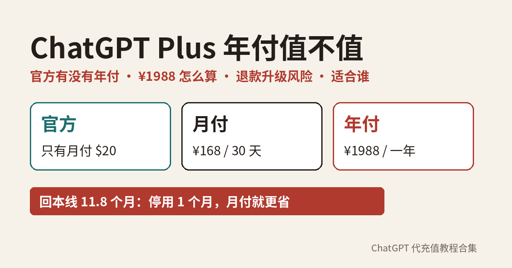

# ChatGPT Plus 年付值不值：官方有没有年付、平台年付怎么算、退款升级续费风险 + 适合谁

**简短回答：** OpenAI **官方没有 ChatGPT Plus 年付**。帮助中心写的是 Plus $20/月、按月计费，「目前不支持年付，也不能一次预付多个月」；定价页也写明月付覆盖 Go、Plus、Business，**年付只给 Business 和 Enterprise**。所以你在国内看到的「Plus 年付」，是**第三方平台自己的商品**，不是 OpenAI 的套餐。比较时不要只拿 12 次月付去对年付：平台月付常见按 30 天一期，覆盖完整一年往往要 13 期。**一年里只要有一个月不用，月付通常更省**。年付适合「确定一整年天天用 Plus、不打算中途升 Pro」的人；第一次开、用量拿不准、可能升级的，先月付。（2026-11-14 核对，来源见文末）

---

## 目录

1. 官方到底有没有 Plus 年付
2. 国内「Plus 年付」是什么商品
3. 平台年付怎么算：先数清月付要买几期
4. 年付的 5 个风险点
5. 谁适合年付，谁应该继续月付
6. 下单年付前要问清的 6 个问题
7. 买了年付之后怎么管
8. 年付自查清单
9. 常见问题

---

## 1. 官方到底有没有 Plus 年付

没有。两处官方说法一致（2026-11-12 核对）：

- [What is ChatGPT Plus?](https://help.openai.com/en/articles/6950777-what-is-chatgpt-plus)：Plus 价格「$20/month (billed monthly)」；FAQ「Is there an annual plan available?」的回答是：目前 Plus **不支持年付，也不支持一次预付多个月**。
- [ChatGPT 定价页](https://chatgpt.com/pricing/) 的 FAQ：付费套餐按「每人每月」计价，**月付覆盖 Go、Plus 和 Business，年付只覆盖 Business 和 Enterprise**。

也就是说，个人用户在官方只能按月续费、随时取消；想「一次付一年」的个人，在官方是做不到的。看到有人说「官方 Plus 年付打折」，先回到上面两页核对。

> 顺带一提：Go 和 Pro 官方同样只有月付，详见[《ChatGPT Go 充值前必读》](https://amber-moose-14.github.io/chatgpt-daichong-guide/chatgpt-go-chongzhi-kaitong-2026.html)和[《ChatGPT Pro 充值前必读》](https://amber-moose-14.github.io/chatgpt-daichong-guide/chatgpt-pro-chongzhi-edu-guize-2026.html)。

---

## 2. 国内「Plus 年付」是什么商品

既然官方没有年付，第三方卖的「年付」就是**平台自己打包的一年服务期**：你一次付清一年的钱，平台负责让你的账号在这一年里保持 Plus。它和官方订阅有三点本质不同：

| 对比项 | 官方 Plus（月付） | 第三方「Plus 年付」 |
|---|---|---|
| 谁定的商品 | OpenAI | 第三方平台 |
| 扣费方式 | 每月自动扣费，直到取消 | 一次付清，通常不自动续费 |
| 中途不想用了 | 取消后用到本期结束，不自动退款 | 看平台售后规则 |
| 价格变动 | 官方可调价，按新价扣 | 已付的一年价格锁定 |
| 售后找谁 | OpenAI 支持 | 卖你年付的平台 |

GPT20X 的公开页面（以下单页实时显示为准）：

- [Plus 年付页](https://gpt20x.com/ChatGPTPlusYear)：写明「充值失败 · 支持退款」，价格见页面；
- [Plus 月付页](https://gpt20x.com/ChatGPTPlus2)：写明「充值失败 · 支持退款」、可下载报销收据、企业可对公批量，价格见页面；
- 首页写明「无需海外信用卡，微信 / 支付宝直接开通」「全程无需提供账号密码」「30 天质保服务」；
- [充值说明](https://gpt20x.com/blog/chatgpt-plus-recharge-price-guide)写明其自助充值订单**通常是单次购买、不会默认连续扣款**。

一句话：**年付是向平台买「一年的省心」，你承担的是平台这一年的履约能力。**

---

## 3. 平台年付怎么算：先数清月付要买几期

把两种买法摆在一起时，先到下单页抄下月付单价和年付一次付清的价格，再用下面的算法比（不要用过期截图里的数字）：

| 要比的事 | 怎么算 |
|---|---|
| 连续买 12 次月付 | 只覆盖 360 天（若一期是 30 天） |
| 覆盖完整 365 天 | 月付往往要 13 期，不能只按 12 期算 |
| 回本线 | 用「年付总价 ÷ 月付单价」，看你要连续买满多少期，年付才开始更省 |
| 会停用的月份 | 把实际要用的期数乘月付单价，再和年付比 |

也就是说：

- 一年里你会连续用满、中间不断档 → 年付才可能略省；
- 一年里你会停 1 个月（放假、换工作、项目结束）→ 少买那一期，月付通常更省；
- 停得越多，月付越划算。

所以年付的价值**主要不在省钱**（把当下页面的数字填进计算器，差价往往不大），而在于：一年不用每月惦记续费、不怕忘续断档、价格提前锁定。如果你看重的是省钱本身，月付按需买更灵活。按天算续费成本的细节，可以把下单页价格填进 [Plus 月付 vs 年付续费成本计算器](https://huggingface.co/spaces/gpt20x/chatgpt-plus) 试一下。

---

## 4. 年付的 5 个风险点

**风险 1：一年里套餐内容可能变。** 年付锁住的是你付的钱，锁不住 OpenAI 的套餐权益。就在 2026 年，Plus 的模型、额度规则变了好几次：Pro 档位多次调整，从 2026 年 12 月起 Plus 等套餐的额度还会在 ChatGPT 和 Codex 之间共享（见 [Understanding ChatGPT and Codex usage limits](https://help.openai.com/en/articles/20001625-understanding-chatgpt-and-codex-usage-limits)）。官方帮助页也写明模型和限额会随时间变化、以模型选择器为准。年付等于把「这一年 Plus 变成什么样」的风险提前接下来了。

**风险 2：售后期限和年付期限不一定一样长。** GPT20X 首页写的是「30 天质保」「有效期内因我方原因失效免费更换」；价格指南里写的是充值成功后 30 天内出现掉订阅等问题，核实后按剩余天数退差价或补足服务；[售后政策](https://gpt20x.com/help)则写明虚拟商品发货后原则上不接受无理由退款、请在 24 小时内激活核验。**对一年期商品，第 31 天到第 365 天出问题怎么处理，公开页面没有逐条写清，下单前一定要问客服并保留聊天记录。**

**风险 3：中途想升 Pro。** 用了几个月发现 Plus 额度不够、想升 Pro，年付剩下的天数怎么算是关键。GPT20X 常见问题里有「从 Plus 升级到 Pro，剩余天数怎么处理？」这一条，买年付前先去 [常见问题页](https://gpt20x.com/faq) 看答案或直接问客服。会用到大量 Codex 的人，先看[《Codex 代充前必读》](https://amber-moose-14.github.io/chatgpt-daichong-guide/codex-daichong-yongliang-kaitong-2026.html)估一下用量，再决定要不要锁一年 Plus。

**风险 4：账号本身出问题。** 售后政策写明，因个人原因（转借他人、泄露密码、多人共用等）导致的封禁或受限，平台不负责。年付周期越长，账号在这一年里的安全越重要：不要共享账号，开好两步验证。

**风险 5：官方退款规则帮不上忙。** OpenAI 的[退款说明](https://help.openai.com/en/articles/7232895-how-do-i-request-a-refund-for-my-chatgpt-subscription)写的是：付款一般不可退，个人订阅仅在扣费 7 天内、未实质使用等条件下可酌情退款，7 天后没有自动按比例退款。第三方年付不是在官方付的钱，退款只能按卖家的规则走。

---

## 5. 谁适合年付，谁应该继续月付

**适合年付：**

- 已经连续用 Plus 3 个月以上，确认每个月都离不开；
- 工作或学习有明确的一整年周期（比如写毕业论文、全年项目），中间不会停；
- 用量稳定在 Plus 范围内，很少被额度挡住，不打算升 Pro；
- 怕每月续费麻烦、怕忘续导致断档，宁愿一次付清。

**应该继续月付：**

- 第一次买 Plus，不确定自己用得多不多（先看[《ChatGPT 会员怎么选》](https://amber-moose-14.github.io/chatgpt-daichong-guide/chatgpt-huiyuan-zenme-xuan-2026.html)）；
- 用 ChatGPT 有淡旺季，一年里会停一两个月；
- 经常用 Codex 写代码，几个月后可能要升 Pro；
- 其实 Go 就够用（日常聊天、偶尔作图传文件）；
- 很在意 12 月起额度共享后的实际体验，想先观察一段时间。

**拿不准就先月付 1～2 个月。** 月付第一个月多花的钱，最多也就是年付和月付几十元的差价，换来的是确认自己真的要用一整年。

---

## 6. 下单年付前要问清的 6 个问题

1. **开到谁的账号？** 必须是你自己的 ChatGPT 账号，聊天记录、Projects、记忆都保留；
2. **要不要密码？** GPT20X 首页写明全程无需账号密码；任何渠道索要密码、验证码、2FA 恢复码都要停手；
3. **一年怎么履约？** 是一次开通一年，还是分期处理？中途需要你配合做什么？
4. **第 31 天以后出问题怎么办？** 掉订阅、被降级时，是补足剩余天数还是退差价？
5. **升级 Pro 剩余天数怎么算？**
6. **凭证怎么留？** 订单号、兑换码、付款记录、客服承诺截图都要保存一年。

把客服的回答截图存下来，比任何口头承诺都可靠。挑平台的通用标准见[《ChatGPT 代充怎么选》](https://amber-moose-14.github.io/chatgpt-daichong-guide/choose-daichong-platform.html)。

---

## 7. 买了年付之后怎么管

- **先查旧订阅**：在 Apple / Google Play 或官网还有 Plus 自动续费的，先取消，避免年付期间重复扣费（方法见[《ChatGPT 订阅怎么管》](https://amber-moose-14.github.io/chatgpt-daichong-guide/chatgpt-dingyue-guanli-quxiao-2026.html)）；
- **开通后核对**：Settings → Account 显示 Plus，记下开始日期；兑换细节见[《GPT 代充卡密怎么兑换？》](https://amber-moose-14.github.io/chatgpt-daichong-guide/gpt-daichong-kami-duihuan-2026.html)；
- **在日历里设提醒**：第 25 天（质保期结束前）检查一次状态，之后每月看一次；到期前 7 天决定续年付、改月付还是换档；
- **出问题先查订单**：带订单号到[订单查询页](https://gpt20x.com/query)看状态，再联系客服（每天 8:00–24:00）；
- **自己付款被拒时**：排查方法见[《Your card was declined 怎么办》](https://amber-moose-14.github.io/chatgpt-daichong-guide/card-declined-fix.html)。

---

## 8. 年付自查清单

- [ ] 知道官方 Plus 没有年付，年付是第三方商品
- [ ] 已经连续用 Plus 至少几个月，确认一年 12 个月都要用
- [ ] 算过账：只要停 1 个月，月付就更便宜
- [ ] 近期不打算升 Pro，或已问清升级时剩余天数怎么算
- [ ] 已问清第 31 天以后掉订阅怎么处理，并截图保存
- [ ] 确认开到自己账号、不需要密码
- [ ] Apple / Google Play / 官网没有还在扣费的旧订阅
- [ ] 订单号、兑换码、付款记录已保存，日历提醒已设好

---

## 9. 常见问题

**Q：ChatGPT Plus 有官方年付吗？**  
没有。OpenAI 帮助中心写明 Plus 按月计费，不支持年付或多月预付；官方年付只面向 Business 和 Enterprise。

**Q：Plus 年付比月付便宜多少？**  
把下单页的月付价乘以所需期数（全年不断档按 13 期，不要只按 12 期），再和年付一次付清的价格比。差价往往不大；只要一年里有一个月不用，月付通常更省。

**Q：年付中途不想用了能退吗？**  
看卖家规则。GPT20X 售后政策写明虚拟商品发货后原则上不接受无理由退款，失败或首次使用前无效可退款或补发；具体以下单前客服确认为准。

**Q：年付期间 OpenAI 涨价或改权益怎么办？**  
你已付的价格不受官方调价影响，但 Plus 包含的模型和额度以官方当时规则为准，年付锁不住权益内容。

**Q：个人能买官方 Business 年付代替吗？**  
Business 是面向团队工作区的套餐，计费、席位和管理方式都和个人 Plus 不同，不是「个人 Plus 年付」的替代品，具体以 [ChatGPT 定价页](https://chatgpt.com/pricing/) 为准。

**Q：年付和月付开通流程一样吗？**  
基本一样：选「Plus 年付」下单、支付宝或微信付款、拿到订单兑换码后按[开通流程说明](https://gpt20x.com/blog/chatgpt-plus-pro-recharge-guide)在自助页验证并核对套餐名是「年付」，提交后不要重复使用同一个兑换码。

---

## 参考来源

- [OpenAI 帮助中心：What is ChatGPT Plus?](https://help.openai.com/en/articles/6950777-what-is-chatgpt-plus)（$20/月按月计费、不支持年付或多月预付、模型与限额会变化）
- [ChatGPT 定价页](https://chatgpt.com/pricing/)（月付覆盖 Go、Plus、Business，年付仅 Business、Enterprise）
- [OpenAI 帮助中心：Canceling your ChatGPT subscription](https://help.openai.com/en/articles/7232927-how-do-i-cancel-my-chatgpt-plus-subscription)（取消只停止续费、不自动退款，需提前 24 小时）
- [OpenAI 帮助中心：How do I request a refund for my ChatGPT subscription?](https://help.openai.com/en/articles/7232895-how-do-i-request-a-refund-for-my-chatgpt-subscription)（付款一般不可退、7 天内酌情退款条件）
- [OpenAI 帮助中心：Understanding ChatGPT and Codex usage limits](https://help.openai.com/en/articles/20001625-understanding-chatgpt-and-codex-usage-limits)（ChatGPT 与 Codex 额度规则）
- GPT20X 首页、[Plus 年付页](https://gpt20x.com/ChatGPTPlusYear)、[Plus 月付页](https://gpt20x.com/ChatGPTPlus2)、[售后政策](https://gpt20x.com/help)、[价格指南](https://gpt20x.com/blog/chatgpt-plus-recharge-price-guide)（开通页与售后说明，2026-11-14 核对）

> 本文为个人整理，非 OpenAI 官方内容。价格、额度和政策会变化，请以 OpenAI 帮助中心、账号内显示和下单页为准。

---

*最后更新：2026-11-12*　｜　[返回教程首页](README.md)
