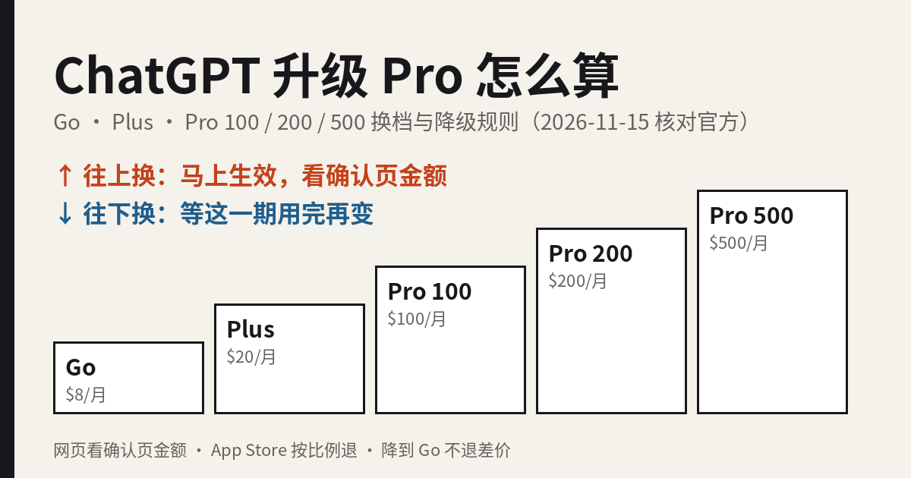

# ChatGPT升级Pro怎么算：换档降级全流程｜GPT20X

ChatGPT升级Pro、在 Pro 100 / 200 / 500 之间换档，或者从 Plus 降回 Go，最常被问的其实只有三件事：**什么时候生效、这个月的钱怎么算、换完会少掉什么**。答案取决于你当初是在哪儿付的款——chatgpt.com 网页、iPhone 的 App Store，还是 Google Play，三者规则不一样。下面全部以 OpenAI 帮助中心和应用商店的官方说明为准（2026-11-15 核对），看不到官方原文的地方会直接标「尚未确认」。

---

## 目录

1. 先看结论：6 种换档一张表
2. ChatGPT升级Pro前先确认 3 件事
3. 网页订阅：升级的完整步骤
4. App Store / Google Play 订阅：升级怎么算
5. 降级：什么时候生效、退不退钱
6. 降级前检查清单：这 6 样会变
7. 升到 Pro 以后：每月 API 额度怎么折算
8. 3 个算账例子
9. 用支付宝 / 微信开通的，换档要注意什么
10. 换档后核对与常见问题

---

## 1. 先看结论：6 种换档一张表

| 你要做的 | 在哪里操作 | 什么时候生效 | 本期费用怎么处理 |
|---|---|---|---|
| Go → Plus，或 Plus → Pro（网页付款） | 定价页，或 设置 → 我的套餐 | 确认后即开通新套餐 | 以确认页「今日应付」为准，官方现行页面没写死是否折算 |
| Pro 100 → Pro 200 / 500（网页付款） | 设置 → 我的套餐 | 以确认信息上的生效日期为准 | 同上，看确认页 |
| 任意升级（App Store 付款） | iPhone 设置 → 订阅 | 立即升级 | Apple 按比例退还原订阅未用部分 |
| 任意升级（Google Play 付款） | Play 商店 → 订阅 | 以 Play 页面显示为准 | 可能付全价，也可能付差价，由开发者设定 |
| Plus / Pro → Go | 设置 → 帐户 | **本账单周期结束时** | **不退差价**，下期起按 Go 扣费 |
| Pro → 更低的 Pro 档或 Plus | 设置 → 我的套餐 | 一般在下次续费时生效（App Store 明确如此） | 当前档位用到周期结束，不退差价 |

一句话记忆：**往上换，钱和权益马上动；往下换，等这一期用完再变。** 网页付款的「升级到底抵不抵扣」，唯一可靠的答案是你点确认前看到的那个金额。

---

## 2. ChatGPT升级Pro前先确认 3 件事

**第 1 件：订阅是在哪个平台买的。** OpenAI 写明，订阅要在购买它的平台上管理：网页买的在 ChatGPT 设置里改，App Store 买的在 Apple 账户里改，Google Play 买的在 Play 商店里改。网页订阅不会出现在 Apple 或 Google 的订阅列表里。分不清就翻一下当初的付款收据，发件方是谁就是在哪儿买的。

**第 2 件：现在是哪一档、哪天续费。** 打开 设置 → 账单（Billing）或 设置 → 我的套餐（My Plan），记下当前档位和下次续费日期。升级会不会让续费日变化、降级哪天生效，都要拿这个日期对照。

**第 3 件：你到底缺的是什么。** 不是所有「不够用」都要靠升级解决：

- 只是偶尔 Codex、Work 额度用完：Plus 和 Pro 在账户支持购买时，可以在 设置 → 用量 里买 Credits 补量，先用套餐内额度、再扣 Credits；
- 想要 Ultrafast：Pro 三档里**只有 Pro 500** 有，Pro 100 / 200 买再多 Credits 也解锁不了；
- 想用 dot（全天候智能体）：个人套餐里定价页只把它列在 Pro 下；
- 日常聊天：Plus 的日常模型默认是 GPT-6（由 GPT-6 Sol 驱动），Work 和 Codex 里可以用 GPT-6.1 Sol 和 GPT-6 Astra，GPT-5.6 Sol 属于上一代可选模型；Pro 多出来的主要是 GPT-6 Astra 驱动的专业推理和更大的用量。

想清楚这三点，再决定升哪一档、要不要现在升。

---

## 3. 网页订阅：升级的完整步骤

适用于在 chatgpt.com 用银行卡（或少数市场的本地支付方式）付款的订阅。

1. 用**正在付费的那个账号**登录 chatgpt.com（设置 → 帐户 里能看到当前登录邮箱，收据邮箱可能和它不同）；
2. 点头像 → 设置 → 我的套餐，查看「可用的套餐变更」；也可以直接打开定价页选目标套餐，帮助中心原话是「如果你是在更换套餐，请使用现有的 ChatGPT 账号」；
3. 选目标档位，比如 Plus → Pro 100，或 Pro 100 → Pro 500；
4. **停在确认页别急着点**，看三样：今日应付金额、新的续费日期、生效时间；
5. 拿今日应付和目标档位的整月价比：等于整月价，说明当前这期剩余天数没有抵扣；低于整月价，差额就是抵扣；
6. 能接受再确认，付款成功后刷新页面；
7. 回到 设置 → 我的套餐，确认档位已变，再打开模型选择器看新模型是否出现。

关于「升级抵不抵扣」：帮助中心较早版本的 Pro 说明写过「升级立即生效、账单周期重新开始，账单调整会根据计费周期自动处理」；**现行版本已改为只写「在 设置 → 我的套餐 查看可用的套餐变更」**，并提醒如果档位比预期更早变化，要对照确认信息里的生效日期。所以本文不替官方下结论，一切以你确认页上显示的金额和日期为准。

官方月费（美元，2026-11-15 核对定价页）：Go 8、Plus 20、Pro 100 / 200 / 500 三档分别为 100、200、500，全部按月付，官方没有年付，也不能一次预付多个月。

---

## 4. App Store / Google Play 订阅：升级怎么算

**App Store（iPhone / iPad）**：Apple 给开发者的订阅规则写得很明确——在同一个订阅组里往上换，是「立即升级，并按比例退还原订阅的费用」；往下换，是「当前订阅持续到下次续费日，然后按更低的档位和价格续费」。操作路径：iPhone 设置 → 你的名字 → 订阅 → ChatGPT，选新的档位；Apple 会弹出确认单，写明新价格和续费日，以那张确认单为准。

**Google Play**：Google 的帮助页写的是，换订阅方案时「可能需要支付新方案的全价或差价」，剩余部分怎么折算由应用开发者决定。OpenAI 没有公开它在 Play 上的折算方式（尚未确认），所以在 Play 商店 → 订阅 → ChatGPT 里换档前，同样先看确认页金额。

**别用「换平台」来升级。** 比如网页上是 Plus，又在 App 里另买一个 Pro，结果是两个平台各扣一份钱，旧的那份还得自己去原平台取消。想换平台，先把旧订阅在原平台取消、等它到期，再在新平台订阅。

---

## 5. 降级：什么时候生效、退不退钱

OpenAI 在 Go 的帮助页里把降级规则写得最清楚：从 Pro 或 Plus 切换到 Go，**不会退款**；当前套餐持续有效到账单周期结束，届时账号自动切换为 Go，之后按 Go 的价格扣费。

操作入口：

- **降到 Go**：头像 → 设置 → 帐户，管理或更改订阅；
- **Pro 换到更低的 Pro 档，或换到 Plus**：设置 → 我的套餐，看列表里有没有目标套餐；
- **列表里没有目标套餐**：先在 设置 → 账单 → 取消套餐 里取消，等当前这期到期后，再从定价页订阅新套餐；取消要在下次扣费日前至少 24 小时完成；
- **App Store / Google Play 订阅**：在对应商店的订阅页里换，按商店规则生效。

两个容易误会的点：降级和取消都**不会自动退还已付的钱**；如果确实需要退款，网页和 Google Play 的订单找 OpenAI 支持，App Store 的订单找 Apple，而且退款获批后，那笔钱对应的使用权通常会提前结束。

---

## 6. 降级前检查清单：这 6 样会变

降级在周期末才生效，正好留出时间做准备。逐项对照：

| 会变的东西 | 官方说明 | 降级前建议 |
|---|---|---|
| dot 智能体 | 个人套餐中定价页只列在 Pro 下 | 把 dot 正在跟进的任务结果导出或记下 |
| Ultrafast | 只在 Pro 500 | 从 Pro 500 往下换后就不能再选 |
| 每月 API 额度 | 降到 Plus、Go 或免费版后，API 组织的关联在账单周期结束时解除 | 已发放的额度在本周期结束前用掉 |
| 文件存储空间 | Pro 100 GB、Plus 20 GB、Go 4 GB | 超出后怎么处理官方没写（尚未确认），先在 设置 → 存储 清理或下载 |
| ChatGPT 工作（Work） | 网页和手机端不面向 Free / Go，Go 只有桌面端有限使用 | Plus → Go 前把 Work 里的长任务收尾 |
| 站点（Sites） | 不面向 Free / Go | 需要保留的站点内容先自行备份 |

另外两点：已经买的 Credits 从购买日起 12 个月有效、没有现金价值，降级不会把它退成钱；Pro 的 GPT-6 Pro 周消息上限和 Work / Codex 额度是分开计算的，降级后两者都会变成新套餐的标准。

---

## 7. 升到 Pro 以后：每月 API 额度怎么折算

2026 年 10 月底起，Pro 100 / 200 / 500 每个账单周期分别可领 100、200、500 美元的 API 额度，用于 OpenAI API 开发，Plus 不在范围内。和换档有关的规则：

1. **付费订阅满 7 天后才能领取**，刚升级当天领不到；
2. **首次发放按当前周期剩余时长折算**，所以月中升级，第一次领到的数字会小于整月额度；
3. **在 Pro 内往上升档**，可能获得按本周期剩余时长折算的额外额度；
4. **降到 Plus、Go 或免费版**，关联在周期末解除，之后不再发放；
5. API 额度只用于关联的 API 组织，**不会增加 ChatGPT 或 Codex 里的用量**，未用完的在周期结束时失效，不结转。

---

## 8. 3 个算账例子

以下按官方月费举例，只说明「怎么判断」，实际金额以你的确认页为准。

**例 1：网页 Plus 用到第 10 天，想升 Pro 100。**
打开确认页看今日应付。如果是 100 美元整，说明剩下 20 天 Plus 没抵扣，而且新套餐从今天算起，等于这 20 天的 Plus 费用（约 20 × 20 ÷ 30 ≈ 13 美元）白花了。这时可以权衡：如果天天撞额度、耽误干活，马上升更值；如果只是偶尔不够，先买点 Credits，等续费日前一两天再升。

**例 2：Pro 200 想降到 Pro 100。**
降档要到下次续费才生效。你在本周期第 3 天操作还是第 28 天操作，这期都按 Pro 200 用满，下期开始按 100 美元扣。所以不用急着在周期初点，只要在续费日之前确认就行。

**例 3：iPhone 上订的 Plus，想升 Pro。**
走 App Store 的升级是立即生效，Apple 会把 Plus 剩余部分按比例退回原付款方式。确认单上写明的新价格和续费日就是最终结果。注意 App Store 的标价可能和网页美元价不同，以 Apple 确认单为准。

---

## 9. 用支付宝 / 微信开通的，换档要注意什么

ChatGPT 对账号使用地区有要求，开通前建议先看一下 OpenAI 官方的支持地区说明。

国内没有境外银行卡的用户，常见做法是通过第三方平台用支付宝或微信付款，把套餐开到自己的账号上。这类开通不是在你的 ChatGPT 设置里直接扣卡，所以第 3 节的「看确认页」不完全适用，换档前要先问清平台三件事：

1. **当前这期还剩几天**，升级时剩余天数怎么处理，是折算还是作废；
2. **能不能在当前这期内直接升档**，还是要等到期后再开新档位；
3. **降档怎么办**：一般是等当前这期结束、不再续开高档，再开低档。

以 GPT20X（gpt20x.com）为例，结账只支持支付宝和微信，不需要提供 ChatGPT 账号密码，套餐开到你自己的账号上；换档的具体规则和售后说明以 [官网](https://gpt20x.com/) 页面为准。无论通过哪个平台开通，开通后都在自己账号的 设置 → 我的套餐 里核对档位和到期日。

---

## 10. 换档后核对与常见问题

**换档后 1 分钟自查：**

- [ ] 设置 → 我的套餐 显示的是新档位
- [ ] 续费日期和确认页一致
- [ ] 模型选择器里出现了新档位的选项（比如 Pro 500 的 Ultrafast）
- [ ] 只有一个平台在扣费（网页、App Store、Google Play 各查一遍）
- [ ] 收据或确认邮件保存到下次续费完成

**Q：升级付款成功了，页面还是旧档位？**
先退出重新登录，App 里可以用「恢复购买」同步；App Store / Play 订阅官方说可能要等几分钟，重启 App 再看。仍然不对，带上收据或扣款卡号后四位联系 OpenAI 支持。

**Q：我点了降级，怎么还是 Pro？**
正常。降级在本周期结束时才生效，在那之前你仍按原档位使用。

**Q：档位比我预期的更早变了？**
帮助中心建议：把 设置 → 我的套餐 里的档位和你确认的变更、确认信息上的生效日期对一下；商店订阅还要看付款商店账号里的订阅。对不上就把两个档位名称、显示的日期和收据编号发给支持团队。

**Q：客服能帮我重置额度，省得升级吗？**
不能。帮助中心写明支持团队无法重置 ChatGPT 或 Codex 的额度，只能排查是否计错。

**Q：取消后又重新订阅 Pro 200，额度会变少吗？**
不会。帮助中心说取消后再订阅，拿到的 Work 和 Codex 额度和其他 Pro 200 用户一样；订阅还在有效期内的，也不需要为了新额度取消重订。

---

## 参考来源

- [OpenAI 帮助中心：关于 ChatGPT Pro 套餐档位](https://help.openai.com/zh-hans-cn/articles/9793128)（三档月费、Ultrafast 只在 Pro 500、在「我的套餐」更改档位、取消与退款、无年付）
- [OpenAI 帮助中心：什么是 ChatGPT Go？](https://help.openai.com/zh-hans-cn/articles/11989085)（从 Plus / Pro 切换到 Go 不退款、周期结束生效）
- [OpenAI 帮助中心：What is ChatGPT Plus?](https://help.openai.com/en/articles/6950777-what-is-chatgpt-plus)（Plus 月费、付费后仍显示免费版的排查）
- [OpenAI 帮助中心：Canceling your ChatGPT subscription](https://help.openai.com/en/articles/7232927)（按购买平台取消、提前 24 小时、取消不自动退款）
- [OpenAI 帮助中心：API credits benefit for eligible ChatGPT subscriptions](https://help.openai.com/en/articles/20001626-api-credits-benefit-for-eligible-chatgpt-subscriptions)（满 7 天领取、首次按比例、升档额外额度、降级解除关联）
- [OpenAI 帮助中心：Using Credits for Flexible Usage](https://help.openai.com/en/articles/12642688-using-credits-for-flexible-usage-in-chatgpt-personal-plans)（Credits 12 个月有效、无现金价值）
- [OpenAI 帮助中心：ChatGPT release notes](https://help.openai.com/en/articles/6825453-chatgpt-release-notes)（2026-05-14 各套餐存储空间；2026-07-09 Work 与 Sites 适用套餐；2026-10-28 Pro API 额度）
- [ChatGPT 定价页](https://chatgpt.com/pricing)（Go / Plus / Pro 月费、dot 与各套餐功能对照）
- [Apple Developer：Auto-renewable subscriptions](https://developer.apple.com/app-store/subscriptions/)（App Store 订阅升级立即生效并按比例退款、降级在下次续费生效）
- [Google Play 帮助：取消、暂停或更改订阅](https://support.google.com/googleplay/answer/7018481)（换方案可能付全价或差价，由开发者决定折算）

> 非 OpenAI 官方内容。套餐、价格和换档规则会调整，请以 OpenAI 帮助中心、应用商店确认页和账号内显示为准。

---

*最后更新：2026-11-15*　｜　[返回教程首页](README.md)
