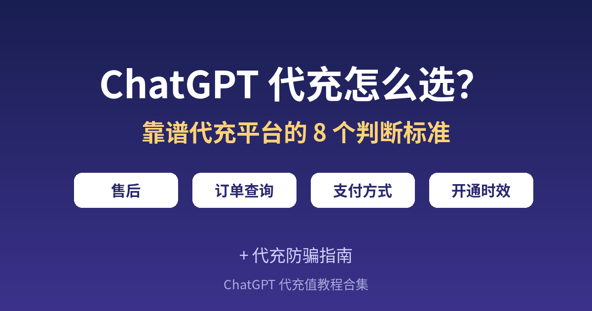

# ChatGPT 代充怎么选？靠谱代充平台的 8 个判断标准 + 防骗指南

**简短回答：** 选 ChatGPT 代充平台，最重要的不是价格最低，而是**开通在你自己的账号上、能查订单、有明确售后**。下单前用本文的 8 个标准逐项对照，基本能避开大部分坑。

---

## 目录

1. 什么是 ChatGPT 代充
2. 代充、自己订阅、共享账号有什么区别
3. 靠谱代充平台的 8 个判断标准
4. 下单前自查清单
5. 常见代充骗局与识别方法
6. 代充的标准流程
7. 开通后怎么核对
8. 常见问题

---

## 1. 什么是 ChatGPT 代充

**代充**就是由第三方平台帮你完成 ChatGPT 会员的付款和开通。你用支付宝、微信等方式付款给平台，平台负责让你**自己的 ChatGPT 账号**开通 Plus、Go 或 Pro 等会员。

适合这些人：

- 没有可用的境外信用卡
- 自己付款反复被拒，被银行或支付风控卡住
- 不想折腾绑卡、地址、3D 验证
- 想用支付宝、微信等熟悉的方式付款

---

## 2. 代充、自己订阅、共享账号有什么区别

| 对比项 | 自己订阅 | 代充 | 共享账号 |
|---|---|---|---|
| 账号归属 | 自己的账号 | **自己的账号** | 别人的账号，多人共用 |
| 聊天记录隐私 | 只有自己可见 | **只有自己可见** | 其他人可能看到 |
| 是否需要境外卡 | 需要 | 不需要 | 不需要 |
| 支付方式 | 信用卡 / 借记卡 | 通常支持支付宝、微信 | 各平台不同 |
| 使用限制 | 无额外限制 | 无额外限制 | 可能限速、限设备、被挤下线 |
| 稳定性 | 高 | 取决于平台 | 较低，容易失效 |

**结论：** 想要稳定、隐私好、长期使用，优先考虑**自己订阅或正规代充**，尽量避开共享账号。

---

## 3. 靠谱代充平台的 8 个判断标准

### 标准 1：开通在你自己的账号上

靠谱的代充是给**你自己的 ChatGPT 账号**开通会员，而不是卖给你一个现成账号或共享账号。下单时如果只让你“领取账号”，就要多留个心。

### 标准 2：能用订单号查询进度

正规平台会给你订单号，并提供**订单查询页面**，随时能看到处理状态，而不是只能私聊客服干等。

### 标准 3：有明确的售后说明

页面上应该写清楚：开通失败怎么处理、多久内可以申请售后、退款规则是什么。**没有任何售后说明的平台，出了问题很难追责。**

### 标准 4：支付方式正规

支付宝、微信是常见方式。要警惕要求**私下转账到个人账户**、或者付款后才告诉你“还要再补差价”的情况。

### 标准 5：开通时效写得清楚

平台应该说明一般多久开通完成。时效模糊、一直拖延的，往往在流程上就不稳定。

### 标准 6：价格合理，不离谱

明显低于正常价格太多的，要想想成本从哪里来。过低的价格常见于共享账号、来路不明的渠道，后续容易失效。

### 标准 7：有长期运营的痕迹

有独立网站、有教程和说明文章、有持续更新的内容，说明平台在长期运营，而不是临时摆摊。

### 标准 8：客服能联系上

至少有一个能稳定联系到的客服渠道（如 Telegram、在线客服），并且下单前问问题能得到正常回复。

---

## 4. 下单前自查清单

- [ ] 确认是开通在**自己的账号**上
- [ ] 找到了**订单查询**入口
- [ ] 看过**售后和退款说明**
- [ ] 支付方式是平台页面上的正规收款，不是私人转账
- [ ] 知道大概的**开通时效**
- [ ] 价格在合理范围内
- [ ] 能联系到客服
- [ ] 已经确认要开通的是哪个套餐（Plus / Go / Pro / 年付）

---

## 5. 常见代充骗局与识别方法

| 骗局类型 | 表现 | 怎么识别 |
|---|---|---|
| 超低价引流 | 价格低得离谱，付款后各种理由拖延 | 对比正常价格，过低就谨慎 |
| 二次收费 | 付款后说“通道费”“验证费”要补钱 | 正规平台价格一次说清，不会临时加价 |
| 卖共享号冒充代充 | 说是代充，实际给你一个多人共用的号 | 问清楚是否开通在你自己的账号上 |
| 私人转账 | 让你转账到个人支付宝或微信 | 优先选平台页面上的正规收款 |
| 开通后很快失效 | 用几天就掉会员 | 选有售后、能查订单的平台 |

---

## 6. 代充的标准流程

一个正规的代充流程大致是：

1. **选择套餐**：Plus、Go、Pro 或年付
2. **选择支付方式并付款**：支付宝、微信等
3. **提交账号信息**：按平台要求提交，注意只提交必要信息
4. **等待开通**：用订单号随时查看进度
5. **登录核对**：确认账号显示对应的会员

以 [GPT20X](https://gpt20x.com/) 为例，整体就是按上面这个流程走的，每一步的具体操作和注意事项可以参考这篇[代开通流程说明](https://gpt20x.com/blog/chatgpt-plus-pro-recharge-guide)。

---

## 7. 开通后怎么核对

1. 登录 ChatGPT，查看账号是否显示对应会员标识
2. 打开设置里的订阅或账户页面，确认套餐名称
3. 试用会员才有的模型或功能
4. 记下开通日期和到期日期
5. 保存好订单号，方便后续查询或售后

---

## 8. 常见问题

**Q：代充安全吗？**
选对平台是安全的。关键是开通在自己账号上、能查订单、有售后。不要把账号交给来路不明、没有任何说明的个人。

**Q：代充会不会影响我的聊天记录？**
正规代充只是给你的账号开通会员，聊天记录仍在你自己的账号里。共享账号才会有隐私问题。

**Q：代充和自己订阅的会员有区别吗？**
从使用上看，会员权益本身以官方为准。区别主要在付款方式和由谁完成付款。

**Q：Plus、Go、Pro 怎么选？**
日常聊天、写作、学习一般 Plus 就够；预算有限可以看 Go；高强度使用、需要更多额度的再考虑 Pro。具体权益以官方页面为准，也可以参考[各开通方式费用参考](https://gpt20x.com/blog/chatgpt-plus-recharge-price-guide)。

**Q：付完款多久能开通？**
各平台不同，正规平台会写明时效。下单后可以[用订单号查询开通进度](https://gpt20x.com/query)。

**Q：到期后怎么续费？**
一般重新下单即可。建议在到期前几天续费，避免中断使用。

---

*最后更新：2026-11-05*　｜　[返回教程首页](README.md)
