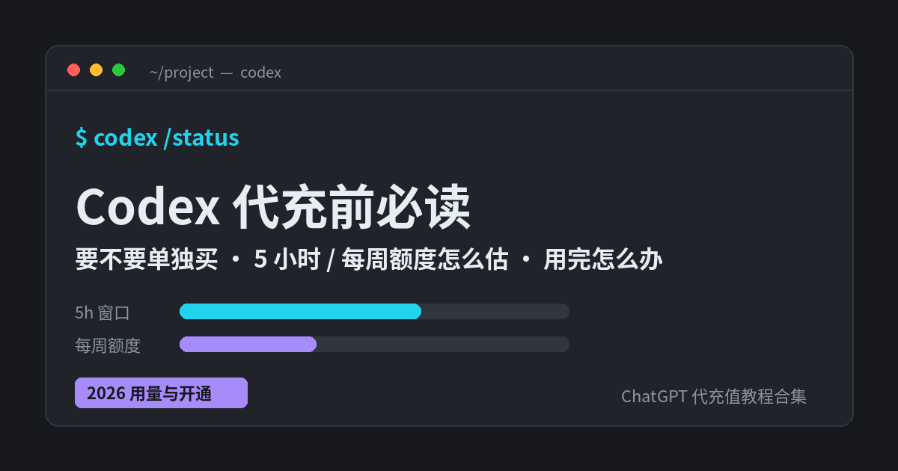

# Codex 代充前必读：Codex 要不要单独买、各套餐用量怎么估、额度用完怎么办 + 国内开通

**简短回答：** 搜「**codex 代充**」「codex 充值」的人，多数以为 Codex 是一个要单独买的会员。其实**不是**：官方写明 **Codex 包含在所有 ChatGPT 套餐里（含 Free 和 Go）**，用 ChatGPT 账号登录就能用；真正决定你「能用多少、能不能跑云端任务」的，是你开的是 **Go、Plus 还是 Pro**。Free / Go **没有 Codex Cloud**；Plus 有 **5 小时 + 每周**两道限额；Pro 100 / 200 / 500 目前**没有 5 小时限额**但仍有套餐内额度。所以「codex 代充」本质上就是**给自己的 ChatGPT 账号开通 Plus 或 Pro**。以上均以 [OpenAI 帮助中心：Using Codex with your ChatGPT plan](https://help.openai.com/en/articles/11369540-using-codex-with-your-chatgpt-plan) 和 [Codex Pricing](https://chatgpt.com/codex/pricing/) 为准（2026-11-09 核对）。

---

## 目录

1. Codex 要单独充值吗？
2. 各套餐能把 Codex 用到哪一步
3. 两道限额：5 小时窗口 + 每周额度
4. Plus 每 5 小时大概能发多少条（官方估算表）
5. 为什么同样的活，额度掉得有快有慢
6. 共享额度：Codex 不是一个人在用这份额度
7. 额度用完了怎么办：5 条路
8. 用 API Key 跑 Codex 和用 ChatGPT 登录有什么不同
9. 国内 codex 代充：价格对照与开通步骤
10. 开通后怎么连上 Codex（桌面端 / CLI / IDE / 网页）
11. 怎么选：一张决策表
12. 充值前自查清单
13. 常见问题

---

## 1. Codex 要单独充值吗？

不用。官方帮助中心原话的意思是：**Codex 包含在 ChatGPT 各个套餐中，包括 Free 和 Go**，不同套餐的**用量上限不同**（[Using Codex with your ChatGPT plan](https://help.openai.com/en/articles/11369540-using-codex-with-your-chatgpt-plan)）。

所以网上说的「Codex 会员」「Codex 充值卡」，通常指的是下面两种之一：

- **开通 / 升级 ChatGPT 套餐**（Plus、Pro 100 / 200 / 500），让 Codex 额度变大、解锁 Codex Cloud；
- **API 额度**：用 OpenAI API Key 登录 Codex 时按 API 价格计费，这跟 ChatGPT 套餐是两套账（见第 8 节）。

个人开发者绝大多数属于第一种。想先弄清 Go / Plus / Pro 之间的整体差别，可以看[《ChatGPT 会员怎么选：Go / Plus / Pro 对照》](https://amber-moose-14.github.io/chatgpt-daichong-guide/chatgpt-huiyuan-zenme-xuan-2026.html)。

---

## 2. 各套餐能把 Codex 用到哪一步

以下整理自 [Using Codex with your ChatGPT plan](https://help.openai.com/en/articles/11369540-using-codex-with-your-chatgpt-plan)、[Managing usage with GPT-6 Astra in Work and Codex](https://help.openai.com/en/articles/20001516-managing-usage-with-gpt-6-astra-in-work-and-codex) 和 [Codex Pricing](https://chatgpt.com/codex/pricing/)（2026-11-09 核对）：

| 项目 | Free / Go | Plus | Pro 100 / Pro 200 | Pro 500 |
|---|---|---|---|---|
| 本地 Codex（桌面端、CLI、IDE 插件） | 可用，体验级额度 | 可用，「Expanded」额度 | 可用，更高额度 | 可用，三档最高 |
| Codex Cloud（云端跑任务） | **不包含** | 包含（视灰度与设置） | 包含 | 包含 |
| GPT-6 Astra | 以账号显示为准 | **有限额度**，可买 Credits 追加 | 在套餐 Codex 额度内使用 | 在套餐额度内使用 |
| 5 小时限额 | 以账号显示为准 | **有** | **目前没有**（仍有套餐内额度） | **目前没有** |
| 每周限额 | 以账号显示为准 | 可能有 | 以 Settings → Usage 为准 | 以 Settings → Usage 为准 |
| Ultrafast | 无 | 无，买 Credits 也不能解锁 | 无，买 Credits 也不能解锁 | **有** |

几点说明：

- **Codex Cloud** 是在 OpenAI 托管的机器上跑编码任务，电脑休眠时任务也能继续；**Free 和 Go 不包含**。
- Pro「没有 5 小时限额」是帮助中心写的「currently」（目前），**不等于无限**；套餐内额度用完同样要等重置。
- Pro 三档的额度规则、Ultrafast 和 Credits 细节，见[《ChatGPT Pro 充值前必读》](https://amber-moose-14.github.io/chatgpt-daichong-guide/chatgpt-pro-chongzhi-edu-guize-2026.html)。

---

## 3. 两道限额：5 小时窗口 + 每周额度

官方说明（[Managing usage with GPT-6 Astra in Work and Codex](https://help.openai.com/en/articles/20001516-managing-usage-with-gpt-6-astra-in-work-and-codex)）：

- **5 小时限额**决定每个窗口能用多少。**新窗口从你上一个窗口结束后、在 Work 或 Codex 里发出的第一条消息开始算**，不是每天固定时刻刷新。
- **每周限额**控制整个周期能用多少。
- 两道都存在时，**两边都要有余量**才能继续。所以可能出现「每周还剩不少，但 5 小时窗口先满了」。
- 「5 小时」**不是在线时长**，不是「每天只能用 5 小时」。

**看余量的地方：** ChatGPT 的 **Settings → Usage**，或 Codex 用量面板；在 Codex CLI 里随时输入 **`/status`**。

---

## 4. Plus 每 5 小时大概能发多少条（官方估算表）

[Codex Pricing](https://chatgpt.com/codex/pricing/) 给出的 **Plus 每 5 小时本地消息**估算区间（2026-11-09 核对）：

| 模型 | Plus（每 5 小时本地消息） | 适合 |
|---|---|---|
| GPT-6 Astra | 5–45 | 难 Bug、陌生代码库、复杂推理 |
| GPT-6.1 Sol | 15–160 | 主力开发 |
| GPT-6 Sol | 15–150 | 主力开发 |
| GPT-5.6 Sol | 10–100 | 实现功能、综合研究 |
| GPT-5.6 Luna | 250–2,000 | 提取、分类、小改动 |
| GPT-6 Luna | 350–3,000 | 重复性、轻量任务 |

读这张表要注意：

1. 这是**估算区间，不是保证条数**；同一个模型，简单改一行和读整个仓库差距可以是十倍。
2. 表里是**本地消息**；官方写明**云端任务可能比本地消息消耗更多**，而且**每周限额也可能生效**。
3. Pricing 页表格里仍列着 GPT-5.5，但官方 [Speed 文档](https://learn.chatgpt.com/docs/agent-configuration/speed)写明 **GPT-5.5 已于 2026-10-14 从「ChatGPT 登录的 Codex」下线**，用 ChatGPT 账号登录时不要再按它估算。
4. Pro 档官方**没有给出固定条数**，只说「Maximum Codex tasks」。国内页面写的「Plus 的 10 倍 / 20 倍 / 50 倍」属于平台参考说法，不是官方承诺。

---

## 5. 为什么同样的活，额度掉得有快有慢

官方列出的影响因素：**模型、任务在哪里运行（本地 / 云端）、任务复杂度、上下文、推理强度、速度模式、工具调用**；长时间运行的任务会比短请求多用很多（[Using Codex with your ChatGPT plan](https://help.openai.com/en/articles/11369540-using-codex-with-your-chatgpt-plan)）。

| 设置 | 套餐内额度消耗 | 用 Credits 时 |
|---|---|---|
| Standard | 1×（基准） | 1× |
| Fast（`/fast` 切换） | **2.5×** | 2× |
| Ultrafast（仅 Pro 500，GPT-6 Astra / GPT-6.1 Sol） | **8×** | 6× |

来源：[ChatGPT Learn：Speed](https://learn.chatgpt.com/docs/agent-configuration/speed)。倍率是**消耗倍率**，不是「快多少倍」的保证。

**更省额度的做法：**

- 日常改代码用 Sol / Luna 一类，**难题才切 Astra**；官方也建议「额度快用完时换更省的模型」。
- 推理强度先从 **Low / Medium** 起；官方说明 Astra 低强度可能比 Sol 高强度效果更好，**高强度不一定结果更好**。
- 限定目录和文件，别让它每次重读整个仓库；对话太长就开新对话（官方提醒：**开新对话不会重置额度**）。
- **自动审查（auto-review）免费**：用 ChatGPT 账号登录时，auto-review 的安全检查**不计入套餐用量**。

---

## 6. 共享额度：Codex 不是一个人在用这份额度

- 在用共享额度的套餐上，**Codex、ChatGPT Work、ChatGPT for Excel、Workspace Agents 共用同一份额度和 Credits 池**（功能可用时）。在 Excel 里跑任务，也会吃掉 Codex 的额度。
- 在桌面端 Work / Codex 里用语音**发起的任务**也算这份额度；普通 Chat 的语音、图片、文件上传有各自独立的限制，**不占 Codex 额度**。
- **12 月起的变化：** 官方预告 Plus、Pro、Business 的额度将在 **ChatGPT 与 Codex 之间共享**，按 **token** 计量，**Instant 聊天不消耗额度**，剩余额度和重置时间在 Settings → Usage 合并显示（[Understanding ChatGPT and Codex usage limits](https://help.openai.com/en/articles/20001625-understanding-chatgpt-and-codex-usage-limits)）。具体上线后以账号显示为准。

---

## 7. 额度用完了怎么办：5 条路

先说一个好消息：**正在进行的这一轮任务撞到限额，Codex 通常可以把这一轮做完**（受公平使用约束），之后的新任务才受限。

然后按官方给的选项走（[Using Codex with your ChatGPT plan](https://help.openai.com/en/articles/11369540-using-codex-with-your-chatgpt-plan)、[Managing usage with GPT-6 Astra](https://help.openai.com/en/articles/20001516-managing-usage-with-gpt-6-astra-in-work-and-codex)）：

1. **等重置**：Settings → Usage 会显示是哪道限额满了、什么时候重置。
2. **用已保存的重置（banked reset）**：活动或邀请奖励送的重置，在桌面端 Settings → Usage 里选「1 reset available」使用，注意过期时间。
3. **买即时重置**：符合条件的个人 Plus / Pro 账号（视账号和账单国家）可以购买，**付款成功立刻刷新 5 小时和每周额度**，不能存着以后用。
4. **买 Credits**：符合条件的 Plus / Pro **不换套餐**也能买，先扣套餐额度再扣 Credits。注意 **Credits 只付用量，不增加模型权限**。
5. **升级套餐**：长期每周都撞限额，Plus → Pro 100 往往比反复补 Credits 更划算。

**别指望的：** 官方客服**不能重置额度**；**切换模型不会把共享池的额度还给你**。如果认为计错了，带上限额截图、重置时间、客户端和模型、时区去联系 Support。

---

## 8. 用 API Key 跑 Codex 和用 ChatGPT 登录有什么不同

| | 用 ChatGPT 账号登录 | 用 API Key |
|---|---|---|
| 计费 | 走套餐内额度，用完可买 Credits | 按 **API token 价格**单独计费 |
| 5 小时 / 每周限额 | 有（视套餐） | 不走套餐限额，按 API 账户规则 |
| Fast / Ultrafast 倍率 | 适用上表倍率 | **不适用** ChatGPT 的 Credits 倍率 |
| 适合 | 个人开发、日常编码 | 团队自动化、需要精确按量结算 |

来源：[Codex Pricing](https://chatgpt.com/codex/pricing/)（API Key 一列为 Usage-based）、[ChatGPT Learn：Speed](https://learn.chatgpt.com/docs/agent-configuration/speed)（「With an API key, Codex uses API token pricing」）。

GPT20X 首页列有「**Codex 额度充值（Codex API 额度，按需充值 · 联系客服办理）**」，需要 API 方式的可以[联系客服](https://gpt20x.com/)确认；个人日常写代码，一般开 Plus / Pro 就够。

---

## 9. 国内 codex 代充：对照与开通步骤

没有境外信用卡时，常见做法是通过代开通平台用支付宝 / 微信付款，把套餐开到**自己的账号**上，然后用这个账号登录 Codex。官方个人套餐均为月付；国内开通以 GPT20X 结算页实时显示为准：

| 套餐 | 官方月费 | 和 Codex 的关系 | 开通页 |
|---|---|---|---|
| Go | 以官方页为准 | 能用 Codex，**无 Codex Cloud** | [Go 充值页](https://gpt20x.com/ChatGPTGo) |
| Plus 月付 | $20 | Expanded Codex、Cloud、有限 Astra | [Plus 充值页](https://gpt20x.com/ChatGPTPlus2) |
| Plus 年付 | 官方个人仅月付 | 同 Plus（平台预付形态） | [Plus 年付页](https://gpt20x.com/ChatGPTPlusYear) |
| Pro 100 | $100 | 无 5 小时限额，Astra 在额度内 | [Pro 100 充值页](https://gpt20x.com/ChatGPTPro5x) |
| Pro 200 | $200 | 高于 Pro 100 | [Pro 200 充值页](https://gpt20x.com/ChatGPTPro20x) |
| Pro 500 | $500 | 最高额度 + Ultrafast | [Pro 500 充值页](https://gpt20x.com/ChatGPTPro500) |

> Plus 官方 $20 / 月与 Pro 三档美元价分别见 [ChatGPT Plus 充值怎么选](https://amber-moose-14.github.io/chatgpt-daichong-guide/chatgpt-plus-chongzhi-yuefu-2026.html) 和 [About ChatGPT Pro tiers](https://help.openai.com/en/articles/9793128-about-chatgpt-pro-tiers)。Plus 与 Pro 的总览可看 [GPT20X Plus 介绍](https://gpt20x.com/chatgpt-plus) 和 [GPT20X Pro 总览](https://gpt20x.com/pro)。

**开通步骤（示例）：**

1. **先定档**：按第 4、11 节估一下自己每 5 小时、每周的用量；拿不准从 Plus 起步，连续一周经常撞 5 小时限额再升 Pro 100。
2. **打开对应充值页**，核对**套餐名和时长**；需要报销的确认开票选项和结算金额。
3. **填写联系方式**（用于查订单和接收结果），支付宝或微信付款。
4. **按页面或客服指引完成开通**；全程**不要提供 ChatGPT 密码、邮箱验证码或 2FA 恢复码**。卡密类商品的兑换见[《GPT 代充卡密怎么兑换》](https://amber-moose-14.github.io/chatgpt-daichong-guide/gpt-daichong-kami-duihuan-2026.html)。
5. 保存订单号，在 [订单查询](https://gpt20x.com/query) 看进度和收款凭证；Codex 相关问题可在 [常见问题](https://gpt20x.com/faq) 的「Codex」分类里查。
6. **开通后核对**：Settings → My Plan 看套餐名；打开 Codex 输入 `/status` 或去 Settings → Usage 看额度是否已变成新套餐。

挑平台、防骗见[《ChatGPT 代充怎么选》](https://amber-moose-14.github.io/chatgpt-daichong-guide/choose-daichong-platform.html)。

---

## 10. 开通后怎么连上 Codex（桌面端 / CLI / IDE / 网页）

官方支持的入口（[Using Codex with your ChatGPT plan](https://help.openai.com/en/articles/11369540-using-codex-with-your-chatgpt-plan)）：

- **ChatGPT 桌面端（Codex 模式）**：登录刚开通的账号即可；如果提示验证手机号，按官方指引操作。
- **Codex CLI**：在项目目录运行 `codex`，按提示**用 ChatGPT 账号登录**；`/status` 看额度，`/fast` 切换 Fast 模式。Windows 上可以用 `codex doctor` 排查启动和连接问题。
- **IDE 插件**：VS Code 及大多数 VS Code 分支可用；其他 IDE 可在终端里跑 CLI。
- **Codex 网页 / Codex Cloud**：Plus 及以上在桌面端或网页创建云端环境后，可从桌面、网页、手机发起和继续任务。

常见坑：

- **桌面端看不到新模型**：官方建议「检查更新 → 完全退出重开 → 再检查一次更新」，然后确认登录的是**刚开通的那个账号 / 工作区**。
- **升级后额度没变**：先确认 CLI 登录的是同一个账号（退出重登一次），再看 Settings → Usage。
- **旧配置报错 `approval_policy = "untrusted"`**：新版 Codex 已不支持，按官方说明从 `~/.codex/config.toml` 删掉这一行。

---

## 11. 怎么选：一张决策表

| 你的情况 | 建议 |
|---|---|
| 只是想试试 Codex，偶尔问代码 | Free / Go 先体验（注意没有 Codex Cloud） |
| 每天写一点代码、改脚本、修小 Bug | **Plus** |
| Plus 每周有好几天撞 5 小时限额 | 升 **Pro 100**（目前无 5 小时限额） |
| 多项目并行、长时间跑 Codex / Work | **Pro 200** |
| 必须要 Ultrafast 低延迟 | 只有 **Pro 500** |
| 团队自动化、要按 token 精确结算 | 考虑 **API Key** 方式 |

---

## 12. 充值前自查清单

- [ ] 知道 Codex **不用单独买**，额度跟着 ChatGPT 套餐走
- [ ] 知道 Free / Go **没有 Codex Cloud**
- [ ] 分清 **5 小时窗口**和**每周限额**，知道去 Settings → Usage 或 `/status` 看
- [ ] 知道 Plus 的条数是**估算区间**，云端任务更耗
- [ ] 知道 **Fast 2.5×、Ultrafast 8×**，Ultrafast 只有 Pro 500
- [ ] 知道额度用完的 5 条路，客服不能重置额度
- [ ] 准备好**自己的** ChatGPT 账号，不提供密码和验证码
- [ ] 保存订单号；开通后用 `/status` 核对额度

---

## 13. 常见问题

**Q：Codex 要单独充值吗？**  
不用。Codex 包含在 ChatGPT 各套餐（含 Free、Go）里，额度大小取决于套餐。所谓 codex 代充，就是给自己的账号开 Plus 或 Pro。

**Q：Go 能用 Codex 吗？**  
能用，但官方写明 **Codex Cloud 不包含在 Free 和 Go**。想让任务在云端跑、电脑合上也继续，至少要 Plus。

**Q：Plus 够不够用 Codex？**  
轻中度够用。官方估算 Plus 每 5 小时用 GPT-6 Astra 约 5–45 条本地消息、GPT-6.1 Sol 约 15–160 条；如果经常撞限额，再考虑 Pro。Plus 详情见[《ChatGPT Plus 充值怎么选》](https://amber-moose-14.github.io/chatgpt-daichong-guide/chatgpt-plus-chongzhi-yuefu-2026.html)。

**Q：Pro 是不是没有限制了？**  
不是。Pro 三档目前没有 5 小时限额，但仍有套餐内额度，到了就要等重置或用 Credits / 重置。

**Q：额度用完正在跑的任务会被掐断吗？**  
官方说明：撞到限额时，当前这一轮通常可以继续完成；之后的新任务才会受限。

**Q：开新对话能重置额度吗？换个模型呢？**  
都不能。开新对话不重置额度；在共享额度池里换模型也不会把额度还回来，只是让剩下的额度更耐用。

**Q：Credits 能解锁 Ultrafast 或 Astra 吗？**  
Credits 只付用量、不增加模型权限；Plus、Pro 100、Pro 200 买 Credits 也不能解锁 Ultrafast。

**Q：代充后用 CLI 登录，额度没变？**  
先在 CLI 退出重新用 ChatGPT 账号登录，确认是同一个账号；再看 Settings → Usage。还不对就带订单号联系平台客服。

---

## 参考来源

- [OpenAI 帮助中心：Using Codex with your ChatGPT plan](https://help.openai.com/en/articles/11369540-using-codex-with-your-chatgpt-plan)（各套餐可用性、Codex Cloud、限额处理、auto-review 免费、客服不能重置）
- [OpenAI 帮助中心：Managing usage with GPT-6 Astra in Work and Codex](https://help.openai.com/en/articles/20001516-managing-usage-with-gpt-6-astra-in-work-and-codex)（5 小时与每周限额、Pro 无 5 小时限额、重置类型、模型与推理强度）
- [OpenAI 帮助中心：Understanding ChatGPT and Codex usage limits](https://help.openai.com/en/articles/20001625-understanding-chatgpt-and-codex-usage-limits)（12 月起 ChatGPT 与 Codex 共享额度）
- [Codex Pricing](https://chatgpt.com/codex/pricing/)（Plus 每 5 小时估算表、Astra 包含情况、API Key 按量）
- [ChatGPT Learn：Speed](https://learn.chatgpt.com/docs/agent-configuration/speed)（Fast / Ultrafast 倍率、GPT-5.5 下线、API Key 计费）
- [OpenAI 帮助中心：About ChatGPT Pro tiers](https://help.openai.com/en/articles/9793128-about-chatgpt-pro-tiers)（Pro 三档美元价）
- [GPT20X 首页](https://gpt20x.com/)、[Plus](https://gpt20x.com/ChatGPTPlus2)、[Plus 年付](https://gpt20x.com/ChatGPTPlusYear)、[Go](https://gpt20x.com/ChatGPTGo)、[Pro 100](https://gpt20x.com/ChatGPTPro5x)、[Pro 200](https://gpt20x.com/ChatGPTPro20x)、[Pro 500](https://gpt20x.com/ChatGPTPro500) 公开开通页（2026-11-14 核对）

> 本文为个人整理，非 OpenAI 官方内容。价格、额度、模型和政策会变化，请以 OpenAI 帮助中心、账号内显示和结算页为准。

---

*最后更新：2026-11-09*　｜　[返回教程首页](https://amber-moose-14.github.io/chatgpt-daichong-guide/)
