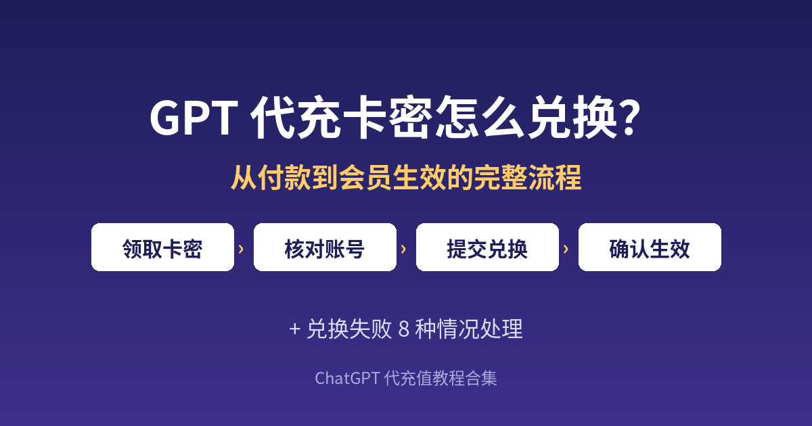

# GPT 代充卡密怎么兑换？从付款到会员生效的完整流程 + 兑换失败 8 种情况处理

**简短回答：** GPT 代充付款成功后，平台会发给你一串卡密（订单兑换码）。它不是 OpenAI 官方礼品卡，而是核对订单的凭证：在平台指定的自助页面输入卡密，确认要开通的 ChatGPT 账号和套餐，提交后等待处理，再回 ChatGPT 刷新确认会员生效。兑换失败多半是卡密复制不全、登错账号或重复提交，先别重复下单，按第 6 节排查即可。

---

## 目录

1. 为什么这两天问卡密兑换的人变多了
2. 卡密是什么：和官方礼品卡、API 余额的区别
3. 兑换前 2 分钟自查清单
4. 卡密兑换的分步骤流程
5. ChatGPT 充值多久到账：各环节时间参考
6. 兑换失败的 8 种情况与处理方法
7. 兑换成功后要核对的 4 件事
8. 常见问题

---

## 1. 为什么这两天问卡密兑换的人变多了

2026 年 11 月 4 日，OpenAI 发布了新的图像模型 Images 2.6，官方说明生成速度比之前快 50%，并在 ChatGPT 里加入了 GIF 动图生成和参考图保存功能，所有订阅档位都可以使用（来源：[OpenAI 官方公告 Introducing Images 2.6](https://openai.com/index/introducing-images-2-6/)）。

新功能一上线，不少人想升级会员拿更多额度，但没有境外卡、官方付款被拒，于是选择了代充，付完款拿到一串卡密却不知道下一步怎么做。

本文只讲**拿到卡密之后怎么把会员开到自己账号上，以及兑换不成功怎么办**。还在挑平台，先看[《ChatGPT 代充怎么选》](choose-daichong-platform.md)；自己绑卡被拒，看[《Your card was declined 怎么办》](card-declined-fix.md)。

---

## 2. 卡密是什么：和官方礼品卡、API 余额的区别

很多人第一次接触卡密，会以为它是 OpenAI 发行的充值卡。其实不是。下面这张表可以帮你分清几个容易混在一起的概念：

| 名称 | 由谁发放 | 用来做什么 | 在哪里使用 |
|---|---|---|---|
| 代充平台卡密 / 订单兑换码 | 代充平台 | 核对你的订单和套餐，触发开通流程 | 平台指定的自助兑换页面 |
| 订单号 | 代充平台 | 查询订单状态、申请售后 | 平台订单查询页、客服 |
| ChatGPT 会员订阅 | OpenAI | Plus / Go / Pro 等会员权益 | 你自己的 ChatGPT 账号 |
| OpenAI API 余额 | OpenAI 开发者平台 | 按量调用 API | 开发者平台，与会员互不相通 |

要点：**卡密只在发放它的平台有效**；**通常只能提交一次**；要和订单号一起保存，查询和售后都要用。会员权益本身以 OpenAI 官方规则为准。

以 [gpt20x.com](https://gpt20x.com/) 为例，首页写明“下单支付后自动发放卡密”，付款后在订单结果页查看；页面关掉了，可以到[订单查询页](https://gpt20x.com/query)找回卡密和发货进度。

---

## 3. 兑换前 2 分钟自查清单

兑换失败大多可以提前避免，动手前对照一遍：

- [ ] 已保存**卡密和订单号**（截图 + 备忘录各留一份）
- [ ] 确认订单上的**套餐名称**和你想开的一致（Go / Plus 月付 / Plus 年付 / Pro）
- [ ] 浏览器里登录的是**你要开通会员的那个 ChatGPT 账号**
- [ ] 同一浏览器登录过多个账号的，先退出不用的
- [ ] 网络稳定，兑换中途不切换网络
- [ ] 没有在同一订单上已经提交过一次
- [ ] 知道客服的工作时间（GPT20X 页面写的是每天 8:00–24:00）

> 提醒：正规的 GPT 代充流程不需要提供 ChatGPT 账号密码。有人索要密码、邮箱验证码或 2FA 恢复码时，先停下核实。

---

## 4. 卡密兑换的分步骤流程

各平台页面略有不同，大体是 6 步。以 GPT20X 当前页面说明为例：

1. **下单付款**：在套餐页选择 Go、Plus 或 Pro，填写下单手机号或邮箱（用于查询订单），用支付宝或微信付款。
2. **领取卡密**：付款完成后，在订单结果页查看卡密；也可以在订单查询页用下单时填写的信息找回。
3. **打开自助兑换页面**：按订单页提示打开平台的自助充值地址（GPT20X 的教程中写的是 `vip.gpt20x.com`），把卡密完整粘贴进去，点击验证。
4. **核对套餐和账号**：验证通过后，页面会显示这张卡密对应的套餐。确认套餐无误，再确认要开通的是当前登录的 ChatGPT 账号。
5. **提交并等待**：确认无误后提交。提交后**不要用同一张卡密反复提交**，在兑换页面或订单查询页查看状态即可。
6. **回到 ChatGPT 确认生效**：状态显示完成后，刷新或重新登录 ChatGPT，在设置里查看当前套餐。

**Pro 稍有不同：** GPT20X 的 Pro 页面写明下单后添加客服、人工一对一开通，付款后直接联系客服即可。

下单前在对应套餐页核对档位名、时长和票据说明：部分套餐提供收款凭证，部分 Pro / 年付套餐可在下单时选择开增值税普通发票（可能含税费），一律以结算页为准。

---

## 5. ChatGPT 充值多久到账：各环节时间参考

“付了钱多久能用”是 ChatGPT 充值被问得最多的问题，拆开看各环节：

| 环节 | 一般情况 | 可能变慢的原因 | 建议 |
|---|---|---|---|
| 付款到卡密发放 | 付款完成后自动发放 | 支付回调延迟、付款未真正完成 | 刷新订单页或到订单查询页查看 |
| 卡密验证 | 输入后即时校验 | 卡密复制不完整、有多余空格 | 重新复制，去掉首尾空格 |
| 提交到开通完成 | 平台页面写的是几分钟内 | 系统繁忙、账号状态需要核验 | 看订单状态，别重复提交 |
| Pro 人工开通 | 以客服确认为准 | 客服不在工作时间 | 在 8:00–24:00 内联系客服 |
| ChatGPT 页面显示会员 | 刷新后显示 | 浏览器缓存、登录的不是同一账号 | 退出重登，核对账号邮箱 |

简单说：**几分钟内完成是常见情况，但以订单查询页最终状态为准**；夜间下单或需人工处理的套餐，可能要等客服上班。

---

## 6. 兑换失败的 8 种情况与处理方法

### 情况 1：提示卡密无效
多半是复制少了字符或带了空格、换行。回到订单页重新复制，检查首尾无空格，并确认输入的是卡密而不是订单号。

### 情况 2：提示卡密已被使用
之前已提交过，或页面卡住时连点了提交。不要再重复提交，到兑换页或订单查询页看处理状态，异常时带订单号和提交时间找客服。

### 情况 3：付款成功但找不到卡密
付款后页面被关掉或支付回调未完成。先到订单查询页用下单手机号或邮箱查询；查不到就保留付款截图，提供付款时间、金额、套餐名称给客服核对。

### 情况 4：账号验证失败
浏览器没登录 ChatGPT 或登录已过期。在同一浏览器重新登录要开通的账号，能正常进入对话页后再回兑换页操作。

### 情况 5：会员开到了另一个账号
浏览器同时登录了多个账号，提交时没核对。立即联系客服，提供订单号、卡密和两个账号邮箱。兑换前退出不用的账号，就能避免。

### 情况 6：一直显示“处理中”
系统繁忙、需要人工核验或正值客服下班。不要重复下单或提交，隔一段时间刷新订单查询页；长时间无变化，在工作时间内找客服核查。

### 情况 7：显示完成，但 ChatGPT 里没有会员
页面缓存未更新，或看的不是提交时的账号。退出重登并核对账号邮箱。OpenAI 帮助中心也提示，付费套餐不显示时先确认登录的是购买时的账号（来源：[OpenAI 帮助中心 Canceling your ChatGPT subscription](https://help.openai.com/en/articles/7232927-how-do-i-cancel-my-chatgpt-plus-subscription) 的“Find a missing paid plan”一节）。

### 情况 8：账号已有未到期的官方订阅
官网、App Store 或 Google Play 的自动续费订阅可能与新套餐冲突。兑换前先告诉客服当前订阅状态。不想再续的官方订阅，按官方说明在原购买平台取消；官方写明取消只停止后续续费，不会自动退还已付费用。

---

## 7. 兑换成功后要核对的 4 件事

1. **套餐名称**：在 ChatGPT 设置里确认是你买的套餐。
2. **到期日期**：记下到期日，提前 1–2 天续费。
3. **功能可用**：试用会员功能，比如新上线的图像生成。
4. **凭证保存**：卡密、订单号、付款截图放一起；报销可在订单查询页下载收款凭证。

---

## 8. 常见问题

**Q：GPT 代充的卡密能在 ChatGPT 官网兑换吗？** 不能。代充卡密只用于核对发放平台的订单，需在平台指定的自助兑换页使用，在 ChatGPT 官网或 App 里输入无效。

**Q：卡密兑换需要提供 ChatGPT 账号密码吗？** 不需要。GPT20X 的常见问题里写明全程无需提供账号密码，遇到索要密码、邮箱验证码或 2FA 恢复码的情况，应先暂停并通过官方客服渠道核实。

**Q：卡密有没有使用期限？** 各平台规则不同，建议付款当天完成兑换，不要长时间搁置；以订单页说明和客服答复为准。

**Q：兑换失败会退款吗？** GPT20X 页面写明充值失败支持全额退款，需要先联系客服核实，退款到账时间取决于原支付渠道。拿不准的问题可以先翻一下 [ChatGPT 充值常见问题](https://gpt20x.com/faq)。

**Q：同一张卡密可以给两个账号用吗？** 不可以。一张卡密对应一笔订单、一个套餐，提交后即被占用；多个账号应分别下单，批量需求先联系客服确认。

**Q：开通后会员中途消失了怎么办？** 先刷新并确认登录的是原账号；仍没有会员，保留订单号和截图联系客服。GPT20X 首页写明提供 30 天质保，有效期内因其可控原因失效可免费更换，以客服核实为准。

---

*最后更新：2026-11-05*　｜　[返回教程首页](README.md)
